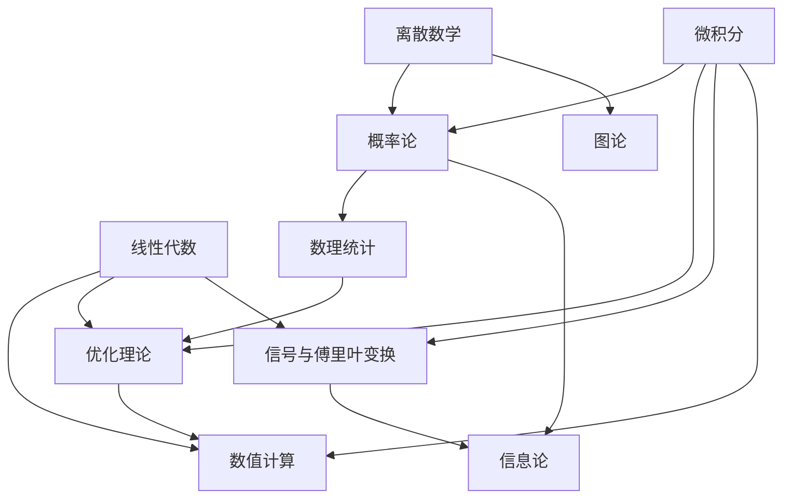

---
Title | Math
-- | --
Created @ | `2022-02-11T02:48:34Z`
Updated @| `2026-11-27T02:57:48Z`
Labels | ``
Edit @| [here](https://github.com/junxnone/math/issues/1)

---
# 数学基础

本仓库按主题组织数学基础知识，每个主题都有一篇“综述”文章（知识地图 + 系列文章索引）和若干章节文章。建议先读综述，再按其中的学习路径阅读章节。

## 主题总览

| 主题 | 综述 | 内容 |
| -- | -- | -- |
| 线性代数 | [线性代数](/0025_线性代数) | 向量、矩阵、行列式、特征值、SVD、矩阵分解、PCA、张量 |
| 微积分 | [微积分](/0048_微积分) | 极限、导数、积分、级数、多元微积分、场论、常微分方程 |
| 概率论 | [概率论](/0059_概率论) | 概率空间、条件概率、分布、期望、极限定理、随机过程 |
| 数理统计 | [数理统计](/0068_数理统计) | 抽样、估计、假设检验、回归、贝叶斯统计、重采样 |
| 优化理论 | [优化理论](/0076_优化理论) | 凸分析、无约束/约束优化、线性规划、SGD、拟牛顿、非凸 |
| 信息论 | [信息论](/0084_信息论) | 熵、KL 散度、交叉熵、信源编码、信道容量、最大熵 |
| 离散数学 | [离散数学](/0091_离散数学) | 集合关系、逻辑、组合计数、代数结构、数论、递推 |
| 图论 | [图论](/0022_图论) | 图的表示与遍历、最短路径、生成树、网络流、匹配、谱图论、图神经网络 |
| 信号与傅里叶变换 | [信号与傅里叶变换](/0098_信号与傅里叶变换) | 线性系统、卷积、傅里叶变换、FFT、采样、滤波、小波 |
| 数值计算 | [数值计算](/0106_数值计算) | 浮点误差、求根、线性方程组、插值、积分、ODE、特征值 |

表中三列依次为主题、综述文章链接和主要内容。

## 主题之间的依赖

下图展示各主题之间的先修与应用关系，自上而下阅读。

图中：

- 节点是一个主题，箭头 $A\to B$ 表示学习 $B$ 前最好具备 $A$ 的基础。
- 线性代数与微积分是两大基石：前者提供向量空间与矩阵的语言，后者提供变化与累积的语言，二者共同支撑优化、信号处理和数值计算。
- 概率论以微积分（积分）和离散数学（计数）为基础，向数理统计和信息论延伸；数理统计的估计问题通常归结为优化问题。
- 信号与傅里叶变换中的采样与带宽决定了信息论的信道容量；数值计算是把所有这些理论落地到计算机上的桥梁。

## 进阶文章

下列文章是各主题中的**进阶专题**，已挂到对应主题之下（文件名带有主题前缀），基础篇讲清概念，进阶篇继续深入。

| 进阶文章 | 所属主题与基础篇 | 内容 |
| --- | --- | --- |
| [高斯分布进阶](/0005_概率论_常见分布_高斯分布进阶) | 概率论 / [常见分布](/0063_概率论_常见分布) | 多维高斯、条件与边缘分布、仿射变换、马氏距离 |
| [贝叶斯推断进阶](/0008_概率论_条件概率与贝叶斯_贝叶斯推断进阶) | 概率论 / [条件概率与贝叶斯](/0061_概率论_条件概率与贝叶斯) | 先验、似然、后验、MLE 与 MAP、后验预测 |
| [随机过程进阶](/0013_概率论_随机过程初步_随机过程进阶) | 概率论 / [随机过程初步](/0067_概率论_随机过程初步) | 相关函数、平稳性、遍历性、功率谱、鞅、SDE |
| [马尔可夫过程进阶](/0018_概率论_随机过程初步_马尔可夫过程进阶) | 概率论 / [随机过程初步](/0067_概率论_随机过程初步) | 状态分类、平稳分布、细致平衡、HMM、MDP |
| [高斯过程进阶](/0020_概率论_随机过程初步_高斯过程进阶) | 概率论 / [随机过程初步](/0067_概率论_随机过程初步) | 核函数、GPR 后验、超参数、复杂度 |
| [最小二乘进阶](/0006_数理统计_回归分析_最小二乘进阶) | 数理统计 / [回归分析](/0073_数理统计_回归分析) | 正规方程、投影几何、Gauss–Markov、正则化 |
| [拉格朗日乘数法进阶](/0019_微积分_极值与拉格朗日乘数_拉格朗日乘数法进阶) | 微积分 / [极值与拉格朗日乘数](/0058_微积分_极值与拉格朗日乘数) | 几何直观、乘子含义、二阶条件、与 KKT |
| [梯度与方向导数进阶](/0009_微积分_多元函数微分_梯度与方向导数进阶) | 微积分 / [多元函数微分](/0054_微积分_多元函数微分) | 方向导数、梯度的几何意义 |
| [模拟退火进阶](/0014_优化理论_非凸优化_模拟退火进阶) | 优化理论 / [非凸优化](/0083_优化理论_非凸优化) | Metropolis 准则、降温策略、收敛性 |
| [RANSAC进阶](/0015_数值计算_插值与拟合_RANSAC进阶) | 数值计算 / [插值与拟合](/0110_数值计算_插值与拟合) | 迭代次数、变体、与最小二乘对比 |
| [动态规划进阶](/0010_离散数学_递推与生成函数_动态规划进阶) | 离散数学 / [递推与生成函数](/0097_离散数学_递推与生成函数) | 最优子结构、常见模型、与分治贪心对比 |
| [四叉树与八叉树进阶](/0017_图论_树_四叉树与八叉树进阶) | 图论 / [树](/0117_图论_树) | 空间划分、八叉树地图、与 KD 树对比 |
| [四元数与三维旋转进阶](/0016_线性代数_线性变换_四元数与三维旋转进阶) | 线性代数 / [线性变换](/0039_线性代数_线性变换) | 四元数代数、旋转表示、Slerp |
| [高斯滤波器进阶](/0021_信号与傅里叶变换_滤波器_高斯滤波器进阶) | 信号与傅里叶变换 / [滤波器](/0104_信号与傅里叶变换_滤波器) | 可分离性、频域特性、尺度空间 |

表中：第一列是进阶文章，第二列是其所属主题和对应的基础篇，第三列概括进阶内容；对比结论：先读基础篇，再读进阶篇。

## 专题文章

在各主题基础篇之上新增的专题文章，已挂到对应主题之下（文件名带有主题前缀）：

| 主题 | 专题文章 |
| --- | --- |
| 线性代数 | [矩阵微积分](https://github.com/junxnone/math/issues/128)、[LU分解](https://github.com/junxnone/math/issues/129)、[QR分解](https://github.com/junxnone/math/issues/130)、[Cholesky分解](https://github.com/junxnone/math/issues/131)、[非负矩阵分解](https://github.com/junxnone/math/issues/132)、[矩阵函数与矩阵指数](https://github.com/junxnone/math/issues/133)、[希尔伯特空间与核方法](https://github.com/junxnone/math/issues/134)、[李群与李代数](https://github.com/junxnone/math/issues/135)、[刚体变换与齐次坐标](https://github.com/junxnone/math/issues/136) |
| 概率论 | [概率不等式](https://github.com/junxnone/math/issues/137)、[指数族分布](https://github.com/junxnone/math/issues/138)、[测度论基础](https://github.com/junxnone/math/issues/139)、[泊松过程](https://github.com/junxnone/math/issues/140)、[布朗运动与伊藤积分](https://github.com/junxnone/math/issues/141)、[隐马尔可夫模型](https://github.com/junxnone/math/issues/142)、[马尔可夫决策过程](https://github.com/junxnone/math/issues/143) |
| 数理统计 | [EM算法](https://github.com/junxnone/math/issues/144)、[MCMC采样](https://github.com/junxnone/math/issues/145)、[变分推断](https://github.com/junxnone/math/issues/146) |
| 优化理论 | [ADMM](https://github.com/junxnone/math/issues/149)、[支持向量机](https://github.com/junxnone/math/issues/150)、[最优传输](https://github.com/junxnone/math/issues/151) |
| 数值计算 | [自动微分](https://github.com/junxnone/math/issues/152) |
| 信号与傅里叶变换 | [卡尔曼滤波](https://github.com/junxnone/math/issues/147)、[拉普拉斯变换与Z变换](https://github.com/junxnone/math/issues/148) |
| 微积分 | [偏微分方程初步](https://github.com/junxnone/math/issues/153)、[变分法](https://github.com/junxnone/math/issues/154)、[复变函数初步](https://github.com/junxnone/math/issues/155)、[微分几何初步](https://github.com/junxnone/math/issues/156) |
| 信息论 | [信息瓶颈与率失真](https://github.com/junxnone/math/issues/157)、[纠错码](https://github.com/junxnone/math/issues/158) |
| 图论 | [PageRank](https://github.com/junxnone/math/issues/159) |
| 离散数学 | [随机算法与哈希](https://github.com/junxnone/math/issues/160) |

表中：每行第一列是所属主题，第二列是该主题下新增的专题文章；对比结论：这些专题多数面向机器学习的常用工具（微积分、概率推断、优化、信号与几何），可以按需要从相关基础篇跳转阅读。

