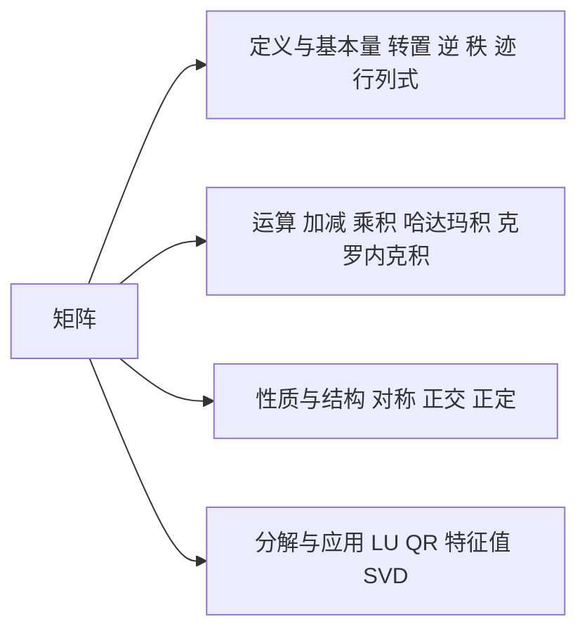

---
Title | 线性代数 Matrix
-- | --
Created @ | `2022-04-19T11:36:53Z`
Updated @| `2026-11-27T01:46:11Z`
Labels | ``
Edit @| [here](https://github.com/junxnone/math/issues/4)

---
# 矩阵

矩阵是按行列排成的矩形数表，既是数据的容器（表格、图像、特征），也是**线性变换**的表示。线性代数的大部分内容都围绕矩阵展开。

$$
A=\begin{bmatrix}a_{11}&a_{12}&\cdots&a_{1n}\\a_{21}&a_{22}&\cdots&a_{2n}\\\vdots&\vdots&\ddots&\vdots\\a_{m1}&a_{m2}&\cdots&a_{mn}\end{bmatrix}\in\mathbb{R}^{m\times n}
$$

其中：$m$ 为行数，$n$ 为列数；$a_{ij}$ 为第 $i$ 行第 $j$ 列的元素；$m=n$ 时称为方阵。

## 知识地图

图中：矩阵相关的文章按「基本量、运算、特殊结构、分解与应用」四条线组织，下面各节给出对应链接。

## 定义
- 行列变换
- 转置
- 逆
- 秩
- 迹
- 雅可比行列式 - Jacobi

| 基本量 | 记号 | 含义 | 文章 |
| --- | --- | --- | --- |
| 转置 | $A^\top$ | 行列互换 | [矩阵转置](https://github.com/junxnone/math/issues/30) |
| 逆 | $A^{-1}$ | $AA^{-1}=I$ | [矩阵的逆](https://github.com/junxnone/math/issues/31) |
| 秩 | $\operatorname{rank}(A)$ | 线性无关行（列）的最大个数 | [矩阵的秩](https://github.com/junxnone/math/issues/29) |
| 迹 | $\operatorname{tr}(A)$ | 对角线元素之和，等于特征值之和 | [迹](https://github.com/junxnone/math/issues/37) |
| 行列式 | $\det A$ | 变换的体积缩放因子 | [行列式](https://github.com/junxnone/math/issues/3) |
| 雅可比矩阵 | $J$ | 多元向量函数的局部线性化 | [雅可比矩阵](https://github.com/junxnone/math/issues/44) |

表中：对比结论：这些量从不同侧面刻画矩阵，可逆性可以由行列式非零、满秩、特征值非零等价地判断，见 [矩阵的逆](https://github.com/junxnone/math/issues/31)。

## 运算
- 加减
- 乘积
  - 矩阵乘积
  - 哈达玛乘积 Hadamard Product
  - 克罗内克积 Kronecker Product

| 运算 | 符号 | 要求 | 结果 | 文章 |
| --- | --- | --- | --- | --- |
| 加减 | $A\pm B$ | 同形 | 同形，逐元素 | |
| 数乘 | $kA$ | 无 | 同形 | |
| 矩阵乘积 | $AB$ | $A$ 列数 = $B$ 行数 | $m\times p$ | [矩阵乘积](https://github.com/junxnone/math/issues/27) |
| 哈达玛积 | $A\circ B$ | 同形 | 同形，逐元素相乘 | [哈达玛乘积](https://github.com/junxnone/math/issues/28) |
| 克罗内克积 | $A\otimes B$ | 任意 | $mp\times nq$ | [克罗内克积](https://github.com/junxnone/math/issues/26) |

表中：对比结论：只有矩阵乘积对应线性变换的复合，其余是「逐元素」或「分块放大」的运算。

## 特殊矩阵

| 类型 | 条件 | 性质 |
| --- | --- | --- |
| 对称矩阵 | $A=A^\top$ | 特征值为实数，可正交对角化 |
| 正交矩阵 | $A^\top A=I$ | 保长度、保夹角，见 [正交矩阵](https://github.com/junxnone/math/issues/32) |
| 对角矩阵 | 非对角元素为 0 | 乘法、求逆、幂都很简单 |
| 三角矩阵 | 对角线以下（或以上）为 0 | 行列式为对角线元素之积；LU 分解的基本形状 |
| 正定矩阵 | $x^\top Ax>0\ (x\ne0)$ | 对应二次型的「碗形」，见 [对称正定与二次型](https://github.com/junxnone/math/issues/41) |
| 置换矩阵 | 每行每列恰有一个 1 | 交换行或列，是正交矩阵 |
| 幂等矩阵 | $A^2=A$ | 投影矩阵，见 [投影](https://github.com/junxnone/math/issues/42) |

表中：对比结论：特殊结构让计算更简单、性质更好，矩阵分解的目标就是把一般矩阵化为这些特殊形式的乘积，见 [矩阵分解](https://github.com/junxnone/math/issues/40)。

## 矩阵的两种角色

- **数据**：$m$ 个样本、$n$ 个特征的数据矩阵；图像是像素矩阵；邻接矩阵表示图
- **变换**：$x\mapsto Ax$ 把向量线性地映射到另一个空间，矩阵乘积就是变换的复合，见 [线性变换](https://github.com/junxnone/math/issues/39)

## 相关文章

- [迹](/0037_线性代数_Matrix_迹)：主对角线元素之和，等于特征值之和
- [初等变换](/0038_线性代数_Matrix_初等变换)：行变换、行阶梯形，用于求秩与求逆
- [线性变换](/0039_线性代数_线性变换)：矩阵是线性变换在选定基下的表示，矩阵乘积对应变换复合
- [矩阵分解](/0040_线性代数_Matrix_矩阵分解)：LU / QR / Cholesky
- [对称正定与二次型](/0041_线性代数_Matrix_对称正定与二次型)、[伪逆](/0043_线性代数_Matrix_伪逆)、[范数与条件数](/0045_线性代数_Matrix_范数与条件数)
- [雅可比矩阵](/0044_线性代数_Matrix_雅可比矩阵)：多元向量函数的局部线性化

## Reference
- [矩阵的运算及其运算规则](http://www2.edu-edu.com.cn/lesson_crs78/self/j_0022/soft/ch0605.html)

