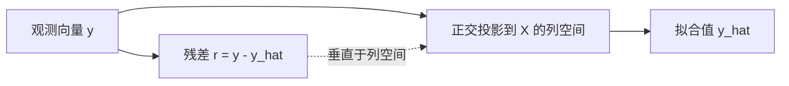

---
Title | 数理统计 回归分析 最小二乘进阶
-- | --
Created @ | `2022-03-07T04:06:49Z`
Updated @| `2026-11-27T01:41:40Z`
Labels | ``
Edit @| [here](https://github.com/junxnone/math/issues/6)

---
# 最小二乘进阶

- Least Squares - 最小二乘法 - 最小平方法
- 最小误差平方和优化获取最佳拟合
- 拟合直线
- 本文是 [回归分析](https://github.com/junxnone/math/issues/73) 的进阶：从矩阵形式、几何（投影）解释、统计性质（Gauss–Markov）和正则化几个角度理解最小二乘。

 | 
-- | --

图中：以上两图为原文档附带的最小二乘拟合示意图，数据点与拟合直线之间的竖直距离就是残差，最小二乘使残差平方和最小。

## 推理

### 一元线性回归

Name | Description
-- | --
数据 | $X = \left\{(x_{1}, y_{1}), (x_{2}, y_{2}), \dots, (x_{m}, y_{m})\right\}$
模型 |  $y = \beta_{0} + \beta_{1}x$
目标函数 | $J(\beta) = \sum_{i=1}^{m}(y_{i}-\beta_{1}x_{i}-\beta_{0})^2$
解 | $\beta_{1} = \dfrac{\sum_{i=1}^{m}(x_{i}-\bar{x})(y_{i}-\bar{y})}{\sum_{i=1}^{m}(x_{i}-\bar{x})^2}$   $\beta_{0} = \bar{y}-\beta_{1}\bar{x}$

其中：

- $m$：样本数；$(x_i,y_i)$：第 $i$ 个样本；$\bar{x},\bar{y}$：$x$、$y$ 的样本均值
- $\beta_0$：截距；$\beta_1$：斜率；$J(\beta)$：残差平方和
- 解的含义：$\beta_1$ 等于 $x$ 与 $y$ 的样本协方差除以 $x$ 的样本方差；$\beta_0=\bar y-\beta_1\bar x$ 说明拟合直线一定经过点 $(\bar x,\bar y)$

### 多元线性回归

Name | Description
-- | --
模型 | $y_{i} = \beta_{0} + \beta_{1} x_{i1} + \beta_{2} x_{i2} + \cdots +  \beta_{k} x_{ik} + \varepsilon_{i}$
矩阵形式 | $\mathbf{y} = X\boldsymbol{\beta} + \boldsymbol{\varepsilon}$
参数 | $\boldsymbol{\beta} = (\beta_{0},\dots,\beta_{k})^{\top}$
数据 | $X = \begin{bmatrix} 1 & x_{11} & x_{12} & \cdots & x_{1k}\\ 1 & x_{21} & x_{22} & \cdots & x_{2k}\\ \vdots& \vdots& \vdots&& \vdots\\ 1 & x_{m1}& x_{m2}& \cdots& x_{mk} \end{bmatrix}$
目标函数 | $\boldsymbol{\varepsilon}^{\top}\boldsymbol{\varepsilon} = (\mathbf{y} - X\boldsymbol{\beta})^{\top}(\mathbf{y} - X\boldsymbol{\beta})$
解 | $\hat{\boldsymbol{\beta}} = (X^{\top}X)^{-1}X^{\top}\mathbf{y}$

其中：

- $\mathbf{y}\in\mathbb{R}^{m}$：观测向量；$X\in\mathbb{R}^{m\times(k+1)}$：设计矩阵，第一列全为 1 对应截距
- $\boldsymbol\varepsilon$：误差向量；$\hat{\boldsymbol\beta}$：最小二乘估计
- 原文档此处使用 `\bm`、`'` 等写法，已统一改为 $\boldsymbol{\ }$ 与 $^\top$

## 正规方程的推导

目标函数对 $\boldsymbol\beta$ 求梯度并令其为零：

$$
J(\boldsymbol\beta)=\lVert\mathbf{y}-X\boldsymbol\beta\rVert_2^{2},\qquad \nabla_{\boldsymbol\beta}J=-2X^{\top}(\mathbf{y}-X\boldsymbol\beta)=0\ \Longrightarrow\ X^{\top}X\,\boldsymbol\beta=X^{\top}\mathbf{y}
$$

其中：最后的方程称为**正规方程**；当 $X$ 列满秩时 $X^\top X$ 可逆，得到上面的闭式解；$J$ 是关于 $\boldsymbol\beta$ 的凸二次函数（Hessian 为 $2X^\top X\succeq0$），所以驻点就是全局最小点，见 [对称正定与二次型](https://github.com/junxnone/math/issues/41)。

## 几何解释：投影

$$
\hat{\mathbf{y}}=X\hat{\boldsymbol\beta}=X(X^{\top}X)^{-1}X^{\top}\mathbf{y}=P\,\mathbf{y},\qquad P=X(X^{\top}X)^{-1}X^{\top}
$$

其中：

- $P$ 称为**投影矩阵（帽子矩阵）**，满足 $P^2=P$、$P^\top=P$；它把 $\mathbf{y}$ 正交投影到 $X$ 的**列空间**上
- 残差 $\mathbf{r}=\mathbf{y}-\hat{\mathbf{y}}$ 与 $X$ 的每一列都正交：$X^\top\mathbf{r}=0$，这正是正规方程的几何含义
- 因此最小二乘就是「在列空间里找离 $\mathbf{y}$ 最近的点」，见 [投影](https://github.com/junxnone/math/issues/42)

图中：拟合值是 $\mathbf{y}$ 在列空间上的投影，残差垂直于该列空间，二者构成直角三角形（勾股关系 $\lVert\mathbf{y}\rVert^2=\lVert\hat{\mathbf{y}}\rVert^2+\lVert\mathbf{r}\rVert^2$）。

## 统计性质：Gauss–Markov 定理

假设 $\mathbb{E}[\boldsymbol\varepsilon]=0$，$\mathrm{Cov}(\boldsymbol\varepsilon)=\sigma^2I$（误差零均值、同方差、互不相关），则最小二乘估计具有：

$$
\mathbb{E}[\hat{\boldsymbol\beta}]=\boldsymbol\beta,\qquad \mathrm{Cov}(\hat{\boldsymbol\beta})=\sigma^{2}(X^{\top}X)^{-1}
$$

其中：

- 第一式说明估计**无偏**；第二式给出估计的协方差，用于构造系数的置信区间与检验，见 [回归分析](https://github.com/junxnone/math/issues/73)
- **Gauss–Markov 定理**：在所有「线性无偏估计」中，最小二乘估计的方差最小（BLUE，最佳线性无偏估计）
- 若误差服从高斯分布，最小二乘等价于最大似然估计，见 [高斯分布进阶](https://github.com/junxnone/math/issues/5)、[点估计](https://github.com/junxnone/math/issues/70)

## 推广

| 方法 | 目标函数 | 解 | 用途 |
| --- | --- | --- | --- |
| 普通最小二乘 OLS | $\lVert\mathbf{y}-X\boldsymbol\beta\rVert^2$ | $(X^\top X)^{-1}X^\top\mathbf{y}$ | 基本情形 |
| 加权最小二乘 WLS | $\sum_i w_i r_i^2$ | $(X^\top WX)^{-1}X^\top W\mathbf{y}$ | 误差方差不齐 |
| 岭回归（L2） | $\lVert\mathbf{y}-X\boldsymbol\beta\rVert^2+\lambda\lVert\boldsymbol\beta\rVert_2^2$ | $(X^\top X+\lambda I)^{-1}X^\top\mathbf{y}$ | 共线性、防过拟合 |
| Lasso（L1） | $\lVert\mathbf{y}-X\boldsymbol\beta\rVert^2+\lambda\lVert\boldsymbol\beta\rVert_1$ | 无闭式解 | 稀疏、特征选择 |
| 总体最小二乘 TLS | 同时考虑 $X$ 和 $\mathbf{y}$ 的误差 | 由 SVD 得到 | 自变量也有噪声 |
| 鲁棒回归 | 用 Huber 等损失代替平方 | 迭代求解 | 有离群点，见 [RANSAC 进阶](https://github.com/junxnone/math/issues/15) |

表中：

- $w_i$ 为第 $i$ 个样本的权重，$W=\mathrm{diag}(w_i)$；$\lambda\ge0$ 为正则强度
- 对比结论：OLS 是基础，其余方法都是在它之上处理「方差不齐、共线性、稀疏、噪声、离群点」等问题

## 数值求解

- 直接解正规方程要先算 $X^\top X$，会把条件数平方（$\kappa(X^\top X)=\kappa(X)^2$），数值上不稳定
- 更稳妥的做法是 **QR 分解**：$X=QR\Rightarrow R\hat{\boldsymbol\beta}=Q^\top\mathbf{y}$；或 **SVD**：$\hat{\boldsymbol\beta}=X^{+}\mathbf{y}$，对秩亏矩阵给出最小范数解，见 [矩阵分解](https://github.com/junxnone/math/issues/40)、[伪逆](https://github.com/junxnone/math/issues/43)

## 常见误区

- 最小二乘最小化的是**竖直方向**（$y$ 方向）的距离，不是点到直线的垂直距离（那是总体最小二乘）
- 平方损失对离群点敏感，一个离群点就可能显著改变拟合
- 特征高度相关（共线性）时 $X^\top X$ 近奇异，估计方差很大，需要正则化或降维
- $R^2$ 高不等于模型正确，要结合残差诊断，见 [回归分析](https://github.com/junxnone/math/issues/73)

## Reference
- [最小二乘法回归 demo](https://phet.colorado.edu/sims/html/least-squares-regression/latest/least-squares-regression_en.html)
- [最小二乘法 - 一元](https://otexts.com/fppcn/least-squares.html)
- [最小二乘法 - 多元](https://otexts.com/fppcn/regression-matrices.html)

