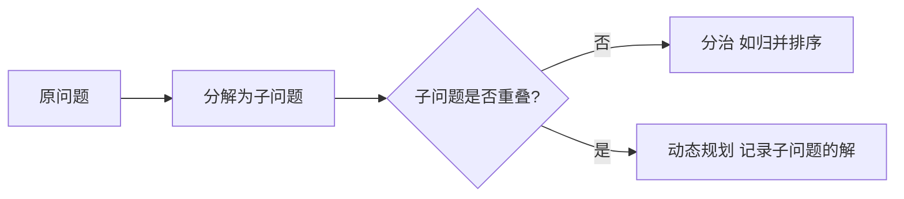

---
Title | 离散数学 递推与生成函数 动态规划进阶
-- | --
Created @ | `2022-04-15T08:46:32Z`
Updated @| `2026-11-27T01:41:47Z`
Labels | ``
Edit @| [here](https://github.com/junxnone/math/issues/10)

---
# 动态规划进阶

- Dynamic Programming - 动态规划
- 记住已经解决过的子问题的解
- **备忘录法**: 自顶向下递归
- **动态规划**: 自底向上
  - 重叠子问题
  - 最优子结构
- 线性模型
- 区间模型
- 背包模型
- 树形模型
- 本文是 [递推与生成函数](https://github.com/junxnone/math/issues/97) 的进阶：把递推关系用于**最优化问题**，讲清动态规划成立的条件、状态与转移的设计、常见模型，以及与分治、贪心的区别。

## 适用条件

动态规划要求问题同时具备两个性质：

- **最优子结构**：问题的最优解包含其子问题的最优解。形式上，若 $f(i)$ 是规模为 $i$ 的问题的最优值，则 $f(i)$ 可以由若干个更小规模的最优值 $f(j)$（$j<i$）组合得到
- **重叠子问题**：递归求解时同一个子问题会被反复计算；动态规划把每个子问题只算一次并记录下来，把指数级的时间降为多项式级

图中：子问题互不重叠时用分治，重叠时用动态规划记录并复用。

## Pipeline

1. **定义状态**：用若干参数刻画「子问题」，如 $f(i)$ 表示前 $i$ 个元素的最优值
2. **写出转移方程（关系式）**：$f(i)=\text{opt}\{f(j)+\text{cost}(j,i)\}$
3. **确定初始值与边界**
4. **确定计算顺序**：保证计算 $f(i)$ 时它依赖的状态已算好（自底向上）
5. **读出答案**：通常是 $f(n)$，或需要回溯路径时额外记录决策

- 初始值
- 关系式
- 历史计算记录

## 记忆化与自底向上

| 方式 | 做法 | 特点 |
| --- | --- | --- |
| 备忘录法（记忆化搜索） | 自顶向下递归，遇到已算过的状态直接返回 | 只计算用到的状态，写法接近递归定义 |
| 动态规划（自底向上） | 按顺序依次填表 | 无递归开销，便于做空间优化（滚动数组） |

表中：对比结论：二者时间复杂度相同，都是「状态数 × 每个状态的转移代价」。

## UseCase
### 斐波拉契数列

$$
F(n)=F(n-1)+F(n-2),\qquad F(0)=0,\ F(1)=1
$$

其中：直接递归会反复计算同一项，时间 $O(2^n)$；用动态规划只保存最近两项即可，时间 $O(n)$、空间 $O(1)$。

## 常见模型

### 线性模型：最长递增子序列（LIS）

$$
f(i)=1+\max\{f(j)\mid j<i,\ a_j<a_i\}
$$

其中：$f(i)$ 是以第 $i$ 个元素结尾的最长递增子序列长度；答案取 $\max_i f(i)$；朴素实现 $O(n^2)$。

### 区间模型：矩阵链乘

$$
m[i,j]=\min_{i\le k<j}\bigl\{m[i,k]+m[k+1,j]+p_{i-1}p_kp_j\bigr\}
$$

其中：$m[i,j]$ 是计算矩阵连乘 $A_i\cdots A_j$ 的最少乘法次数；$A_i$ 的维度是 $p_{i-1}\times p_i$；枚举最后一次相乘的分割点 $k$，见 [矩阵乘积](https://github.com/junxnone/math/issues/27)。

### 背包模型：0-1 背包

$$
f(i,c)=\max\bigl\{f(i-1,c),\ f(i-1,c-w_i)+v_i\bigr\}
$$

其中：$f(i,c)$ 是只考虑前 $i$ 个物品、背包容量为 $c$ 时的最大价值；$w_i,v_i$ 为第 $i$ 个物品的重量和价值；两项分别对应「不放」与「放入」物品 $i$。时间 $O(nC)$（$n$ 个物品，容量 $C$），是「伪多项式」时间。

### 序列比对：编辑距离 / 最长公共子序列

$$
d(i,j)=\min\begin{cases}d(i-1,j)+1\\d(i,j-1)+1\\d(i-1,j-1)+[a_i\ne b_j]\end{cases}
$$

其中：$d(i,j)$ 是 $a$ 的前 $i$ 个字符变成 $b$ 的前 $j$ 个字符所需的最少编辑次数（插入、删除、替换各算一次）；$[\cdot]$ 为指示函数。

### 树形模型

在树上定义 $f(v)$ 为以结点 $v$ 为根的子树的最优值，由孩子结点的值合并得到，见 [树](https://github.com/junxnone/math/issues/117)；例如「树上最大独立集」。

## 图上的动态规划

最短路径中的 Bellman–Ford 算法、Floyd–Warshall 算法本质上都是动态规划，见 [最短路径](https://github.com/junxnone/math/issues/115)：

$$
d_k(i,j)=\min\bigl\{d_{k-1}(i,j),\ d_{k-1}(i,k)+d_{k-1}(k,j)\bigr\}
$$

其中：$d_k(i,j)$ 是只允许经过前 $k$ 个结点作为中转时 $i$ 到 $j$ 的最短距离。

## 与贪心、分治的对比

| 方法 | 做法 | 适用条件 |
| --- | --- | --- |
| 分治 | 子问题独立，合并子问题的解 | 子问题不重叠 |
| 动态规划 | 记录重叠子问题的解，从中选最优 | 最优子结构 + 重叠子问题 |
| 贪心 | 每步取局部最优，不回头 | 需要「贪心选择性质」，可以证明局部最优导致全局最优 |

表中：对比结论：贪心最快但适用面最窄；动态规划是更通用的最优化框架。

## 在机器学习中的作用

- 隐马尔可夫模型的 Viterbi 与前向算法，见 [马尔可夫过程进阶](https://github.com/junxnone/math/issues/18)
- 序列对齐（语音识别中的 DTW）、条件随机场中的解码
- 强化学习中的价值迭代、策略迭代是动态规划（Bellman 方程）
- 最短路径、最优分割类问题

## 常见误区

- 状态定义要「无后效性」：当前状态一旦确定，之后的决策不依赖于如何到达该状态
- 状态过多会使表过大；0-1 背包的复杂度依赖容量数值，不是输入长度的多项式
- 不是所有最优化问题都有最优子结构（例如最长简单路径）

## Reference
- [算法-动态规划 Dynamic Programming--从菜鸟到老鸟](https://blog.csdn.net/u013309870/article/details/75193592)
- [动态规划详解](https://cloud.tencent.com/developer/article/1817113)
- [斐波那契-递归/Table/Memory 动画](https://www.cs.usfca.edu/~galles/visualization/DPFib.html)

