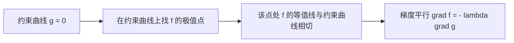

---
Title | 微积分 极值与拉格朗日乘数 拉格朗日乘数法进阶
-- | --
Created @ | `2021-03-26T06:06:14Z`
Updated @| `2026-11-27T01:42:02Z`
Labels | ``
Edit @| [here](https://github.com/junxnone/math/issues/19)

---
# 拉格朗日乘数法进阶

- 通过引入`拉格朗日乘子`来将含有 $n$ 个变量和 $k$ 个约束条件的约束优化问题转化为含有 $(n+k)$ 个变量的无约束优化问题
  - `n 个变量` + `k 个约束条件` ==> `n + k 个变量`
- 本文是 [极值与拉格朗日乘数](https://github.com/junxnone/math/issues/58) 的进阶：几何直观、多约束、二阶条件，以及与不等式约束（KKT）和对偶的联系，见 [约束优化与对偶](https://github.com/junxnone/math/issues/79)。

## 问题与拉格朗日函数

等式约束优化问题：

$$
\min_{x\in\mathbb{R}^{n}}\ f(x)\quad\text{s.t.}\quad g_i(x)=0,\ \ i=1,\dots,k
$$

拉格朗日函数：

$$
\mathcal{L}(x,\boldsymbol\lambda)=f(x)+\sum_{i=1}^{k}\lambda_i\,g_i(x)
$$

其中：

- $f(x)$：目标函数；$g_i(x)=0$：第 $i$ 个等式约束；$k$：约束个数
- $\lambda_i$：拉格朗日乘子，每个约束一个；$\boldsymbol\lambda=(\lambda_1,\dots,\lambda_k)$
- 必要条件：在极值点处 $\nabla_x\mathcal{L}=0$ 且 $\nabla_{\boldsymbol\lambda}\mathcal{L}=0$，即

$$
\nabla f(x^{*})+\sum_{i=1}^{k}\lambda_i\nabla g_i(x^{*})=0,\qquad g_i(x^{*})=0
$$

这是含 $n+k$ 个未知数（$x$ 的 $n$ 个分量与 $k$ 个乘子）的 $n+k$ 个方程。

## 几何直观

图中：沿约束曲线移动时，若 $f$ 的等值线与约束曲线**相交**，则可以继续沿曲线移动使 $f$ 变得更小（或更大）；只有两者**相切**时才可能是极值点。相切意味着二者在该点的法向量平行，也就是梯度共线：

$$
\nabla f=-\lambda\,\nabla g\quad(\lambda\ne0\ \text{时})
$$

- $\nabla g$ 垂直于约束曲线；$\nabla f$ 在约束曲线切方向上的分量必须为 0，所以 $\nabla f$ 只能沿 $\nabla g$ 方向
- 对多个约束，$\nabla f$ 必须落在 $\nabla g_1,\dots,\nabla g_k$ 张成的子空间里（要求这些梯度线性无关，即约束规范性条件）

## 乘子的含义：敏感度

若把约束右端从 $0$ 改为 $c$：$g(x)=c$，最优值 $p^{*}(c)$ 对 $c$ 的变化率恰好是乘子：

$$
\frac{\partial p^{*}}{\partial c}=-\lambda^{*}
$$

其中：$\lambda^{*}$ 为最优乘子；它表示「放松约束一个单位，最优目标值改变多少」，在经济学里称为**影子价格**。

## Examples

### Example 1：双曲线上离原点最近的点

Name | Details
-- | --
问题描述 | 求双曲线 $xy=3$ 上离原点最近的点
目标函数 | $f(x,y)=x^{2}+y^{2}$（距离的平方，等价于最小化距离）
约束 | $g(x,y)=xy-3=0$
转化问题 | 求当 $f$ 的等值线（圆）与约束曲线（双曲线）相切时，$x,y$ 的值是多少？
推理 | 两个曲线相切 ==> 切线相同 ==> 法向量相互平行
引入拉格朗日乘子 $\lambda$ | $\nabla f=\lambda\nabla g\Longrightarrow 2x=\lambda y,\ 2y=\lambda x,\ xy=3$

求解：由前两式得 $4xy=\lambda^{2}xy$，因 $xy=3\ne0$，故 $\lambda=\pm2$；$\lambda=2$ 时 $x=y$，$x^{2}=3$，得 $(\sqrt3,\sqrt3)$ 与 $(-\sqrt3,-\sqrt3)$，此时 $f=6$；$\lambda=-2$ 时 $x=-y$，与 $xy=3>0$ 矛盾。所以最近点为 $(\pm\sqrt3,\pm\sqrt3)$，距离 $\sqrt6$。

曲线 | 
-- | --

表中：该图为原文档附带的曲线示意图，对应上面「圆与双曲线相切」的几何图像。

### Example 2：椭球的内接长方体的最大体积

设椭球 $\dfrac{x^{2}}{a^{2}}+\dfrac{y^{2}}{b^{2}}+\dfrac{z^{2}}{c^{2}}=1$，内接长方体各面平行于坐标面，顶点为 $(\pm x,\pm y,\pm z)$：

Name | Details
-- | --
目标函数 | $f(x,y,z)=8xyz$（体积）
约束 | $g(x,y,z)=\dfrac{x^{2}}{a^{2}}+\dfrac{y^{2}}{b^{2}}+\dfrac{z^{2}}{c^{2}}-1=0$
转化问题 | $\mathcal{L}=8xyz+\lambda\Bigl(\dfrac{x^{2}}{a^{2}}+\dfrac{y^{2}}{b^{2}}+\dfrac{z^{2}}{c^{2}}-1\Bigr)$
求偏导 | $8yz+\dfrac{2\lambda x}{a^{2}}=0,\ 8xz+\dfrac{2\lambda y}{b^{2}}=0,\ 8xy+\dfrac{2\lambda z}{c^{2}}=0$
求解 | 三式分别乘以 $x,y,z$ 后得 $\dfrac{x^{2}}{a^{2}}=\dfrac{y^{2}}{b^{2}}=\dfrac{z^{2}}{c^{2}}$，代入约束得 $x=\dfrac{a}{\sqrt3},\ y=\dfrac{b}{\sqrt3},\ z=\dfrac{c}{\sqrt3}$

结果：最大体积 $V_{\max}=8xyz=\dfrac{8abc}{3\sqrt3}$。

## 二阶条件

一阶条件只给出候选点（驻点），要判断是极小还是极大，需要看拉格朗日函数的 Hessian 在**约束的切空间**上的符号：

$$
d^{\top}\,\nabla_{xx}^{2}\mathcal{L}(x^{*},\boldsymbol\lambda^{*})\,d>0\quad\forall\,d\ne0\ \text{满足}\ \nabla g_i(x^{*})^{\top}d=0
$$

其中：$d$ 为沿约束曲线的切方向；对所有这样的方向都为正则 $x^{*}$ 是严格局部极小点；全为负则是极大点。

## 与 KKT、对偶的联系

| 约束类型 | 方法 | 条件 |
| --- | --- | --- |
| 等式 $g_i=0$ | 拉格朗日乘数法 | $\nabla f+\sum\lambda_i\nabla g_i=0$ |
| 不等式 $h_j\le0$ | KKT 条件 | 在上式基础上增加 $\mu_j\ge0$、互补松弛 $\mu_jh_j=0$ |
| 凸问题 | 对偶 | 强对偶时与原问题最优值相等 |

表中：对比结论：拉格朗日乘数法是 KKT 条件在只有等式约束时的特例，进一步推广见 [约束优化与对偶](https://github.com/junxnone/math/issues/79)。

## 在机器学习中的作用

- 支持向量机的对偶形式推导
- 最大熵模型：在期望约束下最大化熵，得到指数族分布，见 [最大熵原理](https://github.com/junxnone/math/issues/90)
- PCA：在 $\lVert w\rVert=1$ 约束下最大化方差，乘子就是特征值，见 [PCA](https://github.com/junxnone/math/issues/46)
- 带约束的参数估计，如概率总和为 1 的约束

## 常见误区

- 拉格朗日条件只是**必要条件**，得到的点需要检验是极大、极小还是鞍点，还要与边界、不可导点比较
- 乘子 $\lambda$ 的符号约定因教材而异（$f+\lambda g$ 与 $f-\lambda g$），对结果没有影响，只影响 $\lambda$ 的符号
- 约束的梯度必须线性无关（约束规范性），否则可能漏掉极值点

## Reference
- [拉格朗日乘数法 —— 通俗理解](https://blog.csdn.net/THmen/article/details/87366904)
- [拉格朗日乘数法](https://blog.csdn.net/acdreamers/article/details/41413445)

