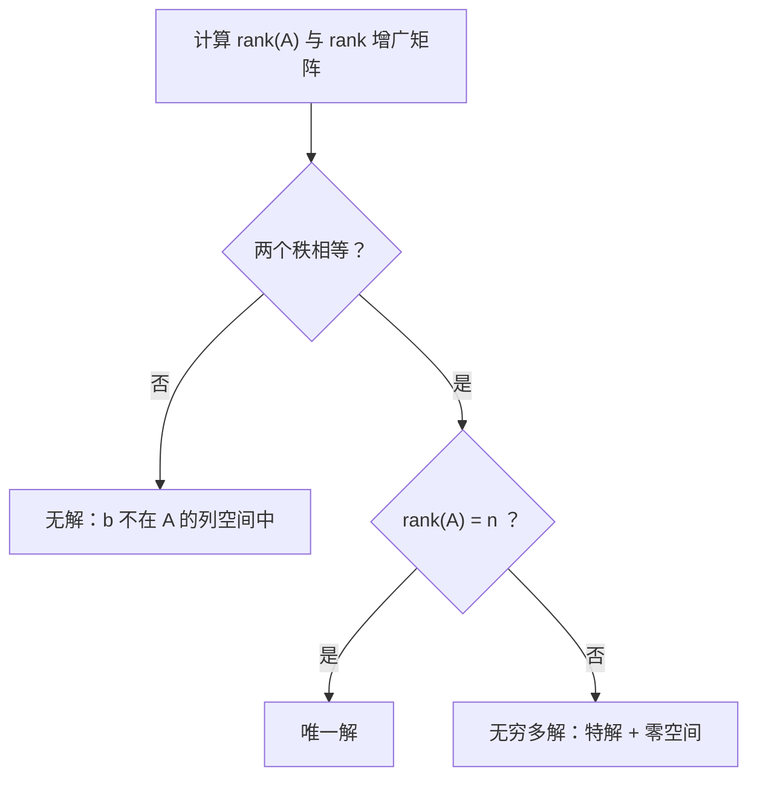

---
Title | 线性代数 线性方程组
-- | --
Created @ | `2026-11-24T10:06:37Z`
Updated @| `2026-11-24T10:06:37Z`
Labels | ``
Edit @| [here](https://github.com/junxnone/math/issues/35)

---
# 线性方程组

线性方程组是线性代数最早也最核心的问题：已知系数和结果，求未知量。矩阵、行列式、秩、逆等概念很大程度上都是为了刻画它的解而发展出来的。

## 矩阵形式

$m$ 个方程、$n$ 个未知数的线性方程组可以写成：

$$
A\mathbf{x}=\mathbf{b},\qquad
\begin{bmatrix}a_{11}&\cdots&a_{1n}\\ \vdots&\ddots&\vdots\\ a_{m1}&\cdots&a_{mn}\end{bmatrix}
\begin{bmatrix}x_1\\ \vdots\\ x_n\end{bmatrix}=
\begin{bmatrix}b_1\\ \vdots\\ b_m\end{bmatrix}
$$

其中：

- $A\in\mathbb{R}^{m\times n}$：系数矩阵，$a_{ij}$ 是第 $i$ 个方程中第 $j$ 个未知数的系数
- $\mathbf{x}\in\mathbb{R}^n$：未知向量，分量为 $x_1,\dots,x_n$
- $\mathbf{b}\in\mathbb{R}^m$：常数项向量；$\mathbf{b}=\mathbf{0}$ 时称齐次方程组，否则为非齐次

两种理解方式：

- 行视角：每个方程是一个超平面，解是这些超平面的公共交点
- 列视角：$A\mathbf{x}=x_1\mathbf{a}_1+\dots+x_n\mathbf{a}_n$（$\mathbf{a}_j$ 为 $A$ 的第 $j$ 列），即问 $\mathbf{b}$ 能否由 $A$ 的列向量线性组合出来，组合系数就是解

## 解的判定

记增广矩阵 $[A\mid\mathbf{b}]$，则：

$$
\begin{cases}
\operatorname{rank}(A)<\operatorname{rank}([A\mid\mathbf{b}]) & \text{无解}\\
\operatorname{rank}(A)=\operatorname{rank}([A\mid\mathbf{b}])=n & \text{唯一解}\\
\operatorname{rank}(A)=\operatorname{rank}([A\mid\mathbf{b}])<n & \text{无穷多解}
\end{cases}
$$

其中：

- $[A\mid\mathbf{b}]$：把 $\mathbf{b}$ 作为最后一列并到 $A$ 右侧的增广矩阵
- $\operatorname{rank}(\cdot)$：矩阵的秩（见 [秩](https://github.com/junxnone/math/issues/29)）
- $n$：未知数个数；无穷多解时自由变量个数为 $n-\operatorname{rank}(A)$

判定过程可以用流程图表示：

图中：

- 菱形是判断，矩形是步骤或结论，箭头旁的“是/否”是判断结果，自上而下阅读。
- 第一个判断检验 $\mathbf{b}$ 是否落在 $A$ 的列空间内；第二个判断检验 $A$ 的列向量是否线性无关（有无自由变量）。
- 方阵情形下 $\operatorname{rank}(A)=n$ 等价于 $\det A\ne0$，即 $A$ 可逆。

## 通解结构

若方程组有解，其全部解为：

$$
\mathbf{x}=\mathbf{x}_p+\mathbf{x}_h,\qquad \mathbf{x}_h\in\operatorname{Null}(A)
$$

其中：

- $\mathbf{x}_p$：任意一个特解，满足 $A\mathbf{x}_p=\mathbf{b}$
- $\mathbf{x}_h$：齐次方程组 $A\mathbf{x}=\mathbf{0}$ 的解，即零空间中的向量，可写成基础解系的线性组合 $c_1\boldsymbol{\xi}_1+\dots+c_{n-r}\boldsymbol{\xi}_{n-r}$，其中 $r=\operatorname{rank}(A)$，$c_i$ 为任意常数
- 几何上：解集是零空间平移 $\mathbf{x}_p$ 后得到的“仿射子空间”

## 求解方法

### 高斯消元法

用初等行变换（见 [初等变换](https://github.com/junxnone/math/issues/38)）把增广矩阵化为行阶梯形，再回代。例：

$$
\begin{cases}x+y+z=6\\ 2y+5z=-4\\ 2x+5y-z=27\end{cases}
$$

增广矩阵消元过程：

$$
\left[\begin{array}{ccc|c}1&1&1&6\\0&2&5&-4\\2&5&-1&27\end{array}\right]
\xrightarrow{R_3-2R_1}
\left[\begin{array}{ccc|c}1&1&1&6\\0&2&5&-4\\0&3&-3&15\end{array}\right]
\xrightarrow{R_3-\frac32R_2}
\left[\begin{array}{ccc|c}1&1&1&6\\0&2&5&-4\\0&0&-\frac{21}{2}&21\end{array}\right]
$$

其中：

- $R_i$：第 $i$ 行；$R_3-2R_1$ 表示“第 3 行减去 2 倍第 1 行”，目的是消去第 1 列下方的元素
- 最后一行给出 $-\frac{21}{2}z=21$，得 $z=-2$
- 回代：$2y+5(-2)=-4\Rightarrow y=3$；$x+3-2=6\Rightarrow x=5$
- 三个主元（对角线上的 $1,2,-\frac{21}{2}$）均非零，故 $\operatorname{rank}(A)=3=n$，解唯一：$(x,y,z)=(5,3,-2)$

### 逆矩阵法

当 $A$ 为可逆方阵时：

$$
\mathbf{x}=A^{-1}\mathbf{b}
$$

其中 $A^{-1}$ 为 $A$ 的逆矩阵（见 [逆](https://github.com/junxnone/math/issues/31)）。理论上简洁，但数值计算中一般不显式求逆，而是直接对 $A\mathbf{x}=\mathbf{b}$ 做消元/分解，计算量更小、精度更好。

### 克拉默法则

当 $A$ 为 $n$ 阶方阵且 $\det A\ne0$ 时：

$$
x_i=\frac{\det A_i}{\det A}
$$

其中：

- $x_i$：第 $i$ 个未知数
- $A_i$：把 $A$ 的第 $i$ 列替换为 $\mathbf{b}$ 后得到的矩阵
- 该法则理论价值大，但计算量随 $n$ 增长极快，不适合实际求解

## 超定方程组与最小二乘

方程数多于未知数（$m>n$）时通常无解，转而求使残差最小的近似解：

$$
\hat{\mathbf{x}}=\arg\min_{\mathbf{x}}\|A\mathbf{x}-\mathbf{b}\|_2^2
\ \Longrightarrow\ A^\top A\,\hat{\mathbf{x}}=A^\top\mathbf{b}
$$

其中：

- $\hat{\mathbf{x}}$：最小二乘解
- $\|A\mathbf{x}-\mathbf{b}\|_2$：残差的 $L_2$ 范数（见 [norm](https://github.com/junxnone/math/issues/11)）
- 右侧是正规方程；$A$ 列满秩时 $A^\top A$ 可逆，$\hat{\mathbf{x}}=(A^\top A)^{-1}A^\top\mathbf{b}$
- 几何意义：$A\hat{\mathbf{x}}$ 是 $\mathbf{b}$ 在列空间上的正交投影；详见 [最小二乘](https://github.com/junxnone/math/issues/6)

## Reference

- [Gaussian elimination - Wikipedia](https://en.wikipedia.org/wiki/Gaussian_elimination)
- Gilbert Strang, *Introduction to Linear Algebra*, Chapter 2

