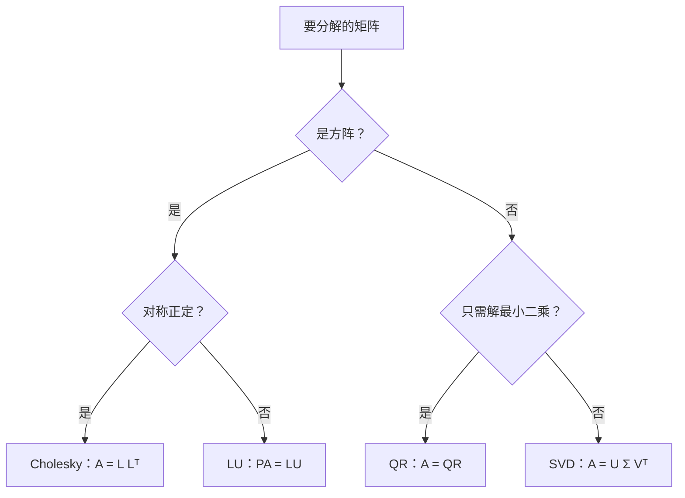

---
Title | 线性代数 Matrix 矩阵分解
-- | --
Created @ | `2026-11-24T14:42:16Z`
Updated @| `2026-11-25T09:20:45Z`
Labels | ``
Edit @| [here](https://github.com/junxnone/math/issues/40)

---
# 矩阵分解

矩阵分解把一个矩阵写成若干“结构简单”的矩阵的乘积（三角、正交、对角），从而把一次复杂的计算拆成几次便宜的计算。数值计算中求解方程组、最小二乘、求特征值基本都靠分解，而不是显式求逆。

## LU 分解

$$
PA=LU
$$

其中：

- $A\in\mathbb{R}^{n\times n}$：待分解的方阵
- $L$：单位下三角矩阵（对角线为 1）；$U$：上三角矩阵
- $P$：置换矩阵，对应选主元时的行交换，保证数值稳定；不需要换行时 $P=I$
- 本质是把高斯消元（见 [初等变换](/0038_线性代数_Matrix_初等变换)）的步骤记录下来：$U$ 是消元结果，$L$ 保存消元乘数

例：

$$
\begin{bmatrix}2&1\\4&3\end{bmatrix}=\begin{bmatrix}1&0\\2&1\end{bmatrix}\begin{bmatrix}2&1\\0&1\end{bmatrix}
$$

其中 $L$ 中的 $2$ 就是消元时用的乘数（第 2 行减去 2 倍第 1 行）。

求解 $A\mathbf{x}=\mathbf{b}$：先解 $L\mathbf{y}=P\mathbf{b}$（前代），再解 $U\mathbf{x}=\mathbf{y}$（回代）。分解只做一次，计算量约 $\tfrac23n^3$，之后对每个新的 $\mathbf{b}$ 只需 $O(n^2)$。

## QR 分解

$$
A=QR
$$

其中：

- $A\in\mathbb{R}^{m\times n}$（$m\ge n$，列满秩）
- $Q\in\mathbb{R}^{m\times n}$：列向量标准正交，$Q^\top Q=I$（见 [正交矩阵](/0032_线性代数_Matrix_正交矩阵)）
- $R\in\mathbb{R}^{n\times n}$：上三角矩阵，对角线非零
- 计算方法：施密特正交化（教学用，数值上不够稳定）、Householder 反射或 Givens 旋转（实用）

用于最小二乘 $\min\|A\mathbf{x}-\mathbf{b}\|_2$：代入得到 $R\mathbf{x}=Q^\top\mathbf{b}$，直接回代，避免了形成 $A^\top A$ 而放大条件数（见 [范数与条件数](/0045_线性代数_Matrix_范数与条件数)）。

## Cholesky 分解

对称正定矩阵（见 [对称正定与二次型](/0041_线性代数_Matrix_对称正定与二次型)）可以分解为：

$$
A=LL^\top
$$

其中：

- $A$：对称正定矩阵
- $L$：对角线元素为正的下三角矩阵
- 计算量约 $\tfrac13n^3$，是 LU 的一半，且无需选主元，数值稳定

例：

$$
\begin{bmatrix}4&2\\2&3\end{bmatrix}=\begin{bmatrix}2&0\\1&\sqrt2\end{bmatrix}\begin{bmatrix}2&1\\0&\sqrt2\end{bmatrix}
$$

验证：$1\cdot2=2$，$1^2+(\sqrt2)^2=3$。

应用：协方差矩阵的求解、高斯分布采样（$\mathbf{x}=\boldsymbol\mu+L\mathbf{z}$，$\mathbf{z}\sim\mathcal N(0,I)$，见 [Gaussian Distribution](/0005_Math_GaussianDistribution)）。

## 特征分解与 SVD

- 特征分解：$A=P\Lambda P^{-1}$，实对称时 $A=Q\Lambda Q^\top$（见 [特征值与特征向量](/0036_线性代数_特征值与特征向量)）
- SVD：任意矩阵 $A=U\Sigma V^\top$（见 [SVD](/0012_线性代数_SVD)）

两者计算量更大，但能揭示矩阵的结构（秩、主方向、条件数）。

## 如何选择

图中：

- 菱形是对矩阵性质的判断，矩形是推荐的分解，自上而下阅读。
- 方阵且对称正定首选 Cholesky（最快）；一般方阵用 LU；非方阵做最小二乘用 QR。
- 需要秩、伪逆、低秩逼近等信息时用 SVD（见 [伪逆](/0043_线性代数_Matrix_伪逆)），这是最稳健但最慢的选择。

| 分解 | 适用矩阵 | 约计算量 | 典型用途 |
| -- | -- | -- | -- |
| LU | 一般方阵 | $\tfrac23n^3$ | 解方程组、求行列式 |
| Cholesky | 对称正定 | $\tfrac13n^3$ | 协方差、优化中的正规方程 |
| QR | 任意（列满秩） | $\sim\tfrac43n^3$（方阵） | 最小二乘、特征值迭代 |
| SVD | 任意 | 最大 | 低秩逼近、伪逆、PCA |

表中依次为分解名称、适用矩阵、近似浮点运算量（$n$ 阶方阵）和典型用途。结论：越特殊的矩阵结构，分解越便宜。

## Reference

- [Matrix decomposition - Wikipedia](https://en.wikipedia.org/wiki/Matrix_decomposition)
- Trefethen & Bau, *Numerical Linear Algebra*

