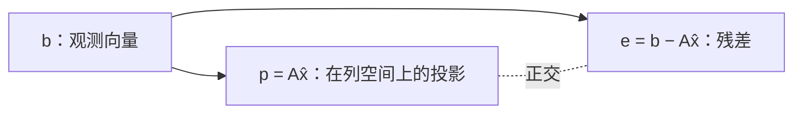

---
Title | 线性代数 投影
-- | --
Created @ | `2026-11-24T14:42:20Z`
Updated @| `2026-11-27T01:42:48Z`
Labels | ``
Edit @| [here](https://github.com/junxnone/math/issues/42)

---
# 投影

投影是把向量“压”到某个子空间上、取其中最近的点。它是最小二乘的几何本质：解不出 $A\mathbf{x}=\mathbf{b}$ 时，就解 $\mathbf{b}$ 在列空间上的投影。

## 向量到向量的投影

把 $\mathbf{b}$ 投影到非零向量 $\mathbf{a}$ 所在直线上：

$$
\mathbf{p}=\frac{\mathbf{a}^\top\mathbf{b}}{\mathbf{a}^\top\mathbf{a}}\,\mathbf{a}=P\mathbf{b},\qquad P=\frac{\mathbf{a}\mathbf{a}^\top}{\mathbf{a}^\top\mathbf{a}}
$$

其中：

- $\mathbf{a},\mathbf{b}\in\mathbb{R}^n$：方向向量与被投影向量
- $\mathbf{p}$：$\mathbf{b}$ 在直线上的投影，是直线上离 $\mathbf{b}$ 最近的点
- $P$：投影矩阵，秩为 1
- 推导：令 $\mathbf{p}=c\mathbf{a}$，要求误差 $\mathbf{e}=\mathbf{b}-\mathbf{p}$ 与 $\mathbf{a}$ 正交，即 $\mathbf{a}^\top(\mathbf{b}-c\mathbf{a})=0$，解得 $c=\mathbf{a}^\top\mathbf{b}/\mathbf{a}^\top\mathbf{a}$

## 向量到子空间的投影

设 $A\in\mathbb{R}^{m\times n}$ 列满秩，投影到列空间 $\operatorname{Col}(A)$：

$$
P=A(A^\top A)^{-1}A^\top,\qquad \mathbf{p}=P\mathbf{b}=A\hat{\mathbf{x}},\quad \hat{\mathbf{x}}=(A^\top A)^{-1}A^\top\mathbf{b}
$$

其中：

- $A$：列向量构成子空间的一组基（见 [向量空间](/0034_线性代数_向量空间)）
- $\hat{\mathbf{x}}$：投影在这组基下的坐标，也就是最小二乘解
- $P\in\mathbb{R}^{m\times m}$：投影矩阵
- 推导：要求误差 $\mathbf{b}-A\hat{\mathbf{x}}$ 与 $A$ 的每一列正交，即 $A^\top(\mathbf{b}-A\hat{\mathbf{x}})=\mathbf{0}$，得正规方程 $A^\top A\hat{\mathbf{x}}=A^\top\mathbf{b}$
- 若 $A=Q$ 的列标准正交，则 $P=QQ^\top$，不需要求逆

## 投影矩阵的性质

- 幂等：$P^2=P$（投影两次与一次相同）
- 对称：$P^\top=P$（正交投影的特征）
- 特征值只有 $1$（在子空间内）和 $0$（在正交补中），所以 $\operatorname{rank}(P)=\operatorname{tr}(P)=\dim\operatorname{Col}(A)$（见 [迹](/0037_线性代数_Matrix_迹)）
- $I-P$ 是到正交补空间的投影，$\mathbf{b}=P\mathbf{b}+(I-P)\mathbf{b}$ 是正交分解

## 最小二乘的几何

图中：

- $\mathbf{b}$ 被分解为两部分：落在列空间内的投影 $\mathbf{p}=A\hat{\mathbf{x}}$ 和与列空间正交的残差 $\mathbf{e}$。
- 虚线表示两者正交（$A^\top\mathbf{e}=\mathbf{0}$），由勾股定理，投影点是列空间内离 $\mathbf{b}$ 最近的点，所以 $\|\mathbf{e}\|_2$ 最小。
- $A\mathbf{x}=\mathbf{b}$ 无解就是因为 $\mathbf{b}\notin\operatorname{Col}(A)$，此时把 $\mathbf{b}$ 换成 $\mathbf{p}$ 就必有解（见 [线性方程组](/0035_线性代数_线性方程组)）。

## 例：直线拟合

用 $y=c_0+c_1t$ 拟合点 $(0,1),(1,2),(2,2)$：

$$
A=\begin{bmatrix}1&0\\1&1\\1&2\end{bmatrix},\quad \mathbf{b}=\begin{bmatrix}1\\2\\2\end{bmatrix},\quad A^\top A=\begin{bmatrix}3&3\\3&5\end{bmatrix},\quad A^\top\mathbf{b}=\begin{bmatrix}5\\6\end{bmatrix}
$$

其中：

- $A$ 的第一列全 1 对应截距 $c_0$，第二列是 $t$ 的取值对应斜率 $c_1$
- 解 $A^\top A\hat{\mathbf{x}}=A^\top\mathbf{b}$ 得 $\hat{\mathbf{x}}=(c_0,c_1)^\top=(\tfrac76,\tfrac12)^\top$，拟合直线 $y=\tfrac76+\tfrac12t$
- 残差 $\mathbf{e}=\mathbf{b}-A\hat{\mathbf{x}}=(-\tfrac16,\tfrac13,-\tfrac16)^\top$，验证 $A^\top\mathbf{e}=\mathbf{0}$：各分量之和为 0，$0\cdot(-\tfrac16)+1\cdot\tfrac13+2\cdot(-\tfrac16)=0$

更一般的最小二乘见 [最小二乘](/0006_数理统计_回归分析_最小二乘进阶)。

## 应用

- 最小二乘回归、曲线/平面拟合（点云平面拟合）
- 格拉姆-施密特正交化：逐个减去已有方向上的投影（见 [正交矩阵](/0032_线性代数_Matrix_正交矩阵)）
- 降维：PCA 把数据投影到主成分子空间（见 [PCA](/0046_线性代数_PCA)）

## Reference

- [Projection (linear algebra) - Wikipedia](https://en.wikipedia.org/wiki/Projection_(linear_algebra))
- Gilbert Strang, *Introduction to Linear Algebra*, Chapter 4

