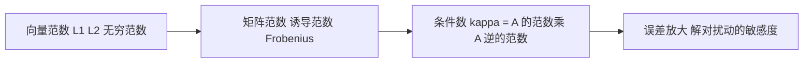

---
Title | 线性代数 Matrix 范数与条件数
-- | --
Created @ | `2026-11-24T14:42:27Z`
Updated @| `2026-11-27T01:51:06Z`
Labels | ``
Edit @| [here](https://github.com/junxnone/math/issues/45)

---
# 范数与条件数

向量范数度量“长度”（见 [norm](/0011_线性代数_norm)）；矩阵范数度量“变换最多能把向量放大多少”。在此基础上，条件数衡量线性问题对误差有多敏感，决定了数值结果可信不可信。

## 概念关系图

图中：由向量范数诱导出矩阵范数，进而定义条件数，条件数衡量线性方程组的解对数据误差的放大倍数。

## 矩阵范数

| 范数 | 定义 | 计算 |
| -- | -- | -- |
| Frobenius 范数 $\lVert A\rVert_F$ | $\sqrt{\sum_{i,j}a_{ij}^2}$ | $\sqrt{\operatorname{tr}(A^\top A)}=\sqrt{\sum_i\sigma_i^2}$ |
| 谱范数 $\lVert A\rVert_2$ | $\max_{\lVert\mathbf{x}\rVert_2=1}\lVert A\mathbf{x}\rVert_2$ | 最大奇异值 $\sigma_{\max}$ |
| 1-范数 $\lVert A\rVert_1$ | $\max_{\lVert\mathbf{x}\rVert_1=1}\lVert A\mathbf{x}\rVert_1$ | 最大列绝对值和 |
| $\infty$-范数 $\lVert A\rVert_\infty$ | $\max_{\lVert\mathbf{x}\rVert_\infty=1}\lVert A\mathbf{x}\rVert_\infty$ | 最大行绝对值和 |
| 核范数 $\lVert A\rVert_*$ | 奇异值之和 | $\sum_i\sigma_i$ |

表中列依次为名称、定义和计算方法，其中 $\sigma_i$ 是 $A$ 的奇异值（见 [SVD](/0012_线性代数_SVD)），$\operatorname{tr}$ 是迹（见 [迹](/0037_线性代数_Matrix_迹)）。除 Frobenius 范数和核范数外，其余是由向量范数诱导的算子范数，满足：

$$
\|A\mathbf{x}\|\le\|A\|\,\|\mathbf{x}\|,\qquad \|AB\|\le\|A\|\,\|B\|
$$

其中第一式说明 $\|A\|$ 是放大倍数的上界，第二式（次乘性）保证连乘不会失控。

## 条件数

对可逆矩阵 $A$：

$$
\kappa(A)=\|A\|\,\|A^{-1}\|,\qquad \kappa_2(A)=\frac{\sigma_{\max}}{\sigma_{\min}}
$$

其中：

- $\kappa(A)\ge1$，$A$ 为正交矩阵时取最小值 1（见 [正交矩阵](/0032_线性代数_Matrix_正交矩阵)）
- 谱范数下 $\kappa_2$ 等于最大与最小奇异值之比，即变换在最“拉伸”与最“压扁”方向的差距
- $\sigma_{\min}\to0$ 时 $A$ 接近奇异，$\kappa\to\infty$（病态）

## 对误差的放大

求解 $A\mathbf{x}=\mathbf{b}$，若右端有扰动 $\delta\mathbf{b}$，解的相对误差满足：

$$
\frac{\|\delta\mathbf{x}\|}{\|\mathbf{x}\|}\le\kappa(A)\,\frac{\|\delta\mathbf{b}\|}{\|\mathbf{b}\|}
$$

其中：

- $\delta\mathbf{b}$：输入误差（测量噪声、舍入误差）；$\delta\mathbf{x}$：由此引起的解的误差
- 经验规则：每增加一个数量级的 $\kappa$，就损失约一位有效数字；双精度（约 16 位）下 $\kappa\sim10^{16}$ 时结果完全不可信

例：$A=\begin{bmatrix}1&1\\1&1.0001\end{bmatrix}$ 对称，特征值约 $2.00005$ 和 $0.00005$，所以 $\kappa_2\approx4\times10^4$：两列几乎共线，求解时输入的微小扰动会被放大 4 万倍。

## 与最小二乘的关系

形成正规方程会让条件数平方：

$$
\kappa_2(A^\top A)=\kappa_2(A)^2
$$

其中 $A$ 为列满秩矩阵。因此病态问题应当用 QR 或 SVD 直接求解，而不是解 $A^\top A\mathbf{x}=A^\top\mathbf{b}$（见 [矩阵分解](/0040_线性代数_Matrix_矩阵分解)）。

## 应用

- 判断线性系统、特征值问题的数值可靠性；条件数大时加正则化（岭回归、截断 SVD，见 [伪逆](/0043_线性代数_Matrix_伪逆)）
- 正则化项：$\|W\|_F^2$（权重衰减）、核范数（低秩约束）
- 优化：Hessian 条件数大时梯度下降收敛慢（等值线为细长椭圆，见 [对称正定与二次型](/0041_线性代数_Matrix_对称正定与二次型)）
- 神经网络：谱范数约束用于稳定训练（如 Spectral Normalization）

## 在机器学习中的作用

- 权重衰减、谱归一化：约束权重矩阵的 Frobenius 范数或谱范数，控制模型的 Lipschitz 常数
- 条件数决定梯度下降的收敛速度：Hessian 条件数越大，收敛越慢，这是预处理与批归一化的动机，见 [一阶方法与随机梯度](https://github.com/junxnone/math/issues/81)
- 梯度裁剪：限制梯度的范数

## 常见误区

- 条件数大不是算法的问题，而是**问题本身**对扰动敏感；换更稳定的算法只能避免进一步恶化，不能消除
- 谱范数（最大奇异值）不等于 Frobenius 范数，$\lVert A\rVert_2\le\lVert A\rVert_F$
- 条件数依赖所用的范数，但在有限维空间中各范数下的条件数是等价的（只差常数倍）

## Reference

- [Matrix norm - Wikipedia](https://en.wikipedia.org/wiki/Matrix_norm)
- [Condition number - Wikipedia](https://en.wikipedia.org/wiki/Condition_number)

