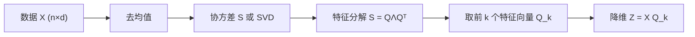

---
Title | 线性代数 PCA
-- | --
Created @ | `2026-11-24T14:42:29Z`
Updated @| `2026-11-25T09:33:44Z`
Labels | ``
Edit @| [here](https://github.com/junxnone/math/issues/46)

---
# PCA

主成分分析（Principal Component Analysis，PCA）把高维数据投影到方差最大的几个正交方向上，用少量主成分保留尽可能多的信息。它是特征分解和 SVD 最经典的应用。

## 目标

找单位向量 $\mathbf{w}$，使数据投影后的方差最大：

$$
\max_{\|\mathbf{w}\|_2=1}\ \mathbf{w}^\top S\mathbf{w}\quad\Longrightarrow\quad S\mathbf{w}=\lambda\mathbf{w}
$$

其中：

- $S=\tfrac1{n-1}X^\top X\in\mathbb{R}^{d\times d}$：去均值后数据的样本协方差矩阵，$X\in\mathbb{R}^{n\times d}$ 为 $n$ 个样本、$d$ 维特征（每列已减去均值）
- $\mathbf{w}^\top S\mathbf{w}$：数据在方向 $\mathbf{w}$ 上投影的方差（见 [对称正定与二次型](/0041_线性代数_Matrix_对称正定与二次型)）
- 推导：引入拉格朗日乘子，令导数为零得 $S\mathbf{w}=\lambda\mathbf{w}$，即 $\mathbf{w}$ 是 $S$ 的特征向量，此时方差为 $\lambda$（见 [特征值与特征向量](/0036_线性代数_特征值与特征向量)）
- 所以第一主成分是最大特征值对应的特征向量，之后依次取与前面正交的方向

## 算法流程

图中：

- 自左向右依次是 PCA 的步骤：去均值、计算协方差（或直接对 $X$ 做 SVD）、特征分解、选取前 $k$ 个主方向、投影得到低维表示。
- $Q_k\in\mathbb{R}^{d\times k}$：由最大的 $k$ 个特征值对应的单位特征向量组成；$Z\in\mathbb{R}^{n\times k}$：降维后的数据。
- 重构：$\hat X=ZQ_k^\top$，把低维数据映射回原空间，损失的部分就是被舍弃方向上的信息。

## 用 SVD 计算

对去均值后的数据做 SVD $X=U\Sigma V^\top$（见 [SVD](/0012_线性代数_SVD)）：

$$
S=\frac{1}{n-1}V\Sigma^2V^\top,\qquad \lambda_i=\frac{\sigma_i^2}{n-1},\qquad Z=XV_k=U_k\Sigma_k
$$

其中：

- $V$ 的列就是主方向（$S$ 的特征向量），$\sigma_i$ 是 $X$ 的奇异值
- $V_k,U_k,\Sigma_k$：取前 $k$ 个的部分
- 优点：不需要显式形成 $X^\top X$，避免条件数平方（见 [范数与条件数](/0045_线性代数_Matrix_范数与条件数)）

## 选择主成分个数

$$
\text{保留比例}=\frac{\sum_{i=1}^k\lambda_i}{\sum_{i=1}^d\lambda_i}=\frac{\sum_{i=1}^k\lambda_i}{\operatorname{tr}(S)}
$$

其中 $\lambda_1\ge\dots\ge\lambda_d$ 是 $S$ 的特征值，分母等于总方差（见 [迹](/0037_线性代数_Matrix_迹)）。常取使保留比例达到 90%–99% 的最小 $k$，或观察特征值的“拐点”（碎石图）。重构的均方误差等于被舍弃的特征值之和：$\tfrac{1}{n-1}\|X-\hat X\|_F^2=\sum_{i>k}\lambda_i$。

## 例：二维数据

设去均值后的协方差为 $S=\begin{bmatrix}2&1\\1&2\end{bmatrix}$，其特征值为 $3,1$，主方向为 $(1,1)^\top/\sqrt2$ 与 $(1,-1)^\top/\sqrt2$。第一主成分保留比例 $3/(3+1)=75\%$：数据沿对角线方向展开最明显，降到一维即沿这条线投影。

## 应用

- 降维与可视化、去噪（丢弃小特征值方向）、特征去相关
- 点云：局部邻域协方差最小特征值对应的特征向量是表面法向，最大的是主方向
- 人脸识别（Eigenfaces）、预处理（白化：$\mathbf{z}=\Lambda^{-1/2}Q^\top\mathbf{x}$）

## Reference

- [Principal component analysis - Wikipedia](https://en.wikipedia.org/wiki/Principal_component_analysis)

