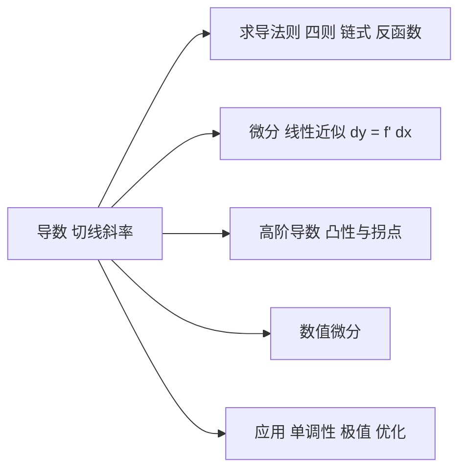

---
Title | 微积分 导数与微分
-- | --
Created @ | `2026-11-24T14:58:26Z`
Updated @| `2026-11-27T02:07:44Z`
Labels | ``
Edit @| [here](https://github.com/junxnone/math/issues/50)

---
# 导数与微分

导数是函数在一点处的瞬时变化率，几何上是切线斜率；微分是用线性函数对增量做的最佳一阶近似。本文补充并扩展 [梯度与方向导数进阶](/0009_微积分_多元函数微分_梯度与方向导数进阶) 里的基本概念。

## 概念关系图

图中：导数的定义出发，得到求导法则、微分（线性近似）、高阶导数（曲率与凸性），并用于单调性、极值和优化；无法解析求导时用数值微分。

## 导数的定义

$$
f'(x_0)=\lim_{\Delta x\to0}\frac{f(x_0+\Delta x)-f(x_0)}{\Delta x}=\frac{df}{dx}\Big|_{x=x_0}
$$

其中：

- $x_0$：考察点；$\Delta x$：自变量增量
- 分式：割线的斜率（平均变化率）；极限：切线的斜率（瞬时变化率）
- 记号：$f'(x_0)$ 为拉格朗日记号，$\tfrac{df}{dx}$ 为莱布尼茨记号
- 可导必连续，反之不然（例：$f(x)=|x|$ 在 $0$ 处连续但不可导）

## 求导法则

| 法则 | 公式 |
| -- | -- |
| 线性 | $(af+bg)'=af'+bg'$ |
| 乘积 | $(fg)'=f'g+fg'$ |
| 商 | $\bigl(\tfrac fg\bigr)'=\dfrac{f'g-fg'}{g^2}\ (g\ne0)$ |
| 链式 | $\bigl(f(g(x))\bigr)'=f'(g(x))\,g'(x)$ |
| 反函数 | $(f^{-1})'(y)=\dfrac1{f'(x)}$，$y=f(x)$ |

表中左列是法则名称，右列为公式，其中 $a,b$ 为常数，$f,g$ 为可导函数。链式法则是反向传播的核心：复合函数的导数等于各层导数的连乘（多元情形见 [多元函数微分](/0054_微积分_多元函数微分)）。

常用导数：

| 函数 | 导数 |
| -- | -- |
| $x^n$ | $nx^{n-1}$ |
| $e^x$ | $e^x$ |
| $a^x$ | $a^x\ln a$ |
| $\ln x$ | $\dfrac1x$ |
| $\sin x$ | $\cos x$ |
| $\cos x$ | $-\sin x$ |
| $\tan x$ | $\sec^2x$ |

## 微分

$$
\Delta y=f(x+\Delta x)-f(x)=f'(x)\,\Delta x+o(\Delta x),\qquad dy=f'(x)\,dx
$$

其中：

- $\Delta y$：函数的实际增量；$dy$：微分，增量的线性主部
- $o(\Delta x)$：比 $\Delta x$ 高阶的无穷小（见 [极限与连续](/0049_微积分_极限与连续)）
- 含义：当 $\Delta x$ 很小时，$\Delta y\approx f'(x)\Delta x$，即用切线代替曲线（局部线性化）

例：估算 $\sqrt{4.04}$：取 $f(x)=\sqrt x$，$x_0=4$，$\Delta x=0.04$，则 $f'(4)=\tfrac14$，$\sqrt{4.04}\approx2+\tfrac14\times0.04=2.01$（真值 $2.00998\ldots$）。

## 高阶导数

$f''=(f')'$ 描述变化率的变化：$f''>0$ 表示曲线下凸（碗状），$f''<0$ 表示上凸。一般用 $f^{(n)}$ 表示 $n$ 阶导数。莱布尼茨公式：$(fg)^{(n)}=\sum_{k=0}^n\binom nkf^{(k)}g^{(n-k)}$，其中 $\binom nk$ 为二项式系数。

## 几何意义：切线与法线

$$
y-f(x_0)=f'(x_0)\,(x-x_0)
$$

其中 $(x_0,f(x_0))$ 是曲线上的切点，$f'(x_0)$ 是切线斜率；法线与切线垂直，斜率为 $-1/f'(x_0)$（$f'(x_0)\ne0$）。例：$y=x^2$ 在 $x_0=1$ 处切线为 $y-1=2(x-1)$，即 $y=2x-1$。

## 特殊求导技巧

| 情形 | 方法 | 公式 |
| -- | -- | -- |
| 隐函数 $F(x,y)=0$ | 两边对 $x$ 求导 | $\dfrac{dy}{dx}=-\dfrac{F_x}{F_y}$ |
| 参数方程 $x=x(t),y=y(t)$ | 链式法则 | $\dfrac{dy}{dx}=\dfrac{y'(t)}{x'(t)}$ |
| 幂指函数 $y=u^v$ | 对数求导 | $y'=u^v\Bigl(v'\ln u+\dfrac{vu'}u\Bigr)$ |

表中依次为情形、方法和结果，其中 $F_x,F_y$ 是 $F$ 的偏导数（见 [多元函数微分](/0054_微积分_多元函数微分)）。例：$x^2+y^2=1$ 求导得 $2x+2yy'=0$，所以 $y'=-x/y$。

## 凸性与拐点

- $f''>0$：曲线下凸（凸函数），切线在曲线下方，局部极小点即全局最小点
- $f''<0$：曲线上凸
- 拐点：$f''$ 变号的点，凹凸性发生改变（例：$x^3$ 在 $0$ 处）

## 数值微分

$$
f'(x)\approx\frac{f(x+h)-f(x-h)}{2h},\qquad \text{误差}=O(h^2)
$$

其中 $h$ 是步长，该式称中心差分，由两个点的泰勒展开相减得到（见 [中值定理与泰勒公式](/0051_微积分_中值定理与泰勒公式)）。$h$ 太大截断误差大，太小则舍入误差大，双精度下常取 $h\sim10^{-5}$。实际深度学习框架使用自动微分，按链式法则逐步计算精确导数，而非差分。

## 导数的应用

- 单调性：$f'>0$ 则递增，$f'<0$ 则递减
- 极值：极值点处 $f'(x_0)=0$（驻点）；$f''(x_0)>0$ 为极小，$<0$ 为极大（见 [极值与拉格朗日乘数](/0058_微积分_极值与拉格朗日乘数)）
- 牛顿法求根：$x_{k+1}=x_k-\dfrac{f(x_k)}{f'(x_k)}$，其中 $x_k$ 是第 $k$ 次迭代的近似根，沿切线与 $x$ 轴的交点逼近零点
- 物理：位置对时间的导数是速度，速度的导数是加速度

## 常见误区

- 可导必连续，**连续不一定可导**（如 $f(x)=\lvert x\rvert$ 在 $0$ 处）；导数存在要求左右导数相等
- $f'(x_0)=0$ 只是极值的**必要条件**（驻点），还可能是拐点或水平拐点（如 $x^3$ 在 $0$ 处）
- 复合函数求导要乘上内函数的导数（链式法则），容易漏乘；反向传播就是反复应用链式法则
- 导数是**瞬时**变化率，不是平均变化率；数值微分的步长太小会因舍入误差而失真，见 [误差与浮点数](https://github.com/junxnone/math/issues/107)

## Reference

- 同济大学数学系，《高等数学》第二章
- [Derivative - Wikipedia](https://en.wikipedia.org/wiki/Derivative)

