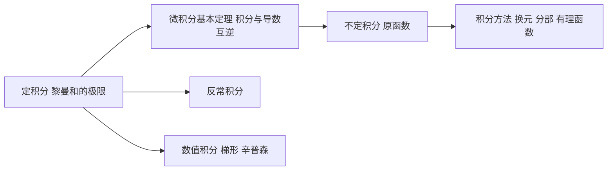

---
Title | 微积分 积分
-- | --
Created @ | `2026-11-24T14:58:31Z`
Updated @| `2026-11-27T01:51:19Z`
Labels | ``
Edit @| [here](https://github.com/junxnone/math/issues/52)

---
# 积分

积分是“累积”的数学：定积分是把无穷多个无穷小量求和（面积、位移、总量），不定积分是求导的逆运算。两者由微积分基本定理联系起来。

## 概念关系图

图中：定积分是黎曼和的极限；微积分基本定理把它与原函数联系起来，由此得到不定积分和各种积分方法；无法求出原函数时用数值积分；区间无界或被积函数无界时是反常积分。

## 定积分（黎曼积分）

$$
\int_a^bf(x)\,dx=\lim_{\lambda\to0}\sum_{i=1}^nf(\xi_i)\,\Delta x_i
$$

其中：

- $[a,b]$：积分区间，被分成 $n$ 个小区间，第 $i$ 个长度为 $\Delta x_i$
- $\xi_i$：第 $i$ 个小区间内任取的一点；$f(\xi_i)\Delta x_i$：一个细长矩形的面积
- $\lambda=\max\Delta x_i$：最长小区间的长度，$\lambda\to0$ 表示划分无限细
- 几何意义：$f\ge0$ 时是曲线下方的面积；$f$ 取负值的部分按负面积计
- 连续函数或只有有限个间断点的有界函数一定可积

性质：线性 $\int(af+bg)=a\int f+b\int g$；区间可加 $\int_a^b=\int_a^c+\int_c^b$；比较 $f\le g\Rightarrow\int f\le\int g$；积分中值定理：连续函数存在 $\xi\in[a,b]$ 使 $\int_a^bf=f(\xi)(b-a)$（$f(\xi)$ 为平均值）。

## 微积分基本定理

$$
F(x)=\int_a^xf(t)\,dt\ \Rightarrow\ F'(x)=f(x);\qquad \int_a^bf(x)\,dx=F(b)-F(a)\ \ (F'=f)
$$

其中：

- $F$：变上限积分函数；第一式说明积分后再求导还原为原函数
- 第二式（牛顿-莱布尼茨公式）：定积分等于任一原函数在端点的差，把求面积转化为求原函数
- 例：$\int_0^1x^2dx=\bigl[\tfrac{x^3}{3}\bigr]_0^1=\tfrac13$

## 不定积分

$f$ 的全体原函数记作：

$$
\int f(x)\,dx=F(x)+C
$$

其中 $F'=f$，$C$ 是任意常数（求导后消失）。常用积分：

| 被积函数 | 原函数 |
| -- | -- |
| $x^n\ (n\ne-1)$ | $\dfrac{x^{n+1}}{n+1}$ |
| $\dfrac1x$ | $\ln\lvert x\rvert$ |
| $e^x$ | $e^x$ |
| $\sin x$ | $-\cos x$ |
| $\cos x$ | $\sin x$ |
| $\dfrac1{1+x^2}$ | $\arctan x$ |

表中左列是被积函数，右列是一个原函数（省略 $+C$），与 [导数与微分](/0050_微积分_导数与微分) 中的求导表互逆。

## 积分方法

**换元法**（对应链式法则）：

$$
\int f\bigl(g(x)\bigr)g'(x)\,dx=\int f(u)\,du,\quad u=g(x)
$$

其中 $u=g(x)$ 是代换变量；定积分换元时上下限也要同时换。例：$\int2x\,e^{x^2}dx=e^{x^2}+C$（令 $u=x^2$）。

**分部积分**（对应乘积法则）：

$$
\int u\,dv=uv-\int v\,du
$$

其中 $u,v$ 是可导函数。例：$\int xe^xdx=xe^x-\int e^xdx=(x-1)e^x+C$（取 $u=x$，$dv=e^xdx$）。选择 $u$ 的经验顺序：对数、反三角、代数、三角、指数（“反对幂三指”）。

其他：有理函数用部分分式分解，三角函数用万能代换，根式用三角代换。

## 反常积分

积分区间无限或被积函数有瑕点时用极限定义：

$$
\int_a^{+\infty}f(x)\,dx=\lim_{b\to+\infty}\int_a^bf(x)\,dx
$$

其中极限存在称收敛，否则发散。例：$\int_1^{+\infty}x^{-p}dx$ 当 $p>1$ 时收敛于 $\tfrac1{p-1}$，$p\le1$ 时发散；高斯积分 $\int_{-\infty}^{+\infty}e^{-x^2}dx=\sqrt\pi$（见 [Gaussian Distribution](/0005_概率论_常见分布_高斯分布进阶)）。

## 例题

- 换元定积分：$\displaystyle\int_0^{1}\frac{x}{1+x^2}dx=\Bigl[\tfrac12\ln(1+x^2)\Bigr]_0^1=\tfrac12\ln2$（令 $u=1+x^2$）。
- 分部两次：$\displaystyle\int x^2e^xdx=x^2e^x-2\int xe^xdx=(x^2-2x+2)e^x+C$。
- 奇偶性：奇函数在 $[-a,a]$ 上积分为 0，偶函数为 $2\int_0^a$。例 $\int_{-1}^1x^3\sin x\,dx$ 的被积函数是偶函数（奇×奇）。
- 面积：曲线 $y=x$ 与 $y=x^2$ 围成的面积 $\displaystyle\int_0^1(x-x^2)dx=\tfrac12-\tfrac13=\tfrac16$。

## 变上限积分求导

$$
\frac{d}{dx}\int_{a(x)}^{b(x)}f(t)\,dt=f\bigl(b(x)\bigr)b'(x)-f\bigl(a(x)\bigr)a'(x)
$$

其中 $a(x),b(x)$ 是可导的上下限函数，$f$ 连续；这是基本定理加链式法则的结果。例：$\dfrac d{dx}\int_0^{x^2}e^{-t^2}dt=2xe^{-x^4}$。

## 数值积分

当原函数无法写成初等函数（如 $e^{-x^2}$）时用数值方法，把 $[a,b]$ 分成 $n$ 等份，$h=(b-a)/n$，$x_i=a+ih$：

$$
\text{梯形法：}\ \frac h2\Bigl[f(x_0)+2\sum_{i=1}^{n-1}f(x_i)+f(x_n)\Bigr],\qquad
\text{辛普森法：}\ \frac h3\Bigl[f(x_0)+4\sum_{\text{奇}}f(x_i)+2\sum_{\text{偶}}f(x_i)+f(x_n)\Bigr]
$$

其中：

- $h$：步长；$x_i$：节点；$n$：份数（辛普森法要求为偶数）
- 梯形法用直线段逼近曲线，误差 $O(h^2)$；辛普森法用抛物线逼近，误差 $O(h^4)$
- 求和中“奇/偶”指下标为奇数/偶数的节点
- 高维或随机场景用蒙特卡洛积分：$\int f\,dx\approx\dfrac{V}N\sum f(\mathbf{x}_i)$，其中 $V$ 为区域体积，$\mathbf{x}_i$ 为均匀采样点，误差 $O(N^{-1/2})$ 与维数无关

## 应用

- 几何：平面面积 $\int(f-g)dx$、旋转体体积 $\pi\int f^2dx$、弧长 $\int\sqrt{1+f'^2}\,dx$
- 物理：位移 $=\int v\,dt$、功 $=\int F\,dx$
- 概率：概率 $=\int p(x)dx$，期望 $\mathbb{E}[X]=\int xp(x)dx$
- 数值积分：梯形法、辛普森法（把积分近似为加权和，误差由泰勒公式分析，见 [中值定理与泰勒公式](/0051_微积分_中值定理与泰勒公式)）

## 在机器学习中的作用

- 连续概率分布的归一化、期望和方差都是积分，见 [随机变量与分布](https://github.com/junxnone/math/issues/62)、[期望方差与矩](https://github.com/junxnone/math/issues/64)
- 贝叶斯推断中的证据 $p(x)=\int p(x\mid\theta)p(\theta)d\theta$ 往往没有闭式解，需要数值积分或蒙特卡洛，见 [贝叶斯推断进阶](https://github.com/junxnone/math/issues/8)
- 累积分布函数、AUC 等指标本质上是积分

## 常见误区

- 积分不是「求导的逆运算」那么简单：不定积分有任意常数 $C$，定积分是一个**数**
- 定积分的值是**带符号**的面积，曲线在 $x$ 轴下方的部分为负
- 换元法做定积分时要同时更换积分**上下限**；反常积分要先判断收敛再计算

## Reference

- 同济大学数学系，《高等数学》第五、六章
- [Integral - Wikipedia](https://en.wikipedia.org/wiki/Integral)

