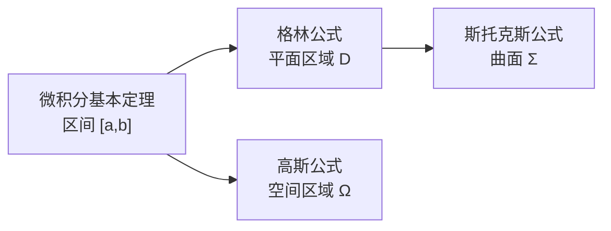

---
Title | 微积分 曲线曲面积分与场论
-- | --
Created @ | `2026-11-24T14:58:40Z`
Updated @| `2026-11-24T14:58:40Z`
Labels | ``
Edit @| [here](https://github.com/junxnone/math/issues/56)

---
# 曲线曲面积分与场论

沿曲线、在曲面上的积分把积分推广到“有形状的区域”，与场（标量场、向量场）的概念配合，就构成场论。格林、斯托克斯、高斯三个定理，都是微积分基本定理在高维的推广。

## 场与算子

- 标量场 $\phi(\mathbf{x})$：空间每一点对应一个数（温度、势能）
- 向量场 $\mathbf{F}(\mathbf{x})=(P,Q,R)^\top$：每一点对应一个向量（速度场、电场）

$$
\nabla\phi=\Bigl(\phi_x,\phi_y,\phi_z\Bigr),\qquad
\nabla\cdot\mathbf{F}=P_x+Q_y+R_z,\qquad
\nabla\times\mathbf{F}=\begin{vmatrix}\mathbf{i}&\mathbf{j}&\mathbf{k}\\\partial_x&\partial_y&\partial_z\\P&Q&R\end{vmatrix}
$$

其中：

- $\nabla\phi$：梯度（标量场 → 向量场），指向 $\phi$ 增加最快的方向（见 [多元函数微分](https://github.com/junxnone/math/issues/54)）
- $\nabla\cdot\mathbf{F}$：散度（向量场 → 标量场），表示一点处场“向外发散”的强度，即源的强度
- $\nabla\times\mathbf{F}$：旋度（向量场 → 向量场），表示场绕该点旋转的程度，方向为旋转轴
- $P_x$ 等为偏导数；$\mathbf{i},\mathbf{j},\mathbf{k}$ 是坐标轴单位向量；$|\cdot|$ 为行列式形式的记号
- 恒等式：$\nabla\times(\nabla\phi)=\mathbf{0}$，$\nabla\cdot(\nabla\times\mathbf{F})=0$

## 第一型曲线/曲面积分

$$
\int_Lf\,ds=\int_\alpha^\beta f\bigl(\mathbf{r}(t)\bigr)\,\lVert\mathbf{r}'(t)\rVert\,dt,\qquad
\iint_\Sigma f\,dS=\iint_Df\bigl(\mathbf{r}(u,v)\bigr)\,\lVert\mathbf{r}_u\times\mathbf{r}_v\rVert\,du\,dv
$$

其中：

- $\mathbf{r}(t)$：曲线的参数方程，$t\in[\alpha,\beta]$；$ds=\lVert\mathbf{r}'\rVert dt$ 是弧长元
- $\mathbf{r}(u,v)$：曲面的参数方程，$D$ 是参数域；$dS=\lVert\mathbf{r}_u\times\mathbf{r}_v\rVert\,du\,dv$ 是面积元（叉乘的模是平行四边形面积）
- 与方向无关，用于求曲线的质量、曲面的面积

## 第二型曲线/曲面积分

$$
\int_C\mathbf{F}\cdot d\mathbf{r}=\int_\alpha^\beta\mathbf{F}\bigl(\mathbf{r}(t)\bigr)\cdot\mathbf{r}'(t)\,dt,\qquad
\iint_\Sigma\mathbf{F}\cdot\mathbf{n}\,dS
$$

其中：

- 左式是线积分，$\mathbf{r}'(t)dt=d\mathbf{r}$ 是沿曲线的位移元；物理上是力 $\mathbf{F}$ 沿路径做的功
- 右式是通量，$\mathbf{n}$ 是曲面的单位法向量；物理上是单位时间穿过曲面的流量
- 与方向有关：反向则变号
- 若 $\mathbf{F}=\nabla\phi$（保守场），则 $\int_C\mathbf{F}\cdot d\mathbf{r}=\phi(B)-\phi(A)$，只与起终点有关，是基本定理的推广（见 [积分](https://github.com/junxnone/math/issues/52)）

## 三大定理

图中：

- 节点是定理，箭头表示推广关系；它们统一的形式是“区域内部的导数之积分 = 边界上的值（的积分）”。
- 基本定理：一维区间，边界是两个端点；格林：平面区域，边界是闭曲线；斯托克斯：曲面，边界是闭曲线；高斯：空间区域，边界是闭曲面。

**格林公式**（$D$ 为平面区域，$\partial D$ 取逆时针方向）：

$$
\oint_{\partial D}P\,dx+Q\,dy=\iint_D\Bigl(\frac{\partial Q}{\partial x}-\frac{\partial P}{\partial y}\Bigr)dA
$$

其中 $P(x,y),Q(x,y)$ 有连续偏导；右端被积函数是二维向量场的旋度分量。例：取 $P=-y/2,\ Q=x/2$，右端为 $\iint_D1\,dA$，所以区域面积 $A=\tfrac12\oint x\,dy-y\,dx$。

**斯托克斯公式**（$\partial\Sigma$ 与 $\Sigma$ 的法向满足右手定则）：

$$
\oint_{\partial\Sigma}\mathbf{F}\cdot d\mathbf{r}=\iint_\Sigma(\nabla\times\mathbf{F})\cdot\mathbf{n}\,dS
$$

其中：左端是环流量（沿边界的线积分），右端是旋度穿过曲面的通量；格林公式是它在平面上的特例。

**高斯公式**（散度定理，$\partial\Omega$ 取外法向）：

$$
\iint_{\partial\Omega}\mathbf{F}\cdot\mathbf{n}\,dS=\iiint_\Omega\nabla\cdot\mathbf{F}\,dV
$$

其中：左端是从闭曲面流出的总通量，右端是区域内部各点散度（源强）的总和：流出量等于内部产生的量。

## 例题

**线积分**：$\mathbf{F}=(-y,x)$，沿单位圆逆时针 $\mathbf{r}(t)=(\cos t,\sin t)$，$t\in[0,2\pi]$：

$$
\oint\mathbf{F}\cdot d\mathbf{r}=\int_0^{2\pi}(-\sin t,\cos t)\cdot(-\sin t,\cos t)\,dt=\int_0^{2\pi}1\,dt=2\pi
$$

其中 $\mathbf{r}'(t)=(-\sin t,\cos t)$。用格林公式验证：$Q_x-P_y=1-(-1)=2$，$2\iint_D dA=2\pi$（$D$ 为单位圆盘，面积 $\pi$），一致。该场的旋度 $\nabla\times\mathbf{F}=2\mathbf{k}\ne\mathbf{0}$，不是保守场（环流不为零）。

**通量**：$\mathbf{F}=(x,y,z)$ 穿过半径 $R$ 球面的向外通量：球面上 $\mathbf{F}\cdot\mathbf{n}=R$，面积 $4\pi R^2$，通量 $=4\pi R^3$；用高斯公式验证：$\nabla\cdot\mathbf{F}=3$，$3\cdot\tfrac43\pi R^3=4\pi R^3$。

## 常用恒等式与拉普拉斯算子

$$
\nabla^2\phi=\nabla\cdot(\nabla\phi)=\phi_{xx}+\phi_{yy}+\phi_{zz}
$$

其中 $\nabla^2$（也记 $\Delta$）是拉普拉斯算子：梯度的散度，衡量某点的值与其周围平均值的差；$\nabla^2\phi=0$ 称调和函数（如静电势）。热方程 $u_t=\alpha\nabla^2u$、波动方程 $u_{tt}=c^2\nabla^2u$ 都由它描述；图像处理中的拉普拉斯滤波用于边缘检测（见 [多元函数微分](https://github.com/junxnone/math/issues/54)）。

## 保守场判定

在单连通区域，下列等价：$\mathbf{F}$ 是保守场 $\iff\nabla\times\mathbf{F}=\mathbf{0}$ $\iff$ 线积分与路径无关 $\iff\oint\mathbf{F}\cdot d\mathbf{r}=0$ $\iff\exists\phi:\mathbf{F}=\nabla\phi$。例：$\mathbf{F}=(2xy,x^2)$，$Q_x=P_y=2x$，所以保守，势函数 $\phi=x^2y$。

## 应用

- 电磁学：麦克斯韦方程组的积分形式与微分形式靠斯托克斯、高斯定理互相转换
- 流体力学：连续性方程 $\partial_t\rho+\nabla\cdot(\rho\mathbf{v})=0$
- 图形学：面积/体积的曲线曲面积分计算，法线与通量
- 机器学习：流形上的积分、散度在连续归一化流中出现

## Reference

- 同济大学数学系，《高等数学》第十一章
- [Vector calculus - Wikipedia](https://en.wikipedia.org/wiki/Vector_calculus)

