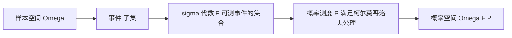

---
Title | 概率论 概率空间与公理
-- | --
Created @ | `2026-11-24T15:21:54Z`
Updated @| `2026-11-27T01:52:57Z`
Labels | ``
Edit @| [here](https://github.com/junxnone/math/issues/60)

---
# 概率空间与公理

概率论的出发点是一个数学对象：概率空间 $(\Omega,\mathcal{F},P)$。它规定了“什么是随机试验的所有结果”“哪些结果的集合可以谈概率”和“怎样给它们赋值”。

## 概念关系图

图中：先有样本空间，再规定哪些子集是可测事件（$\sigma$-代数），最后在其上定义满足公理的概率测度，三者合起来就是概率空间，它是整个概率论的出发点。

## 样本空间与事件

- **随机试验**：可重复、结果事先不确定、但所有可能结果已知的试验。
- **样本空间 $\Omega$**：所有可能结果（样本点 $\omega$）的集合。例：掷一枚骰子 $\Omega=\{1,\dots,6\}$；测量灯泡寿命 $\Omega=[0,\infty)$。
- **事件**：$\Omega$ 的子集，“事件发生”即试验结果落在该子集中。

事件之间的运算与集合运算一一对应：

| 事件关系 | 集合记号 | 含义 |
| -- | -- | -- |
| 并 | $A\cup B$ | $A$ 或 $B$ 至少一个发生 |
| 交 | $A\cap B$（或 $AB$） | $A$ 与 $B$ 同时发生 |
| 补 | $A^c$ | $A$ 不发生 |
| 互斥 | $A\cap B=\varnothing$ | $A$ 与 $B$ 不可能同时发生 |
| 包含 | $A\subseteq B$ | $A$ 发生必导致 $B$ 发生 |

表中依次为关系名称、集合记号和含义。德摩根律 $(A\cup B)^c=A^c\cap B^c$ 在事件运算中同样成立。

## σ-代数

$\mathcal{F}$ 是 $\Omega$ 的子集构成的集合族，称为事件域，要求：$\Omega\in\mathcal{F}$；$A\in\mathcal{F}\Rightarrow A^c\in\mathcal{F}$；$A_i\in\mathcal{F}\Rightarrow\bigcup_iA_i\in\mathcal{F}$（对可列并封闭）。有限的离散样本空间取 $\mathcal{F}=2^\Omega$（全部子集）；在 $\mathbb{R}$ 上取博雷尔 σ-代数（由区间生成）。引入 σ-代数是为了避开不可测集合带来的矛盾。

## 柯尔莫哥洛夫公理

$P:\mathcal{F}\to[0,1]$ 满足非负性、规范性和可列可加性（见 [概率论](/0059_概率论) 中的公式）。由公理可推出：

$$
P(A^c)=1-P(A),\qquad P(\varnothing)=0,\qquad A\subseteq B\Rightarrow P(A)\le P(B)
$$

$$
P(A\cup B)=P(A)+P(B)-P(A\cap B)
$$

其中：

- 第二式是容斥原理的两事件形式：并的概率要减去重复计入的交
- 一般形式：$P(\bigcup_{i=1}^nA_i)=\sum_iP(A_i)-\sum_{i<j}P(A_iA_j)+\sum_{i<j<k}P(A_iA_jA_k)-\cdots$
- 连续性：事件序列单调时，概率与极限可交换（$P(\lim A_n)=\lim P(A_n)$）

## 古典概型与几何概型

古典概型（有限个等可能结果）：

$$
P(A)=\frac{|A|}{|\Omega|}
$$

其中 $|A|$ 是事件 $A$ 包含的样本点个数，$|\Omega|$ 是样本点总数；计算依赖排列组合（见 [组合计数](/0094_离散数学_组合计数)）。几何概型：$P(A)=\dfrac{\mu(A)}{\mu(\Omega)}$，其中 $\mu$ 是长度/面积/体积。

例（生日问题）：$n$ 个人中至少两人同生日的概率：

$$
P_n=1-\frac{365\cdot364\cdots(365-n+1)}{365^n}
$$

其中分子是 $n$ 个人生日两两不同的排列数，分母是所有可能。$n=23$ 时 $P_{23}\approx0.507$，已经超过一半——反直觉的结果，原因是人与人之间有 $\binom{23}2=253$ 对可能。

例（几何概型）：在 $[0,1]$ 上随机取两点，距离小于 $1/2$ 的概率为 $1-(1/2)^2=3/4$（单位正方形中 $|x-y|<1/2$ 的区域面积）。

## 概率的解释

- 频率学派：概率是大量重复试验中事件发生频率的极限（见 [大数定律与中心极限定理](/0066_概率论_大数定律与中心极限定理)）。
- 贝叶斯学派：概率是对命题的置信程度，可随证据更新（见 [条件概率与贝叶斯](/0061_概率论_条件概率与贝叶斯)）。

两种解释共用同一套公理，只是对概率含义的理解不同。

## 应用

- 概率模型的基础：任何随机模型首先要写出 $(\Omega,\mathcal{F},P)$
- 可靠性、保险精算、算法分析（随机算法的期望复杂度）
- 概率方法：用概率论证明组合对象的存在性

## 在机器学习中的作用

- 机器学习的概率视角：数据是从某个未知分布（概率空间）中独立同分布抽取的样本
- 公理推出的性质（单调性、容斥、加法公式）是所有概率计算的基础，见 [条件概率与贝叶斯](https://github.com/junxnone/math/issues/61)
- 几何概型与采样：蒙特卡洛用随机点落入区域的比例估计面积、积分

## 常见误区

- 概率为 0 的事件不一定不可能发生（如连续分布中取到某个具体值），概率为 1 的事件也不一定必然发生（几乎必然）
- 互斥（不能同时发生）与独立（互不影响）是两个不同的概念，通常互斥的非零概率事件**不独立**
- 「等可能」是古典概型的**前提**，不是所有随机试验都等可能（如抛不均匀硬币）

## Reference

- Sheldon Ross, *A First Course in Probability*, Chapters 1–2
- [Probability axioms - Wikipedia](https://en.wikipedia.org/wiki/Probability_axioms)

