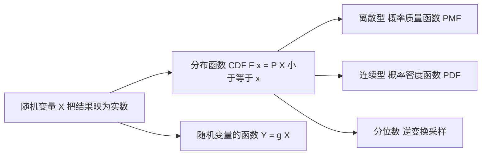

---
Title | 概率论 随机变量与分布
-- | --
Created @ | `2026-11-24T15:21:59Z`
Updated @| `2026-11-27T01:53:01Z`
Labels | ``
Edit @| [here](https://github.com/junxnone/math/issues/62)

---
# 随机变量与分布

随机变量把随机试验的结果变成数，使我们可以用函数和微积分研究随机性。分布函数、概率质量函数和概率密度函数是描述随机变量取值规律的三种基本工具。

## 概念关系图

图中：随机变量由分布函数完整刻画；离散型用 PMF、连续型用 PDF；CDF 的反函数给出分位数并可用于采样；对随机变量做变换得到新的随机变量及其分布。

## 随机变量

随机变量 $X:\Omega\to\mathbb{R}$ 是把样本点 $\omega$ 映射成实数 $X(\omega)$ 的（可测）函数。例：掷两枚骰子，$X$ 取点数之和，$\Omega$ 有 36 个样本点，$X$ 取值 $2,\dots,12$。按取值类型分为：

- 离散型：取值有限或可列（如次品个数）
- 连续型：取值充满区间（如身高、等待时间）

## 分布函数（CDF）

$$
F(x)=P(X\le x),\qquad x\in\mathbb{R}
$$

其中 $F(x)$ 是累积分布函数，对任何随机变量都有定义。性质：

- 单调不减；$\lim_{x\to-\infty}F(x)=0$，$\lim_{x\to+\infty}F(x)=1$
- 右连续
- $P(a<X\le b)=F(b)-F(a)$

## 离散型：概率质量函数（PMF）

$$
p(x_k)=P(X=x_k),\qquad \sum_kp(x_k)=1,\qquad F(x)=\sum_{x_k\le x}p(x_k)
$$

其中 $x_k$ 是 $X$ 的可能取值，$p(x_k)\ge0$ 是对应概率。CDF 是阶梯函数，每个取值点处的跳跃高度等于该点概率。

## 连续型：概率密度函数（PDF）

$$
F(x)=\int_{-\infty}^xf(t)\,dt,\qquad f(x)=F'(x),\qquad \int_{-\infty}^{+\infty}f(x)\,dx=1
$$

其中：

- $f(x)\ge0$：概率密度，**不是概率**，可以大于 1；概率是密度曲线下的面积 $P(a<X\le b)=\int_a^bf(x)dx$
- 连续型随机变量取任何单点的概率为 0：$P(X=x)=0$
- 积分和导数的关系见 [积分](/0052_微积分_积分)（微积分基本定理）

| 对比 | 离散型 | 连续型 |
| -- | -- | -- |
| 描述函数 | PMF $p(x)$ | PDF $f(x)$ |
| 概率 | $P(X=x)=p(x)$ | $P(a<X\le b)=\int_a^bf$ |
| CDF | 求和（阶梯） | 积分（连续光滑） |
| 总和为 1 | $\sum p=1$ | $\int f=1$ |

表中左列是对比项，另两列为两类变量的写法；两者可以统一用测度/积分的语言，把求和看作对计数测度的积分。

## 分位数

$$
Q(p)=F^{-1}(p)=\inf\{x:F(x)\ge p\},\qquad p\in(0,1)
$$

其中 $Q(p)$ 是 $p$ 分位数，使 $X$ 以概率 $p$ 不超过它。中位数是 $Q(0.5)$；假设检验中的临界值就是分位数（见 [假设检验](/0072_数理统计_假设检验)）。

## 随机变量函数的分布

设 $Y=g(X)$，$g$ 严格单调可导，则：

$$
f_Y(y)=f_X\bigl(g^{-1}(y)\bigr)\,\Bigl|\frac{d\,g^{-1}(y)}{dy}\Bigr|
$$

其中 $g^{-1}$ 是反函数，$|d g^{-1}/dy|$ 是变量替换的缩放因子（雅可比，见 [重积分](/0055_微积分_重积分)）。例：$X\sim\mathcal{N}(0,1)$，$Y=\sigma X+\mu$，$g^{-1}(y)=(y-\mu)/\sigma$，得 $f_Y(y)=\dfrac1\sigma f_X\bigl(\tfrac{y-\mu}\sigma\bigr)$，即 $Y\sim\mathcal{N}(\mu,\sigma^2)$。

## 逆变换采样

若 $U\sim\text{Uniform}(0,1)$，则 $X=F^{-1}(U)$ 的分布函数就是 $F$。例：指数分布 $F(x)=1-e^{-\lambda x}$，$F^{-1}(u)=-\dfrac{\ln(1-u)}\lambda$，所以 $X=-\ln(U)/\lambda$（$1-U$ 与 $U$ 同分布）服从参数 $\lambda$ 的指数分布。这是计算机生成各种分布随机数的基本方法。

## 例

连续型 $f(x)=\begin{cases}2x&0\le x\le1\\0&\text{其他}\end{cases}$：验证 $\int_0^12x\,dx=1$；$F(x)=x^2$（$0\le x\le1$）；$P(X>0.5)=1-F(0.5)=0.75$；中位数 $Q(0.5)=\sqrt{0.5}\approx0.707$。

## 应用

- 建模：任何随机量先确定它是离散还是连续、取值范围和 CDF 形态
- 仿真：逆变换法、拒绝采样生成随机数
- 机器学习：概率输出、似然函数 $p(x\mid\theta)$ 就是 PDF/PMF 在数据处的取值

## 在机器学习中的作用

- 模型输出的分布：分类模型输出类别分布（PMF），回归模型可输出高斯分布的参数（PDF）
- 逆变换采样与重参数化技巧：用均匀分布生成任意分布的样本，是生成模型采样的基础
- 分位数与置信区间：分位数回归、预测区间

## 常见误区

- 连续型随机变量的 PDF 值**不是概率**，可以大于 1；概率是 PDF 在区间上的积分
- 对连续变量 $P(X=x)=0$，因此 $P(X\le x)$ 与 $P(X<x)$ 相同，离散变量则不同
- 随机变量函数的分布不能只代入期望：$\mathbb{E}[g(X)]\ne g(\mathbb{E}[X])$（除非 $g$ 线性），变量替换要乘雅可比因子

## Reference

- Sheldon Ross, *A First Course in Probability*, Chapters 4–5
- [Random variable - Wikipedia](https://en.wikipedia.org/wiki/Random_variable)

