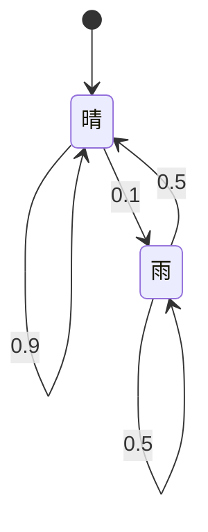

---
Title | 概率论 随机过程初步
-- | --
Created @ | `2026-11-24T15:22:10Z`
Updated @| `2026-11-25T09:40:08Z`
Labels | ``
Edit @| [here](https://github.com/junxnone/math/issues/67)

---
# 随机过程初步

随机过程是一族按时间（或空间）索引的随机变量，用来描述随时间演化的随机现象：股价、排队长度、信号噪声、文本序列。本文介绍最基本的几类。更多细节见已有的 [Stochastic process](/0013_Math_SC) 与 [Markov Process](/0018_Math_MarkovProcess)。

## 定义与分类

随机过程 $\{X_t,\ t\in T\}$ 是以 $t$ 为指标的随机变量族。

| 分类依据 | 类型 | 例子 |
| -- | -- | -- |
| 时间 $T$ | 离散时间 / 连续时间 | 每日股价 / 到达过程 |
| 状态空间 | 离散状态 / 连续状态 | 排队人数 / 温度 |
| 依赖结构 | 独立增量、马尔可夫、平稳 | 泊松过程、马尔可夫链、噪声 |

表中依次为分类依据、类型和例子。固定 $\omega$ 得到一条样本路径 $t\mapsto X_t(\omega)$；固定 $t$ 得到一个随机变量。

## 随机游走

$$
S_n=\sum_{i=1}^nX_i,\qquad P(X_i=+1)=P(X_i=-1)=\tfrac12
$$

其中 $X_i$ 独立同分布，$S_n$ 是第 $n$ 步位置。$\mathbb{E}[S_n]=0$，$\operatorname{Var}(S_n)=n$：位置的标准差按 $\sqrt n$ 增长。由中心极限定理（见 [大数定律与中心极限定理](/0066_概率论_大数定律与中心极限定理)），$S_n/\sqrt n\to\mathcal{N}(0,1)$；时间与空间尺度缩放后的极限就是布朗运动。

## 马尔可夫链

**马尔可夫性**：未来只依赖于现在，与过去无关：

$$
P(X_{n+1}=j\mid X_n=i,X_{n-1},\dots,X_0)=P(X_{n+1}=j\mid X_n=i)=P_{ij}
$$

其中 $P_{ij}$ 是一步转移概率，所有 $P_{ij}$ 构成转移矩阵 $P$（每行和为 1，行随机矩阵）。分布演化：

$$
\boldsymbol\pi^{(n+1)}=\boldsymbol\pi^{(n)}P,\qquad \boldsymbol\pi^{(n)}=\boldsymbol\pi^{(0)}P^n
$$

其中 $\boldsymbol\pi^{(n)}$ 是第 $n$ 步状态分布（行向量）。$n$ 步转移矩阵是 $P^n$（Chapman-Kolmogorov 方程，来自矩阵乘法，见 [矩阵乘积](/0027_线性代数_Matrix_矩阵乘积)）。

**平稳分布** $\boldsymbol\pi$ 满足：

$$
\boldsymbol\pi=\boldsymbol\pi P,\qquad \sum_i\pi_i=1,\ \pi_i\ge0
$$

其中 $\boldsymbol\pi$ 是 $P$ 的特征值 $1$ 对应的左特征向量（见 [特征值与特征向量](/0036_线性代数_特征值与特征向量)）。不可约且非周期的有限链有唯一平稳分布，且无论初始分布如何，$\boldsymbol\pi^{(n)}\to\boldsymbol\pi$（遍历定理）。

## 例：两状态天气链

晴 → 晴 $0.9$，晴 → 雨 $0.1$，雨 → 晴 $0.5$，雨 → 雨 $0.5$：

图中：

- 圆角框是状态，箭头是转移，箭头上的数字是转移概率；从同一状态出发的数字之和为 1。
- 平稳分布由 $0.1\pi_{晴}=0.5\pi_{雨}$ 且 $\pi_{晴}+\pi_{雨}=1$ 得 $\boldsymbol\pi=(5/6,\,1/6)$：长期来看约 $83\%$ 的日子是晴天。
- 此 $P=\begin{bmatrix}0.9&0.1\\0.5&0.5\end{bmatrix}$ 的另一个特征值是 $0.4$，每步偏离平稳分布的误差按 $0.4^n$ 衰减，谱隙决定收敛速度。

## 泊松过程

计数过程 $N(t)$ 满足：$N(0)=0$；独立增量；在长为 $t$ 的区间内的事件数 $N(t)\sim\text{Pois}(\lambda t)$。其中 $\lambda$ 是单位时间平均事件率。推论：相邻事件的间隔时间独立同分布于 $\text{Exp}(\lambda)$（见 [常见分布](/0063_概率论_常见分布)）。例：呼叫中心每分钟平均 $2$ 通电话，$5$ 分钟内无电话的概率 $e^{-10}\approx4.5\times10^{-5}$。

## 布朗运动（维纳过程）

$W_t$ 满足 $W_0=0$，独立增量，$W_t-W_s\sim\mathcal{N}(0,t-s)$，路径连续但处处不可导。它是扩散、股价模型（几何布朗运动）和随机微分方程的基础。

## 平稳过程

若联合分布对时间平移不变（或宽平稳：均值常数，协方差仅依赖时间差），称平稳。其自相关函数的傅里叶变换是功率谱密度（见 [信号与线性系统](/0099_信号与傅里叶变换_信号与线性系统)、[连续傅里叶变换](/0101_信号与傅里叶变换_连续傅里叶变换)）；白噪声的功率谱是常数。

## 应用

- 排队论、可靠性：泊松过程与生灭链
- 自然语言：$n$-gram、隐马尔可夫模型（HMM）
- MCMC：构造以目标分布为平稳分布的马尔可夫链，从中采样（Metropolis-Hastings、Gibbs 采样）
- PageRank：网页间随机跳转链的平稳分布
- 滤波与高斯过程（见 [Gaussian Filter](/0021_Math_GaussianFilter)、[Gaussian Process](/0020_Math_GaussianProcess)）

## Reference

- Sheldon Ross, *Introduction to Probability Models*
- [Stochastic process - Wikipedia](https://en.wikipedia.org/wiki/Stochastic_process)

