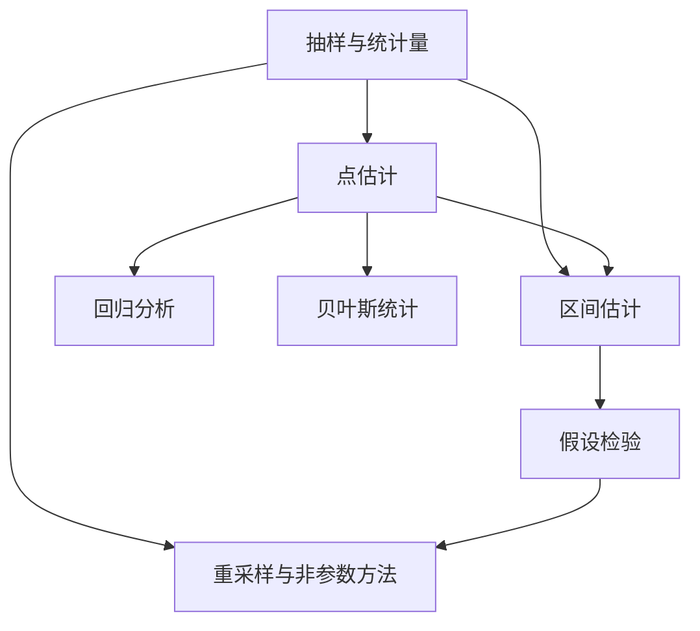

---
Title | 数理统计
-- | --
Created @ | `2026-11-24T15:22:12Z`
Updated @| `2026-11-24T15:22:12Z`
Labels | ``
Edit @| [here](https://github.com/junxnone/math/issues/68)

---
# 数理统计

数理统计是概率论的“逆问题”：概率论在已知分布的前提下预测数据，数理统计则从观测数据出发，推断产生数据的分布。它为机器学习的训练、评估和实验设计提供了理论依据。

## 核心思想

- **总体与样本**：总体的分布 $F_\theta$ 未知（或参数 $\theta$ 未知），只能观察到从中抽取的样本 $X_1,\dots,X_n$。
- **统计量**：样本的函数（如样本均值），其分布称为抽样分布，描述了估计的随机波动。
- **三类推断**：点估计（给出一个值）、区间估计（给出一个范围）、假设检验（做出是/否的判断）。
- **两大学派**：频率学派把 $\theta$ 视为未知常数；贝叶斯学派把 $\theta$ 视为随机变量并给出先验。

概率论与统计的方向对比：

$$
\underbrace{\theta\ \xrightarrow{\ \text{概率论}\ }\ X_1,\dots,X_n}_{\text{正问题}},\qquad
\underbrace{X_1,\dots,X_n\ \xrightarrow{\ \text{统计推断}\ }\ \theta}_{\text{逆问题}}
$$

其中 $\theta$ 是总体分布的（未知）参数，$X_1,\dots,X_n$ 是样本。正问题由 [概率论](https://github.com/junxnone/math/issues/59) 给出，逆问题需要概率论提供的抽样分布来量化不确定性。

## 知识地图

下图展示本系列各章的依赖关系，自上而下阅读。

图中：

- 节点是一章，箭头表示先修关系。
- 抽样分布是所有推断的共同基础；点估计给出估计量，区间估计在其上量化误差，假设检验与区间估计对偶（置信区间包含 $\theta_0$ 等价于不拒绝 $H_0:\theta=\theta_0$）。
- 回归分析是点估计在条件均值建模上的应用；贝叶斯统计提供另一种估计思路；重采样在不依赖分布假设时替代理论抽样分布。

## 系列文章

| 主题 | 内容概要 | 文章 |
| -- | -- | -- |
| 抽样与统计量 | 样本均值方差、$\chi^2$/$t$/$F$ 分布、抽样分布 | [抽样与统计量](https://github.com/junxnone/math/issues/69) |
| 点估计 | 矩估计、最大似然、评价标准、Cramér-Rao | [点估计](https://github.com/junxnone/math/issues/70) |
| 区间估计 | 置信区间、枢轴量、样本量 | [区间估计](https://github.com/junxnone/math/issues/71) |
| 假设检验 | 两类错误、$p$ 值、$z$/$t$/$\chi^2$ 检验 | [假设检验](https://github.com/junxnone/math/issues/72) |
| 回归分析 | 最小二乘、推断、正则化、诊断 | [回归分析](https://github.com/junxnone/math/issues/73) |
| 贝叶斯统计 | 先验后验、共轭、MAP、可信区间 | [贝叶斯统计](https://github.com/junxnone/math/issues/74) |
| 重采样与非参数方法 | Bootstrap、置换检验、核密度、秩检验 | [重采样与非参数方法](https://github.com/junxnone/math/issues/75) |

表中三列依次为主题、内容概要和文章链接。

## 关键公式速览

$$
\bar X=\frac1n\sum_{i=1}^nX_i,\qquad S^2=\frac1{n-1}\sum_{i=1}^n(X_i-\bar X)^2,\qquad \hat\theta_{\text{MLE}}=\arg\max_\theta\prod_{i=1}^np(X_i;\theta)
$$

其中 $n$ 是样本量，$\bar X$ 是样本均值（总体均值的估计），$S^2$ 是样本方差（分母 $n-1$ 使其无偏），$p(\cdot;\theta)$ 是以 $\theta$ 为参数的密度（或质量）函数，$\hat\theta_{\text{MLE}}$ 是使观测数据出现概率最大的参数值。

正态总体均值的 $1-\alpha$ 置信区间（方差未知）：

$$
\bar X\pm t_{\alpha/2,\,n-1}\frac S{\sqrt n}
$$

其中 $t_{\alpha/2,n-1}$ 是自由度 $n-1$ 的 $t$ 分布的上 $\alpha/2$ 分位数，$S/\sqrt n$ 是均值的标准误差。

## 与其他主题的联系

- 概率论：抽样分布、极限定理（见 [大数定律与中心极限定理](https://github.com/junxnone/math/issues/66)）
- 线性代数与优化：回归的正规方程、最大似然的数值求解（见 [投影](https://github.com/junxnone/math/issues/42)、[无约束优化](https://github.com/junxnone/math/issues/78)）
- 信息论：最大似然等价于最小化 KL 散度（见 [互信息与 KL 散度](https://github.com/junxnone/math/issues/86)）

## 应用方向

- 机器学习：模型参数估计、模型比较与评估（交叉验证）、A/B 测试
- 科学实验：显著性检验、实验设计、可重复性
- 工业与医学：质量控制、临床试验、可靠性分析

## Reference

- Casella & Berger, *Statistical Inference*
- 盛骤等，《概率论与数理统计》
- [Statistics - Wikipedia](https://en.wikipedia.org/wiki/Statistics)

