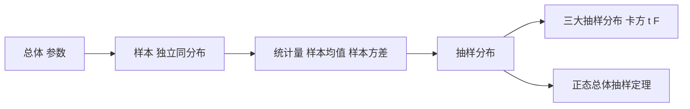

---
Title | 数理统计 抽样与统计量
-- | --
Created @ | `2026-11-24T15:22:15Z`
Updated @| `2026-11-27T01:54:33Z`
Labels | ``
Edit @| [here](https://github.com/junxnone/math/issues/69)

---
# 抽样与统计量

统计推断的第一步是弄清楚：用样本算出的量（统计量）自身是随机的，它的分布是什么？本文介绍样本均值、样本方差及其在正态总体下的精确抽样分布。

## 概念关系图

图中：从总体中抽样得到样本，由样本计算统计量；统计量本身是随机变量，它的分布称为抽样分布；卡方、$t$、$F$ 三大分布和正态总体抽样定理是推断的基础。

## 总体、样本与统计量

- **总体**：研究对象全体，用一个分布 $F$（或 $F_\theta$）表示。
- **简单随机样本** $X_1,\dots,X_n$：相互独立且与总体同分布（i.i.d.）。观测值 $x_1,\dots,x_n$ 是样本的一次实现。
- **统计量**：样本的函数 $T(X_1,\dots,X_n)$，不含未知参数。统计量是随机变量，其分布称为**抽样分布**。

## 样本均值与样本方差

$$
\bar X=\frac1n\sum_{i=1}^nX_i,\qquad S^2=\frac1{n-1}\sum_{i=1}^n(X_i-\bar X)^2
$$

其中 $n$ 是样本量，分母取 $n-1$ 的原因：

$$
\mathbb{E}\Bigl[\sum_i(X_i-\bar X)^2\Bigr]=(n-1)\sigma^2\ \Longrightarrow\ \mathbb{E}[S^2]=\sigma^2
$$

其中 $\sigma^2$ 是总体方差。由于 $\bar X$ 是由数据本身算出的，各 $X_i-\bar X$ 受到 $\sum(X_i-\bar X)=0$ 的约束，只有 $n-1$ 个自由度，所以除以 $n$ 会低估方差。

均值的性质（总体均值 $\mu$、方差 $\sigma^2$ 存在时，无需正态）：

$$
\mathbb{E}[\bar X]=\mu,\qquad \operatorname{Var}(\bar X)=\frac{\sigma^2}n
$$

标准误差 $\sigma/\sqrt n$ 随样本量按 $1/\sqrt n$ 下降：要把误差缩小一半需要四倍的数据。当 $n$ 较大时，由 CLT $\bar X\approx\mathcal{N}(\mu,\sigma^2/n)$（见 [大数定律与中心极限定理](/0066_概率论_大数定律与中心极限定理)）。

## 三大抽样分布

**卡方分布** $\chi^2(k)$：$Z_1,\dots,Z_k$ 独立标准正态，$\chi^2=\sum_{i=1}^kZ_i^2$。其中 $k$ 是自由度，均值 $k$，方差 $2k$；它是 Gamma 分布的特例 $\Gamma(k/2,1/2)$（见 [常见分布](/0063_概率论_常见分布)）。

**$t$ 分布** $t(k)$：

$$
T=\frac{Z}{\sqrt{V/k}},\qquad Z\sim\mathcal{N}(0,1),\ V\sim\chi^2(k)\ \text{独立}
$$

其中 $k$ 是自由度。形状类似标准正态但尾部更厚（考虑到用 $S$ 估计 $\sigma$ 带来的额外不确定性），$k\to\infty$ 时趋于标准正态。

**$F$ 分布** $F(k_1,k_2)$：

$$
F=\frac{U/k_1}{V/k_2},\qquad U\sim\chi^2(k_1),\ V\sim\chi^2(k_2)\ \text{独立}
$$

其中 $k_1,k_2$ 分别是分子、分母的自由度，用于比较两个方差、方差分析（ANOVA）和回归整体显著性。

| 分布 | 构成 | 主要用途 |
| -- | -- | -- |
| $\chi^2(k)$ | $k$ 个标准正态的平方和 | 方差的区间估计、拟合优度检验 |
| $t(k)$ | 标准正态 / $\sqrt{\chi^2/k}$ | 均值的推断（方差未知） |
| $F(k_1,k_2)$ | 两个卡方（除自由度）之比 | 方差比较、ANOVA |

表中依次为分布、构成方式和主要用途。

## 正态总体的抽样分布定理

设 $X_i\overset{iid}{\sim}\mathcal{N}(\mu,\sigma^2)$，则：

$$
\bar X\sim\mathcal{N}\Bigl(\mu,\frac{\sigma^2}n\Bigr),\qquad \frac{(n-1)S^2}{\sigma^2}\sim\chi^2(n-1),\qquad \bar X\ \text{与}\ S^2\ \text{独立}
$$

$$
T=\frac{\bar X-\mu}{S/\sqrt n}\sim t(n-1)
$$

其中：

- 第一式是正态的线性性质；第二式说明样本方差的缩放后服从自由度为 $n-1$ 的卡方分布
- $\bar X$ 与 $S^2$ 的独立性是正态分布的特有性质（见 [Gaussian Distribution](/0005_概率论_常见分布_高斯分布进阶)）
- $T$ 的构造：分子标准化后是标准正态，分母 $S/\sigma=\sqrt{\chi^2(n-1)/(n-1)}$，二者独立，所以是 $t$ 分布；这是均值 $t$ 检验与 $t$ 区间的依据（见 [区间估计](/0071_数理统计_区间估计)）

## 顺序统计量与经验分布

- 顺序统计量：样本从小到大排列 $X_{(1)}\le\cdots\le X_{(n)}$，中位数、分位数、最大最小值都是它们的函数。例：$U(0,1)$ 样本的最大值 $X_{(n)}$ 的 CDF 是 $x^n$。
- 经验分布函数：

$$
\hat F_n(x)=\frac1n\sum_{i=1}^n\mathbf{1}\{X_i\le x\}
$$

其中 $\mathbf{1}\{\cdot\}$ 是示性函数，$\hat F_n(x)$ 是样本中不超过 $x$ 的比例。格利文科-坎泰利定理：$\sup_x|\hat F_n(x)-F(x)|\to0$（几乎必然），即样本分布一致逼近总体分布，这是重采样方法（见 [重采样与非参数方法](/0075_数理统计_重采样与非参数方法)）的依据。

## 例

总体 $\mathcal{N}(100,15^2)$，样本量 $n=25$：$\bar X\sim\mathcal{N}(100,3^2)$；$P(\bar X>105)=P(Z>5/3)\approx0.048$。若总体标准差未知，$S=12$ 时标准误差 $12/5=2.4$，$T=(\bar X-100)/2.4\sim t(24)$。

## 应用

- 一切推断方法的基础：置信区间、检验统计量的分布都来自抽样分布
- 样本量设计：由标准误差反推需要的 $n$
- 质量控制图：均值图的控制限 $\mu\pm3\sigma/\sqrt n$

## 在机器学习中的作用

- 训练集 / 测试集上的指标是统计量，有抽样波动：报告结果要给出多次运行的均值与标准差
- $t$ 分布与 $F$ 分布用于模型比较的显著性检验，见 [假设检验](https://github.com/junxnone/math/issues/72)
- 样本均值与样本方差是批归一化、数据标准化的基础统计量

## 常见误区

- 样本方差用 $n-1$ 作分母才是无偏估计；用 $n$ 是方差的最大似然估计（有偏），见 [点估计](https://github.com/junxnone/math/issues/70)
- 统计量是随机的，参数是固定的未知常数（频率学派的看法）；不要说「参数落在区间里的概率」
- 「样本均值服从正态分布」要么总体是正态，要么样本量足够大（中心极限定理），见 [大数定律与中心极限定理](https://github.com/junxnone/math/issues/66)

## Reference

- Casella & Berger, *Statistical Inference*, Chapter 5
- [Sampling distribution - Wikipedia](https://en.wikipedia.org/wiki/Sampling_distribution)

