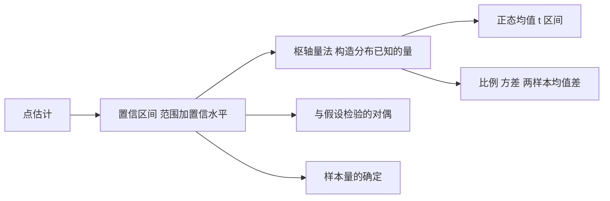

---
Title | 数理统计 区间估计
-- | --
Created @ | `2026-11-24T15:22:19Z`
Updated @| `2026-11-27T01:54:37Z`
Labels | ``
Edit @| [here](https://github.com/junxnone/math/issues/71)

---
# 区间估计

点估计只给一个数，没有说明它有多可靠。区间估计给出一个范围（置信区间），并附上这个范围“覆盖真值”的可靠程度。

## 概念关系图

图中：置信区间在点估计的基础上给出范围；构造枢轴量是推导区间的通用方法，针对均值、比例、方差、两样本差分别给出公式；区间与假设检验互为对偶；还可以反过来由所需精度确定样本量。

## 置信区间的定义与解释

参数 $\theta$ 的 $1-\alpha$ 置信区间 $[L(X),U(X)]$ 满足：

$$
P\bigl(L(X_1,\dots,X_n)\le\theta\le U(X_1,\dots,X_n)\bigr)=1-\alpha
$$

其中：

- $L,U$：由样本算出的上下界，是随机变量；$\theta$：固定的未知常数
- $1-\alpha$：置信水平（常用 $95\%$，即 $\alpha=0.05$）
- **正确解释**：重复抽样很多次，每次构造一个区间，约 $95\%$ 的区间会包含真值；而对已算出的某一个具体区间，真值要么在里面要么不在，不能说“真值有 $95\%$ 概率在这个区间内”（后者是贝叶斯可信区间，见 [贝叶斯统计](/0074_数理统计_贝叶斯统计)）

## 枢轴量法

找一个含 $\theta$ 的函数 $G(X,\theta)$，其分布不依赖未知参数（枢轴量），解不等式得到区间。例：正态总体 $\sigma$ 已知，$G=\dfrac{\bar X-\mu}{\sigma/\sqrt n}\sim\mathcal{N}(0,1)$。

## 正态总体均值

**$\sigma$ 已知**：

$$
\bar X\pm z_{\alpha/2}\frac\sigma{\sqrt n}
$$

**$\sigma$ 未知**（用样本标准差 $S$ 代替）：

$$
\bar X\pm t_{\alpha/2,\,n-1}\frac S{\sqrt n}
$$

其中：

- $z_{\alpha/2}$：标准正态的上 $\alpha/2$ 分位数（$95\%$ 时为 $1.96$）；$t_{\alpha/2,n-1}$：自由度 $n-1$ 的 $t$ 分布分位数（见 [抽样与统计量](/0069_数理统计_抽样与统计量)）
- $\sigma/\sqrt n$ 或 $S/\sqrt n$：标准误差；乘以分位数后称为误差界（margin of error）
- 区间宽度随 $1/\sqrt n$ 缩小；置信水平越高区间越宽

例：$n=25$，$\bar x=10$，$s=2$，$95\%$ 区间：$t_{0.025,24}=2.064$，误差界 $2.064\times2/5=0.826$，区间 $(9.17,\,10.83)$。若 $\sigma=2$ 已知，则误差界 $1.96\times0.4=0.784$，区间稍窄，因为少了估计 $\sigma$ 的不确定性。

## 比例的区间估计

$$
\hat p\pm z_{\alpha/2}\sqrt{\frac{\hat p(1-\hat p)}n}
$$

其中 $\hat p=k/n$ 是样本比例，根号项是其标准误差（由二项分布方差得到，见 [常见分布](/0063_概率论_常见分布)）。这是大样本（CLT）近似，$n\hat p$ 或 $n(1-\hat p)$ 太小时不准，可用 Wilson 区间。例：民调 $n=1000$、$\hat p=0.5$，误差界 $1.96\sqrt{0.25/1000}\approx0.031$，即“误差约 $\pm3\%$”。

## 方差的区间估计

正态总体：

$$
\Bigl[\frac{(n-1)S^2}{\chi^2_{\alpha/2,\,n-1}},\ \frac{(n-1)S^2}{\chi^2_{1-\alpha/2,\,n-1}}\Bigr]
$$

其中 $\chi^2_{\beta,n-1}$ 是自由度 $n-1$ 的卡方分布的上 $\beta$ 分位数（注意区间两端用不同的分位数，卡方分布不对称）。由枢轴量 $\frac{(n-1)S^2}{\sigma^2}\sim\chi^2(n-1)$ 得到。

## 两个总体均值之差

独立样本，方差不等（Welch）：

$$
(\bar X_1-\bar X_2)\pm t_{\alpha/2,\nu}\sqrt{\frac{S_1^2}{n_1}+\frac{S_2^2}{n_2}}
$$

其中下标 $1,2$ 表示两组，$\nu$ 是由 Welch–Satterthwaite 公式估计的自由度。若区间不包含 $0$，说明两组均值差异显著。

## 样本量的确定

要使均值的误差界不超过 $E$（$\sigma$ 已知或预估）：

$$
n\ge\Bigl(\frac{z_{\alpha/2}\,\sigma}E\Bigr)^2
$$

其中 $E$ 是容许的最大误差。例：$\sigma=15$，希望 $95\%$ 区间半宽不超过 $2$：$n\ge(1.96\times15/2)^2\approx216.1$，向上取整得 $n=217$。比例：取 $\hat p=0.5$（最保守）得 $n\ge z^2/(4E^2)$，$E=0.03$ 需约 $1068$ 人。

## 区间估计与假设检验的对偶

$H_0:\theta=\theta_0$ 在水平 $\alpha$ 下不被拒绝，当且仅当 $\theta_0$ 落在 $1-\alpha$ 置信区间内（见 [假设检验](/0072_数理统计_假设检验)）。置信区间比单个 $p$ 值信息更多：它同时给出效应大小的合理范围。

## 应用

- 报告模型指标的不确定性（如准确率的置信区间）
- 调查抽样、质量检验
- 非正态/复杂统计量用 Bootstrap 构造区间（见 [重采样与非参数方法](/0075_数理统计_重采样与非参数方法)）

## 常用置信区间对比

| 参数 | 条件 | 区间 |
| --- | --- | --- |
| 均值 $\mu$ | 方差已知 | $\bar x\pm z_{\alpha/2}\,\sigma/\sqrt n$ |
| 均值 $\mu$ | 方差未知（正态） | $\bar x\pm t_{\alpha/2}(n-1)\,s/\sqrt n$ |
| 比例 $p$ | 大样本 | $\hat p\pm z_{\alpha/2}\sqrt{\hat p(1-\hat p)/n}$ |
| 方差 $\sigma^2$ | 正态 | $\Bigl[\dfrac{(n-1)s^2}{\chi^2_{\alpha/2}},\ \dfrac{(n-1)s^2}{\chi^2_{1-\alpha/2}}\Bigr]$ |

表中：$\bar x$ 为样本均值，$s$ 为样本标准差，$n$ 为样本量，$\alpha$ 为显著性水平（置信水平 $1-\alpha$）；$z$、$t$、$\chi^2$ 为对应分布的分位数；对比结论：方差未知时用 $t$ 分布，样本量大时 $t$ 趋近于正态。

## 在机器学习中的作用

- 模型评估报告置信区间（如 Bootstrap 区间），说明指标差异是否显著，见 [重采样与非参数方法](https://github.com/junxnone/math/issues/75)
- 预测区间与不确定性估计的基本概念
- 样本量规划：由要求的区间宽度反推所需的测试集大小

## 常见误区

- 95% 置信区间**不是**「参数有 95% 的概率落在该区间内」：参数是固定常数，随机的是区间；含义是「重复抽样中，约 95% 的区间会覆盖真值」（贝叶斯可信区间才是后者的含义，见 [贝叶斯统计](https://github.com/junxnone/math/issues/74)）
- 置信水平越高，区间越宽；想要又窄又可靠只能增大样本量
- 区间估计的公式依赖分布假设（正态或大样本），小样本非正态时要用其他方法

## Reference

- Casella & Berger, *Statistical Inference*, Chapter 9
- [Confidence interval - Wikipedia](https://en.wikipedia.org/wiki/Confidence_interval)

