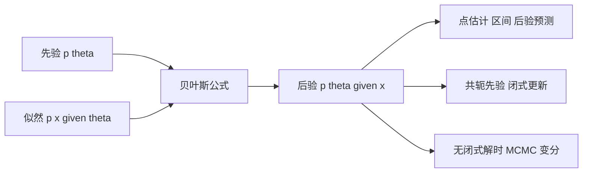

---
Title | 数理统计 贝叶斯统计
-- | --
Created @ | `2026-11-24T15:22:26Z`
Updated @| `2026-11-27T01:54:44Z`
Labels | ``
Edit @| [here](https://github.com/junxnone/math/issues/74)

---
# 贝叶斯统计

贝叶斯统计把未知参数 $\theta$ 当作随机变量：先给出先验分布，观察数据后用贝叶斯公式更新为后验分布，所有推断都基于后验。它能自然地融合先验知识并给出不确定性的完整刻画。

## 概念关系图

图中：先验与似然通过贝叶斯公式得到后验；后验用于点估计、可信区间和预测；共轭先验让后验有闭式解，否则用采样（MCMC）或变分近似。

## 基本框架

$$
p(\theta\mid D)=\frac{p(D\mid\theta)\,p(\theta)}{p(D)},\qquad p(D)=\int p(D\mid\theta)\,p(\theta)\,d\theta
$$

其中：

- $p(\theta)$：先验分布，观察数据前对参数的信念；$p(D\mid\theta)$：似然函数（见 [点估计](/0070_数理统计_点估计)）
- $p(\theta\mid D)$：后验分布，结合数据后的信念；$p(D)$：边缘似然（证据），是对 $\theta$ 的积分，只起归一化作用（积分见 [积分](/0052_微积分_积分)）
- 简记：后验 $\propto$ 似然 $\times$ 先验；这是 [条件概率与贝叶斯](/0061_概率论_条件概率与贝叶斯) 公式在参数推断上的应用
- 序贯更新：今天的后验就是明天的先验

## 共轭先验

先验与后验属同一分布族时，更新只需改参数，有闭式解：

| 似然 | 共轭先验 | 后验 |
| -- | -- | -- |
| 伯努利/二项（$k$ 成功 $n$ 次） | $\text{Beta}(\alpha,\beta)$ | $\text{Beta}(\alpha+k,\ \beta+n-k)$ |
| 泊松 | $\text{Gamma}(\alpha,\beta)$ | $\text{Gamma}(\alpha+\sum x_i,\ \beta+n)$ |
| 正态（方差已知，均值未知） | 正态 | 正态（见下） |

表中依次为似然、共轭先验和后验，$\alpha,\beta$ 是先验的超参数，可视为“虚拟观测”的次数（见 [常见分布](/0063_概率论_常见分布)）。

例（硬币）：先验 $\text{Beta}(1,1)$（均匀），抛 10 次 7 次正面，后验 $\text{Beta}(8,4)$，后验均值 $8/12\approx0.667$；若先验是 $\text{Beta}(20,20)$（强烈相信公平），后验 $\text{Beta}(27,23)$，均值 $0.54$——先验越强，数据越难拉动，数据越多先验的影响越弱。

正态-正态：$x_i\sim\mathcal{N}(\mu,\sigma^2)$，先验 $\mu\sim\mathcal{N}(\mu_0,\sigma_0^2)$：

$$
\mu\mid D\sim\mathcal{N}(\mu_n,\sigma_n^2),\qquad
\frac1{\sigma_n^2}=\frac1{\sigma_0^2}+\frac n{\sigma^2},\qquad
\mu_n=\sigma_n^2\Bigl(\frac{\mu_0}{\sigma_0^2}+\frac{n\bar x}{\sigma^2}\Bigr)
$$

其中：

- $\bar x$：样本均值；$\mu_0,\sigma_0^2$：先验均值与方差；$\mu_n,\sigma_n^2$：后验均值与方差
- 精度（方差的倒数）相加：后验精度 = 先验精度 + 数据精度，所以后验总比先验更窄
- 后验均值是先验均值与样本均值按各自精度加权的平均；$n\to\infty$ 时 $\mu_n\to\bar x$

## 点估计与区间

- 后验均值：最小化平方损失的贝叶斯估计；后验中位数：绝对损失。
- **MAP**（最大后验）：

$$
\hat\theta_{\text{MAP}}=\arg\max_\theta\bigl[\ln p(D\mid\theta)+\ln p(\theta)\bigr]
$$

其中第一项是对数似然，第二项是对数先验；MAP 相当于“带正则项的最大似然”：高斯先验对应 $L_2$ 惩罚（岭回归），拉普拉斯先验对应 $L_1$ 惩罚（Lasso，见 [回归分析](/0073_数理统计_回归分析)）。上例 $\text{Beta}(8,4)$ 的众数 $\frac{8-1}{8+4-2}=0.7$ 即 MAP，与 MLE $7/10$ 重合（因为均匀先验不提供信息）。

- **可信区间**：后验概率 $95\%$ 的区间 $[a,b]$，满足 $P(a\le\theta\le b\mid D)=0.95$。这里可以直接说“$\theta$ 有 $95\%$ 概率在区间内”，与频率学派的置信区间含义不同（见 [区间估计](/0071_数理统计_区间估计)）。

## 后验预测

$$
p(x_{\text{new}}\mid D)=\int p(x_{\text{new}}\mid\theta)\,p(\theta\mid D)\,d\theta
$$

其中 $x_{\text{new}}$ 是新观测。对 $\theta$ 的不确定性做加权平均，而不是代入单个估计值，预测分布因此更宽、更诚实地反映了不确定性。

## 计算：当后验没有闭式解

- **MCMC**：构造以后验为平稳分布的马尔可夫链并采样（Metropolis-Hastings、Gibbs、HMC，见 [随机过程初步](/0067_概率论_随机过程初步)）。
- **变分推断**：用简单分布 $q$ 近似后验，最小化 $\mathrm{KL}(q\Vert p)$（见 [互信息与 KL 散度](/0086_信息论_互信息与KL散度)）。
- **拉普拉斯近似**：在 MAP 点做二阶泰勒展开，用正态近似后验，协方差为负 Hessian 的逆（见 [中值定理与泰勒公式](/0051_微积分_中值定理与泰勒公式)）。

## 频率学派与贝叶斯学派

| 比较项 | 频率学派 | 贝叶斯学派 |
| -- | -- | -- |
| 参数 | 固定未知常数 | 随机变量 |
| 概率含义 | 长期频率 | 信念程度 |
| 先验 | 不使用 | 必需 |
| 区间 | 置信区间 | 可信区间 |
| 小样本 | 依赖渐近理论 | 先验起正则作用 |
| 计算 | 通常较简单 | 常需 MCMC / 变分 |

表中依次为比较项、频率学派和贝叶斯学派的做法。两者在数据充足时结论趋同（伯恩斯坦-冯·米塞斯定理：后验渐近正态，中心在 MLE）。

## 应用

- 小样本、有先验知识的场景：医学、A/B 测试、风险评估
- 机器学习：贝叶斯神经网络、高斯过程（见 [Gaussian Process](/0020_概率论_随机过程初步_高斯过程进阶)）、主题模型、超参数优化
- 在线学习与滤波：卡尔曼滤波是线性高斯模型的递推贝叶斯估计（见 [Gaussian Filter](/0021_信号与傅里叶变换_滤波器_高斯滤波器进阶)）

## 常见误区

- 可信区间（后验区间）与频率学派的置信区间含义不同：前者是「参数落在其中的后验概率」，后者是对重复抽样的覆盖率，见 [区间估计](https://github.com/junxnone/math/issues/71)
- 先验不是「随意的主观」：弱信息先验、层次先验、经验贝叶斯都是在数据允许的范围内约束先验；数据足够多时先验影响趋于消失
- 后验均值、中位数、众数（MAP）是不同的点估计，在后验偏斜或多峰时差别很大；本篇的推断流程可参考 [贝叶斯推断进阶](https://github.com/junxnone/math/issues/8)

## Reference

- Gelman et al., *Bayesian Data Analysis*
- [Bayesian statistics - Wikipedia](https://en.wikipedia.org/wiki/Bayesian_statistics)

