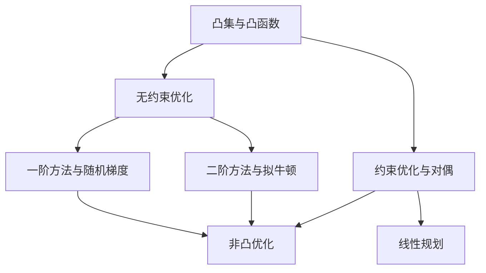

---
Title | 优化理论
-- | --
Created @ | `2026-11-24T15:22:30Z`
Updated @| `2026-11-25T09:43:13Z`
Labels | ``
Edit @| [here](https://github.com/junxnone/math/issues/76)

---
# 优化理论

优化理论研究如何在一组约束下，寻找使目标函数最小（或最大）的决策变量。从机器学习的模型训练、工程设计到资源调度，几乎所有“做到最好”的问题都可以写成优化问题。

## 核心思想

- **建模**：把问题抽象为目标函数 $f$、变量 $\mathbf{x}$ 和约束。
- **凸性**：凸问题局部最优即全局最优，有高效可靠的算法；非凸问题则困难得多。
- **算法**：利用梯度（一阶）、Hessian（二阶）或问题结构，迭代逼近最优解。
- **对偶**：每个约束问题都有对偶问题，提供下界、最优性条件（KKT）和算法设计思路。

标准形式：

$$
\min_{\mathbf{x}\in\mathbb{R}^n}\ f(\mathbf{x})\quad\text{s.t.}\quad g_i(\mathbf{x})\le0,\ \ i=1,\dots,m;\qquad h_j(\mathbf{x})=0,\ \ j=1,\dots,p
$$

其中：

- $\mathbf{x}\in\mathbb{R}^n$：决策变量；$f$：目标函数（损失、成本）
- $g_i\le0$：不等式约束；$h_j=0$：等式约束；满足所有约束的 $\mathbf{x}$ 称为可行解，其集合为可行域
- 最大化问题可通过 $\min(-f)$ 转化

## 知识地图

下图展示本系列各章的依赖关系，自上而下阅读。

图中：

- 节点是一章，箭头表示先修关系。
- 凸性是理论基础；无约束优化讨论没有约束时的算法，约束优化引入拉格朗日对偶和 KKT 条件，线性规划是最重要的特例。
- 一阶/二阶方法是两大类算法（梯度与 Hessian）；非凸优化综合以上工具，研究深度学习等现实问题。

## 系列文章

| 主题 | 内容概要 | 文章 |
| -- | -- | -- |
| 凸集与凸函数 | 凸集、凸函数判定、强凸与光滑 | [凸集与凸函数](/0077_优化理论_凸集与凸函数) |
| 无约束优化 | 最优性条件、线搜索、梯度下降、牛顿法、共轭梯度 | [无约束优化](/0078_优化理论_无约束优化) |
| 约束优化与对偶 | 拉格朗日对偶、KKT、罚函数与障碍法 | [约束优化与对偶](/0079_优化理论_约束优化与对偶) |
| 线性规划 | 标准形、单纯形法、对偶、内点法 | [线性规划](/0080_优化理论_线性规划) |
| 一阶方法与随机梯度 | SGD、动量、Adam、近端梯度 | [一阶方法与随机梯度](/0081_优化理论_一阶方法与随机梯度) |
| 二阶方法与拟牛顿 | 牛顿法、BFGS、L-BFGS、Gauss-Newton | [二阶方法与拟牛顿](/0082_优化理论_二阶方法与拟牛顿) |
| 非凸优化 | 鞍点、局部极小、全局优化策略 | [非凸优化](/0083_优化理论_非凸优化) |

表中三列依次为主题、内容概要和文章链接。已有的相关文章：[拉格朗日乘数法](/0019_Math_LMM)、[模拟退火](/0014_Math_SA)、[最小二乘](/0006_Math_LeastSquares)、[RANSAC](/0015_Math_RANSAC)、[极值与拉格朗日乘数](/0058_微积分_极值与拉格朗日乘数)。

## 关键概念速览

梯度下降与牛顿法：

$$
\mathbf{x}_{k+1}=\mathbf{x}_k-\eta\nabla f(\mathbf{x}_k),\qquad \mathbf{x}_{k+1}=\mathbf{x}_k-\bigl[\nabla^2f(\mathbf{x}_k)\bigr]^{-1}\nabla f(\mathbf{x}_k)
$$

其中 $\eta>0$ 是步长（学习率），$\nabla f$ 是梯度，$\nabla^2f$ 是 Hessian 矩阵（见 [多元函数微分](/0054_微积分_多元函数微分)）。前者只用一阶信息，后者利用曲率，在极小点附近收敛更快。

KKT 条件（约束最优性）：

$$
\nabla f+\sum_i\mu_i\nabla g_i+\sum_j\lambda_j\nabla h_j=\mathbf{0},\quad \mu_i\ge0,\quad \mu_ig_i=0
$$

其中 $\mu_i,\lambda_j$ 是拉格朗日乘数，$\mu_ig_i=0$ 是互补松弛条件（见 [约束优化与对偶](/0079_优化理论_约束优化与对偶)）。

## 问题类型一览

| 类型 | 目标 | 约束 | 难度 |
| -- | -- | -- | -- |
| 线性规划（LP） | 线性 | 线性 | 易（多项式时间） |
| 二次规划（QP） | 凸二次 | 线性 | 易 |
| 凸优化 | 凸 | 凸 | 易 |
| 整数规划 | 线性 | 线性 + 整数 | NP 难 |
| 非凸优化 | 非凸 | 任意 | 一般 NP 难，实用启发式 |

表中依次为问题类型、目标函数、约束形式和难度。识别问题所属类型是选择算法的第一步。

## 与其他主题的联系

- 微积分：梯度、Hessian、拉格朗日乘数法是工具（见 [极值与拉格朗日乘数](/0058_微积分_极值与拉格朗日乘数)）。
- 线性代数：线性方程组、矩阵分解、条件数决定算法的效率（见 [矩阵分解](/0040_线性代数_Matrix_矩阵分解)、[范数与条件数](/0045_线性代数_Matrix_范数与条件数)）。
- 概率统计：最大似然、经验风险最小化、随机梯度的方差分析（见 [点估计](/0070_数理统计_点估计)）。
- 数值计算：迭代格式的稳定性与收敛性（见 [数值计算](/0106_数值计算)）。

## 应用方向

- 机器学习：训练即最小化损失函数（线性回归、SVM、神经网络）
- 运筹学：生产计划、运输、排班、网络流
- 控制与信号处理：最优控制、稀疏重构、滤波器设计

## Reference

- Boyd & Vandenberghe, *Convex Optimization*
- Nocedal & Wright, *Numerical Optimization*
- [Mathematical optimization - Wikipedia](https://en.wikipedia.org/wiki/Mathematical_optimization)

