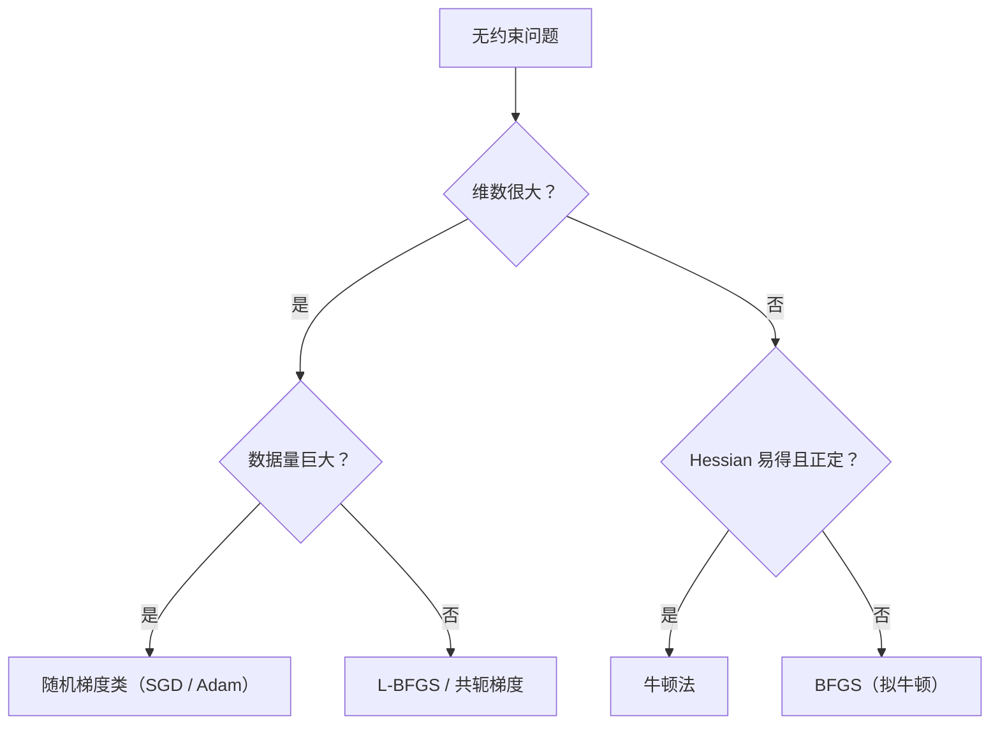

---
Title | 优化理论 无约束优化
-- | --
Created @ | `2026-11-24T15:22:34Z`
Updated @| `2026-11-24T15:22:34Z`
Labels | ``
Edit @| [here](https://github.com/junxnone/math/issues/78)

---
# 无约束优化

无约束优化 $\min_{\mathbf{x}}f(\mathbf{x})$ 是最基本的优化问题，也是约束优化、机器学习训练的算法基础。本文介绍最优性条件和基于线搜索的经典下降方法。

## 最优性条件

设 $f$ 二阶连续可微：

| 条件 | 内容 |
| -- | -- |
| 一阶必要条件 | $\mathbf{x}^*$ 是局部极小 $\Rightarrow\nabla f(\mathbf{x}^*)=\mathbf{0}$ |
| 二阶必要条件 | 同时 $\nabla^2f(\mathbf{x}^*)\succeq0$ |
| 二阶充分条件 | $\nabla f(\mathbf{x}^*)=\mathbf{0}$ 且 $\nabla^2f(\mathbf{x}^*)\succ0\Rightarrow$ 严格局部极小 |
| 凸情形 | $\nabla f(\mathbf{x}^*)=\mathbf{0}$ 即全局极小 |

表中依次为条件名称和内容。满足 $\nabla f=\mathbf{0}$ 的点称驻点，可能是极小、极大或鞍点，由 Hessian 的正定性判别（见 [极值与拉格朗日乘数](https://github.com/junxnone/math/issues/58)、[对称正定与二次型](https://github.com/junxnone/math/issues/41)）。

## 下降方法的通用框架

$$
\mathbf{x}_{k+1}=\mathbf{x}_k+\alpha_k\mathbf{d}_k,\qquad \nabla f(\mathbf{x}_k)^\top\mathbf{d}_k<0
$$

其中：

- $\mathbf{d}_k$：下降方向，条件 $\nabla f^\top\mathbf{d}<0$ 保证沿 $\mathbf{d}_k$ 走小步函数值下降（方向导数为负，见 [多元函数微分](https://github.com/junxnone/math/issues/54)）
- $\alpha_k>0$：步长，由线搜索确定
- 不同方法的区别在于如何选方向：最速下降 $\mathbf{d}=-\nabla f$，牛顿法 $\mathbf{d}=-H^{-1}\nabla f$，共轭梯度，拟牛顿等

## 线搜索

**精确线搜索**：$\alpha_k=\arg\min_\alpha f(\mathbf{x}_k+\alpha\mathbf{d}_k)$，代价高。**回溯线搜索**（Armijo 条件）：从较大的 $\alpha$ 开始，反复乘以 $\rho\in(0,1)$ 缩小，直到：

$$
f(\mathbf{x}_k+\alpha\mathbf{d}_k)\le f(\mathbf{x}_k)+c\,\alpha\,\nabla f(\mathbf{x}_k)^\top\mathbf{d}_k
$$

其中 $c\in(0,1)$（常取 $10^{-4}$）是充分下降系数，右端是按一阶近似预期下降量的 $c$ 倍。含义：实际下降至少达到线性预测的一定比例，避免步子过大；配合曲率条件（Wolfe 条件）可避免步子过小。

## 梯度下降的收敛性

$$
\mathbf{x}_{k+1}=\mathbf{x}_k-\eta\nabla f(\mathbf{x}_k)
$$

设 $f$ 是 $L$-光滑的（见 [凸集与凸函数](https://github.com/junxnone/math/issues/77)），取 $\eta=1/L$：

| 函数类 | 收敛速率 | 说明 |
| -- | -- | -- |
| 凸 | $f(\mathbf{x}_k)-f^*\le\dfrac{L\lVert\mathbf{x}_0-\mathbf{x}^*\rVert^2}{2k}$ | 次线性 $O(1/k)$ |
| $m$-强凸 | $\lVert\mathbf{x}_k-\mathbf{x}^*\rVert^2\le\bigl(1-\tfrac1\kappa\bigr)^k\lVert\mathbf{x}_0-\mathbf{x}^*\rVert^2$ | 线性（几何）收敛 |

表中依次为函数类、收敛速率和说明。其中 $f^*$ 为最优值，$\mathbf{x}^*$ 为最优解，$\kappa=L/m$ 为条件数。迭代次数约 $O(\kappa\ln(1/\varepsilon))$，条件数大时很慢。

二次函数 $f(\mathbf{x})=\frac12\mathbf{x}^\top A\mathbf{x}-\mathbf{b}^\top\mathbf{x}$（$A\succ0$）：误差沿特征向量方向分解，每步各分量乘 $1-\eta\lambda_i$；最优步长 $\eta=\dfrac2{\lambda_{\max}+\lambda_{\min}}$，收敛因子：

$$
\frac{\kappa-1}{\kappa+1},\qquad \kappa=\frac{\lambda_{\max}}{\lambda_{\min}}
$$

其中 $\lambda_{\max},\lambda_{\min}$ 是 $A$ 的最大、最小特征值（见 [特征值与特征向量](https://github.com/junxnone/math/issues/36)）。例：$\kappa=100$ 时因子 $0.98$，约需 $115$ 步误差减小为 $1/10$；$\kappa=1$（等值线是圆）一步到位。

## 共轭梯度法

求解 $A\mathbf{x}=\mathbf{b}$（$A$ 对称正定，等价于最小化二次函数）：

$$
\mathbf{x}_{k+1}=\mathbf{x}_k+\alpha_k\mathbf{p}_k,\qquad \mathbf{p}_{k+1}=-\mathbf{r}_{k+1}+\beta_k\mathbf{p}_k,\qquad \beta_k=\frac{\mathbf{r}_{k+1}^\top\mathbf{r}_{k+1}}{\mathbf{r}_k^\top\mathbf{r}_k}
$$

其中 $\mathbf{r}_k=A\mathbf{x}_k-\mathbf{b}$ 是残差（梯度），$\mathbf{p}_k$ 是搜索方向，各方向两两 $A$-共轭（$\mathbf{p}_i^\top A\mathbf{p}_j=0$）。含义：每次在新的共轭方向上精确极小化，至多 $n$ 步精确收敛；收敛因子 $\frac{\sqrt\kappa-1}{\sqrt\kappa+1}$，比梯度下降好得多。每步只需一次矩阵向量乘，适合大规模稀疏系统（见 [线性方程组的数值解法](https://github.com/junxnone/math/issues/109)）。

## 牛顿法

$$
\mathbf{x}_{k+1}=\mathbf{x}_k-\alpha_k\,H_k^{-1}\nabla f(\mathbf{x}_k),\qquad H_k=\nabla^2f(\mathbf{x}_k)
$$

其中 $H_k^{-1}\nabla f$ 通过解线性方程组 $H_k\mathbf{d}=-\nabla f$ 得到。来源：在 $\mathbf{x}_k$ 处二阶泰勒展开，二次模型的最小点（见 [中值定理与泰勒公式](https://github.com/junxnone/math/issues/51)）。极小点附近二次收敛，但每步 $O(n^3)$，$H$ 可能不正定；详见 [二阶方法与拟牛顿](https://github.com/junxnone/math/issues/82)。

## 方法选择

图中：

- 菱形是判断，矩形是推荐方法，自上而下阅读。
- 高维大数据只能用每步代价低的一阶随机方法（见 [一阶方法与随机梯度](https://github.com/junxnone/math/issues/81)）；中等规模、精确梯度可得时，拟牛顿/共轭梯度更快；低维且 Hessian 可得时牛顿法最快。

## 例

$f(x,y)=x^2+10y^2$，$\nabla f=(2x,20y)$，$\kappa=10$。从 $(1,1)$ 出发取 $\eta=0.1$：$y$ 方向因子 $1-2=-1$，不收敛；取 $\eta=0.05$：$x$ 方向因子 $0.9$，$y$ 方向 $0$，收敛但被 $x$ 方向拖慢；而牛顿法 $H^{-1}\nabla f=(x,y)$，一步到 $(0,0)$。

## 应用

- 机器学习的参数训练、最大似然估计（见 [点估计](https://github.com/junxnone/math/issues/70)）
- 解非线性方程组与最小二乘问题
- 工程中的曲线拟合、参数辨识

## Reference

- Nocedal & Wright, *Numerical Optimization*, Chapters 2–6
- [Gradient descent - Wikipedia](https://en.wikipedia.org/wiki/Gradient_descent)

