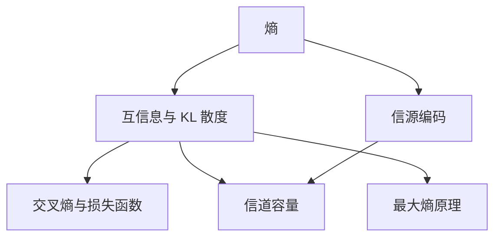

---
Title | 信息论
-- | --
Created @ | `2026-11-24T15:22:47Z`
Updated @| `2026-11-25T09:46:17Z`
Labels | ``
Edit @| [here](https://github.com/junxnone/math/issues/84)

---
# 信息论

信息论由香农（Shannon）于 1948 年创立，用数学定义“信息量”，回答两个基本问题：数据最多能被压缩到多小（信源编码），以及在有噪声的信道上最多能可靠传输多快（信道编码）。它的核心概念——熵、交叉熵、KL 散度、互信息——今天是机器学习损失函数和模型分析的基础语言。

## 核心思想

- **信息 = 惊讶程度**：越不可能发生的事件，发生时带来的信息越多。
- **熵 = 平均不确定性**：分布的平均信息量，也是无损压缩的极限。
- **散度与互信息**：衡量两个分布的差异、两个变量之间的依赖。
- **两大定理**：信源编码定理（压缩极限是熵）、信道编码定理（可靠传输的速率上限是信道容量）。

香农熵：

$$
H(X)=-\sum_xp(x)\log p(x)
$$

其中：

- $X$：离散随机变量；$p(x)$：$X=x$ 的概率（见 [随机变量与分布](/0062_概率论_随机变量与分布)）
- $\log$：底为 $2$ 时单位是比特（bit），底为 $e$ 时单位是奈特（nat）
- $-\log p(x)$：事件 $x$ 的自信息；$H(X)$ 是其期望（见 [期望方差与矩](/0064_概率论_期望方差与矩)）
- 约定 $0\log0=0$

## 知识地图

下图展示本系列各章的依赖关系，自上而下阅读。

图中：

- 节点是一章，箭头表示先修关系。
- 熵是起点；KL 散度/互信息是在熵之上定义的两类“距离/依赖”度量，向两个方向发展：机器学习中的交叉熵损失与最大熵模型，通信中的信道容量。
- 信源编码（压缩）与信道编码（纠错）合起来构成香农的通信理论。

## 系列文章

| 主题 | 内容概要 | 文章 |
| -- | -- | -- |
| 熵 | 自信息、熵、联合熵、条件熵、微分熵 | [熵](/0085_信息论_熵) |
| 互信息与 KL 散度 | KL 散度、互信息、数据处理不等式 | [互信息与 KL 散度](/0086_信息论_互信息与KL散度) |
| 交叉熵与损失函数 | 交叉熵、softmax 梯度、与最大似然的关系 | [交叉熵与损失函数](/0087_信息论_交叉熵与损失函数) |
| 信源编码 | Kraft 不等式、信源编码定理、Huffman 编码 | [信源编码](/0088_信息论_信源编码) |
| 信道容量 | 信道模型、二元对称信道、AWGN、香农公式 | [信道容量](/0089_信息论_信道容量) |
| 最大熵原理 | 最大熵分布、指数族、与 softmax 的联系 | [最大熵原理](/0090_信息论_最大熵原理) |

表中三列依次为主题、内容概要和文章链接。

## 关键公式速览

$$
D_{\mathrm{KL}}(P\Vert Q)=\sum_xp(x)\log\frac{p(x)}{q(x)},\qquad
H(P,Q)=-\sum_xp(x)\log q(x)=H(P)+D_{\mathrm{KL}}(P\Vert Q),\qquad
I(X;Y)=H(X)-H(X\mid Y)
$$

其中 $P,Q$ 是同一个空间上的两个分布，$p,q$ 是它们的概率；$D_{\mathrm{KL}}\ge0$ 衡量用 $Q$ 近似 $P$ 的代价；$H(P,Q)$ 是交叉熵；$I(X;Y)$ 是互信息，表示知道 $Y$ 之后 $X$ 的不确定性减少了多少。

## 与其他主题的联系

- 概率论：熵是分布的泛函，与期望、凸性（詹森不等式）密不可分（见 [概率论](/0059_概率论)）。
- 数理统计：最大似然等价于最小化 KL 散度，费希尔信息是 KL 散度的二阶近似（见 [点估计](/0070_数理统计_点估计)）。
- 优化理论：最大熵问题是带约束的凸优化，对偶给出指数族（见 [约束优化与对偶](/0079_优化理论_约束优化与对偶)）。
- 信号与傅里叶变换：采样与带宽决定信道容量（见 [采样定理](/0103_信号与傅里叶变换_采样定理)）。

## 应用方向

- 机器学习：交叉熵损失、变分推断（ELBO）、互信息特征选择、知识蒸馏、对比学习
- 数据压缩：Huffman、算术编码、LZ 系列、熵编码在 JPEG/视频编码中的应用
- 通信：香农容量、纠错码（汉明码、LDPC、Turbo、极化码）
- 密码学与统计物理：熵作为不确定性与无序度量

## Reference

- Cover & Thomas, *Elements of Information Theory*
- Shannon, *A Mathematical Theory of Communication* (1948)
- [Information theory - Wikipedia](https://en.wikipedia.org/wiki/Information_theory)

