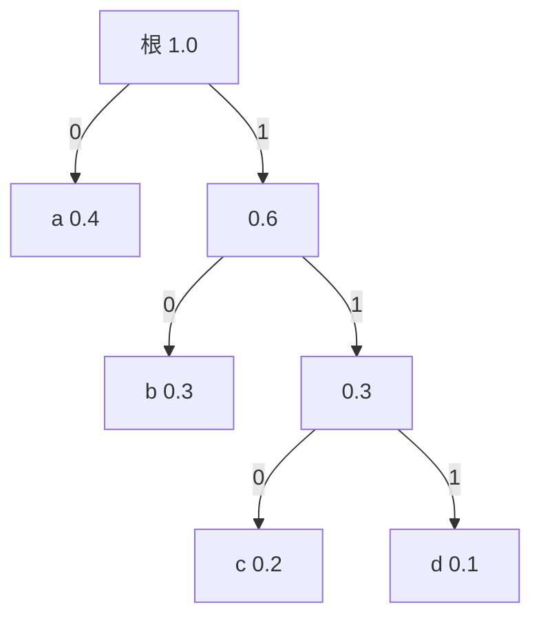

---
Title | 信息论 信源编码
-- | --
Created @ | `2026-11-24T15:22:56Z`
Updated @| `2026-11-27T01:57:58Z`
Labels | ``
Edit @| [here](https://github.com/junxnone/math/issues/88)

---
# 信源编码

信源编码（数据压缩）的任务是用尽量少的比特无损地表示信源输出。香农证明：压缩的极限正好是信源的熵。

## 编码的基本概念

- **码字**：给每个符号 $x$ 分配一个二进制串，长度 $\ell(x)$。
- **前缀码**（即时码）：任何码字都不是另一个码字的前缀，因此接收端可以逐位立即译码，不需要分隔符。
- **平均码长**：

$$
\bar L=\sum_xp(x)\,\ell(x)
$$

其中 $p(x)$ 是符号 $x$ 的概率（见 [随机变量与分布](/0062_概率论_随机变量与分布)），$\ell(x)$ 是码字长度（比特数）。目标是在可唯一译码的前提下最小化 $\bar L$。

## Kraft 不等式

存在码长为 $\ell_1,\dots,\ell_n$ 的二进制前缀码，当且仅当：

$$
\sum_{i=1}^n2^{-\ell_i}\le1
$$

其中 $\ell_i$ 是第 $i$ 个符号的码长。直观：长度 $\ell$ 的码字“占用”了二叉树中 $2^{-\ell}$ 比例的叶子，总占用不能超过整棵树。例：码长 $(1,2,3,3)$：$\tfrac12+\tfrac14+\tfrac18+\tfrac18=1$，可以构成前缀码，如 $\{0,10,110,111\}$。

## 信源编码定理

最优前缀码满足：

$$
H(X)\le\bar L^*<H(X)+1
$$

其中 $H(X)$ 是以 2 为底的熵（见 [熵](/0085_信息论_熵)）。推导：最小化 $\sum p_i\ell_i$ 受 Kraft 约束，用拉格朗日乘数法得最优码长 $\ell_i^*=-\log_2p_i$（见 [约束优化与对偶](/0079_优化理论_约束优化与对偶)），取整后得上界。对长度为 $n$ 的符号块编码，平均每符号码长趋于 $H(X)$（上界变为 $H+1/n$）。**结论：熵是无损压缩的绝对极限**。

若用基于分布 $Q$ 设计的码去压缩来自 $P$ 的数据，平均码长约为 $H(P,Q)=H(P)+D_{\mathrm{KL}}(P\Vert Q)$：KL 散度就是“用错分布的代价”（见 [交叉熵与损失函数](/0087_信息论_交叉熵与损失函数)）。

## Huffman 编码

给定符号概率，每步合并概率最小的两个节点，直到只剩一棵树；左右分支标 $0/1$，从根到叶的路径就是码字。Huffman 码是最优前缀码（最小化 $\bar L$）。

例：概率 $(0.4,\,0.3,\,0.2,\,0.1)$ 的四个符号 $a,b,c,d$：

1. 合并 $0.1+0.2=0.3$（节点 $cd$）；
2. 合并 $0.3+0.3=0.6$（节点 $bcd$）；
3. 合并 $0.4+0.6=1.0$。

图中：

- 节点内是符号及概率（内部节点是合并后的概率之和），边上的数字是码位；自上而下读出路径即码字。
- 得到码字 $a=0,\ b=10,\ c=110,\ d=111$，码长 $(1,2,3,3)$。
- 平均码长 $\bar L=0.4\cdot1+0.3\cdot2+0.2\cdot3+0.1\cdot3=1.9$ bit，熵 $H=1.846$ bit，满足 $H\le\bar L<H+1$；相比定长码（2 bit）节省约 $5\%$。

Huffman 码的局限：每个符号至少 1 比特，概率很偏时（如 $p=0.99$）浪费大；需要预先知道概率。

## 算术编码

把整个消息映射为 $[0,1)$ 中的一个子区间：每读入一个符号，按其概率把当前区间按比例切分并选取对应子区间，最后输出该区间内的一个数的二进制表示。码长约为 $-\log_2\prod p(x_i)=\sum-\log_2p(x_i)$，逼近熵，可以达到分数比特/符号，并且很容易与自适应概率模型结合。广泛用于 JPEG2000、H.264/H.265 的 CABAC。

## 通用编码与实际压缩

| 方法 | 思想 | 例子 |
| -- | -- | -- |
| 字典法（LZ77/LZ78） | 用对已出现片段的引用替换重复 | gzip、zip、PNG（DEFLATE=LZ77+Huffman） |
| 熵编码 | 按概率分配码长 | Huffman、算术编码、ANS |
| 变换编码 | 先去相关（DCT/小波），再量化与熵编码 | JPEG、MP3、视频 |
| 预测编码 | 编码预测残差 | FLAC、无损图像压缩 |

表中依次为方法、思想和例子。有损压缩在“率失真理论”框架下研究：允许失真 $D$ 时，最小码率是 $R(D)=\min_{p(\hat x\mid x):\,\mathbb{E}d\le D}I(X;\hat X)$，其中 $d$ 是失真度量，$I$ 是互信息（见 [互信息与 KL 散度](/0086_信息论_互信息与KL散度)）；变换编码依赖对信号的频域分析（见 [离散傅里叶变换与 FFT](/0102_信号与傅里叶变换_离散傅里叶变换与FFT)）。

## 应用

- 文件、图像、音视频、网络传输的压缩
- 语言模型的“压缩视角”：好的预测器就是好的压缩器（算术编码 + 概率模型）
- 熵估计与数据的可压缩性分析

## 编码方法对比

| 方法 | 思路 | 平均码长 | 特点 |
| --- | --- | --- | --- |
| Huffman 编码 | 概率大的符号用短码，构造最优前缀码 | $H\le\bar L<H+1$ | 每个符号至少 1 比特，符号概率接近 2 的幂时最优 |
| 算术编码 | 把整个序列编码成 $[0,1)$ 内的一个区间 | 趋近于 $H$ | 不受「整数比特」限制，压缩率更高，实现更复杂 |
| 通用编码（LZ 系列） | 不需要预知概率，用字典 / 重复片段 | 渐近趋近熵率 | 实际压缩工具（gzip、zstd）的基础 |

表中：$H$ 为信源熵；对比结论：理论极限由熵给出，Huffman 简单高效，算术编码更接近极限，通用编码不依赖先验。

## 在机器学习中的作用

- 语言模型的困惑度对应对数据的压缩能力：好的预测就是好的压缩，见 [交叉熵与损失函数](https://github.com/junxnone/math/issues/87)
- 词元化（BPE）与 Huffman / 压缩思想相通：把高频片段合并为单个符号
- 熵编码用于模型权重压缩（Deep Compression 中的 Huffman 编码）

## 常见误区

- 无损压缩有理论下限（熵），不可能对所有数据都压缩：对随机数据任何压缩算法都无效
- Huffman 码的最优性只对「每个符号单独编码」成立；联合编码（块编码、算术编码）可以更好
- 前缀码（无前缀条件）才保证可以唯一译码，Kraft 不等式 $\sum 2^{-l_i}\le1$ 是其存在的充要条件

## Reference

- Cover & Thomas, *Elements of Information Theory*, Chapters 5
- [Huffman coding - Wikipedia](https://en.wikipedia.org/wiki/Huffman_coding)

