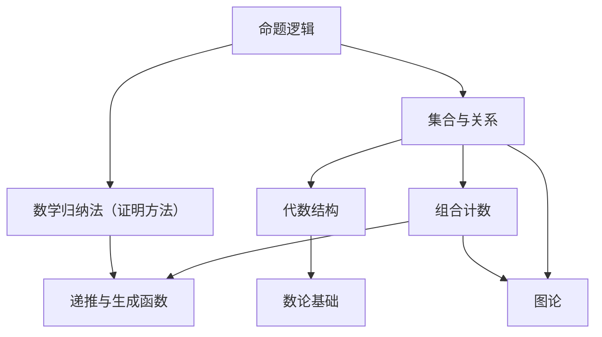

---
Title | 离散数学
-- | --
Created @ | `2026-11-24T15:23:02Z`
Updated @| `2026-11-24T15:23:02Z`
Labels | ``
Edit @| [here](https://github.com/junxnone/math/issues/91)

---
# 离散数学

离散数学研究“可数的、分立的”数学对象——整数、集合、逻辑命题、图、组合结构。与微积分处理连续量不同，离散数学是计算机科学的数学基础：算法分析、数据结构、数据库、密码学、形式验证都建立在它之上。

## 核心思想

- **集合与关系**：万物皆集合，关系与函数刻画对象之间的联系。
- **逻辑与证明**：命题逻辑和谓词逻辑给出严格推理的规则，归纳法是证明递归结构的主要工具。
- **计数**：不逐个枚举而计算对象的个数（排列组合、容斥、递推）。
- **代数结构与数论**：群、环、域以及整数的同余性质，是编码和密码的数学来源。
- **图论**：用点和边建模网络与关系（已有专文）。

## 知识地图

下图展示本系列各章的依赖关系，自上而下阅读。

图中：

- 节点是一章，箭头表示先修关系。
- 逻辑是语言与证明工具；集合与关系是对象和结构；其后分成计数线（组合计数 → 递推与生成函数）和代数线（代数结构 → 数论）。
- 归纳法既是证明方法，也是递推式的理论依据；图论综合运用集合关系与计数（见已有文章 [图论](https://github.com/junxnone/math/issues/22)、[二分图](https://github.com/junxnone/math/issues/23)）。

## 系列文章

| 主题 | 内容概要 | 文章 |
| -- | -- | -- |
| 集合与关系 | 集合运算、关系性质、等价关系、偏序、函数 | [集合与关系](https://github.com/junxnone/math/issues/92) |
| 命题逻辑 | 联结词、等值演算、范式、推理、归纳法 | [命题逻辑](https://github.com/junxnone/math/issues/93) |
| 组合计数 | 排列组合、二项式定理、容斥原理、鸽巢原理 | [组合计数](https://github.com/junxnone/math/issues/94) |
| 代数结构 | 群、环、域、子群与拉格朗日定理 | [代数结构](https://github.com/junxnone/math/issues/95) |
| 数论基础 | 整除、最大公约数、同余、欧拉定理、RSA | [数论基础](https://github.com/junxnone/math/issues/96) |
| 递推与生成函数 | 线性递推、生成函数、分治递归的复杂度 | [递推与生成函数](https://github.com/junxnone/math/issues/97) |

表中三列依次为主题、内容概要和文章链接。图论相关：[图论](https://github.com/junxnone/math/issues/22)、[二分图](https://github.com/junxnone/math/issues/23)。

## 关键公式速览

容斥原理（两个集合）与二项式系数：

$$
|A\cup B|=|A|+|B|-|A\cap B|,\qquad \binom nk=\frac{n!}{k!\,(n-k)!}
$$

其中 $|A|$ 是集合 $A$ 的元素个数，$\cup,\cap$ 是并与交，$n!$ 是阶乘，$\binom nk$ 是从 $n$ 个元素中选 $k$ 个的组合数。

欧拉定理：

$$
\gcd(a,n)=1\ \Longrightarrow\ a^{\varphi(n)}\equiv1\pmod n
$$

其中 $\varphi(n)$ 是欧拉函数（$1,\dots,n$ 中与 $n$ 互素的数的个数），$\equiv$ 表示模 $n$ 同余，是 RSA 加密的数学基础。

## 与其他主题的联系

- 概率论：古典概型就是计数问题（见 [概率空间与公理](https://github.com/junxnone/math/issues/60)）。
- 线性代数：关系可以表示为布尔矩阵，路径计数用矩阵幂（见 [矩阵乘积](https://github.com/junxnone/math/issues/27)）。
- 数值计算：整数运算、浮点表示是离散的（见 [误差与浮点数](https://github.com/junxnone/math/issues/107)）。
- 信息论：编码需要组合与有限域代数（见 [信源编码](https://github.com/junxnone/math/issues/88)）。

## 应用方向

- 算法与复杂度：递推式、组合计数估算运行时间；动态规划（见 [Dynamic Programming](https://github.com/junxnone/math/issues/10)）
- 密码学：模运算、RSA、椭圆曲线、有限域
- 数据库与形式化方法：关系代数、逻辑、模型检验、SAT/SMT 求解
- 网络与图：路由、调度、匹配

## Reference

- Kenneth Rosen, *Discrete Mathematics and Its Applications*
- 屈婉玲等，《离散数学》
- [Discrete mathematics - Wikipedia](https://en.wikipedia.org/wiki/Discrete_mathematics)

