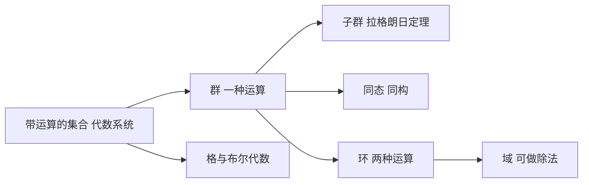

---
Title | 离散数学 代数结构
-- | --
Created @ | `2026-11-24T15:23:10Z`
Updated @| `2026-11-27T01:58:10Z`
Labels | ``
Edit @| [here](https://github.com/junxnone/math/issues/95)

---
# 代数结构

代数结构研究“带有运算的集合”。群、环、域抽象出加减乘除的共同规律，使同一套定理能用于整数、矩阵、多项式、置换和有限域。它是密码学、编码理论、对称性分析的数学基础。

## 概念关系图

图中：代数结构按运算的数量和性质逐步增强：群（一种运算）、环（两种运算）、域（可除）；同态与同构比较不同结构；格与布尔代数是另一条线，与逻辑和集合运算对应。

## 运算与代数系统

集合 $S$ 上的二元运算 $*:S\times S\to S$ 要求**封闭**：$a*b\in S$。重要性质：

| 性质 | 定义 |
| -- | -- |
| 结合律 | $(a*b)*c=a*(b*c)$ |
| 交换律 | $a*b=b*a$ |
| 单位元 $e$ | $a*e=e*a=a$ |
| 逆元 $a^{-1}$ | $a*a^{-1}=a^{-1}*a=e$ |

表中依次为性质和定义。例：整数的加法满足全部（单位元 $0$，逆元 $-a$）；矩阵乘法满足结合律、有单位元 $I$，但不满足交换律，且只有可逆矩阵有逆元（见 [矩阵乘积](/0027_线性代数_Matrix_矩阵乘积)、[逆](/0031_线性代数_Matrix_逆)）。

## 群

$(G,*)$ 是**群**，若运算封闭、满足结合律、有单位元、每个元素有逆元。交换律也成立时称**阿贝尔群**（交换群）。

| 例子 | 运算 | 是否交换 | 说明 |
| -- | -- | -- | -- |
| $(\mathbb{Z},+)$ | 加法 | 是 | 无限循环群，由 $1$ 生成 |
| $(\mathbb{Z}_n,+)$ | 模 $n$ 加法 | 是 | $n$ 阶循环群 |
| $(\mathbb{R}\setminus\{0\},\times)$ | 乘法 | 是 | |
| $GL_n(\mathbb{R})$ | 矩阵乘法 | 否（$n\ge2$） | $n$ 阶可逆实矩阵 |
| $S_n$ | 复合 | 否（$n\ge3$） | $n$ 个元素的置换群，阶 $n!$ |
| 旋转群 $SO(n)$ | 复合 | 否（$n\ge3$） | 行列式为 1 的正交矩阵（见 [正交矩阵](/0032_线性代数_Matrix_正交矩阵)） |

表中依次为群、运算、是否交换和说明。旋转矩阵构成的群 $SO(3)$ 是三维刚体运动的数学描述（见 [线性变换](/0039_线性代数_线性变换)）。

**模 $n$ 加法群** $\mathbb{Z}_4=\{0,1,2,3\}$ 的运算表（加法后取模 4）：

| $+$ | 0 | 1 | 2 | 3 |
| -- | -- | -- | -- | -- |
| 0 | 0 | 1 | 2 | 3 |
| 1 | 1 | 2 | 3 | 0 |
| 2 | 2 | 3 | 0 | 1 |
| 3 | 3 | 0 | 1 | 2 |

表中第一行和第一列是运算对象，格子是它们的和（模 4）。每行每列都是 $\{0,1,2,3\}$ 的一个排列（群的特征），关于主对角线对称（交换），单位元是 $0$，$1$ 与 $3$ 互逆，$2$ 的逆是自身。

## 子群与拉格朗日定理

$H\subseteq G$ 且在同一运算下自身构成群，称子群。**拉格朗日定理**：有限群 $G$ 的子群 $H$ 的阶整除 $G$ 的阶：

$$
|G|=[G:H]\cdot|H|
$$

其中 $|G|$ 是群的阶（元素个数），$[G:H]$ 是 $H$ 在 $G$ 中陪集的个数（指数）。原因：$G$ 被 $H$ 的左陪集 $gH$ 划分成大小都为 $|H|$ 的互不相交块（等价关系的划分，见 [集合与关系](/0092_离散数学_集合与关系)）。推论：

- 元素 $g$ 的阶（最小的 $k$ 使 $g^k=e$）整除 $|G|$，所以 $g^{|G|}=e$
- 阶为素数的群必是循环群
- 由此可证费马小定理与欧拉定理（取 $G=\mathbb{Z}_p^\times$ 或 $\mathbb{Z}_n^\times$，见 [数论基础](/0096_离散数学_数论基础)）

## 同态与同构

映射 $\phi:G\to H$ 保持运算 $\phi(a*b)=\phi(a)\star\phi(b)$，称同态；双射同态称同构（结构完全相同）。例：$\exp:(\mathbb{R},+)\to(\mathbb{R}_{>0},\times)$，$\exp(a+b)=\exp(a)\exp(b)$ 是同构；行列式 $\det:GL_n\to\mathbb{R}^\times$ 是群同态，因为 $\det(AB)=\det A\det B$（见 [Determinant](/0003_线性代数_Determinant)）。同态的核 $\ker\phi=\{g\mid\phi(g)=e\}$ 是正规子群（类似线性映射的核，见 [线性变换](/0039_线性代数_线性变换)）。

## 环与域

- **环** $(R,+,\cdot)$：$(R,+)$ 是阿贝尔群，乘法封闭、结合，且乘法对加法分配 $a(b+c)=ab+ac$。例：$\mathbb{Z}$、$\mathbb{Z}_n$、多项式环 $\mathbb{R}[x]$、$n$ 阶矩阵环（乘法不可交换，有零因子）。
- **域** $F$：交换环，且每个非零元素有乘法逆元，即可以做加、减、乘、除。例：$\mathbb{Q},\mathbb{R},\mathbb{C}$。
- **有限域** $\mathbb{F}_p=\mathbb{Z}_p$（$p$ 素数）：$\mathbb{Z}_n$ 是域当且仅当 $n$ 为素数（需要 $\gcd(a,n)=1$ 才有模逆，见 [数论基础](/0096_离散数学_数论基础)）。更一般地，有限域存在当且仅当元素个数是素数幂 $p^m$，记 $\mathrm{GF}(p^m)$（如 AES 用 $\mathrm{GF}(2^8)$）。

线性代数定义在域上：向量空间是域上的“模”，把 $\mathbb{R}$ 换成 $\mathbb{F}_2$ 或 $\mathbb{F}_{2^8}$，线性方程组、秩、逆的理论依然成立（见 [向量空间](/0034_线性代数_向量空间)）。

## 格与布尔代数

偏序集中任意两元素都有上确界（并 $\vee$）和下确界（交 $\wedge$），称**格**。有补的分配格是**布尔代数**：集合的并交补、命题的或与非（见 [命题逻辑](/0093_离散数学_命题逻辑)）、数字电路的逻辑门都是它的模型。

## 例

- $\mathbb{Z}_5$ 中 $3\times4=12\equiv2$；$3^{-1}=2$（$3\times2=6\equiv1$）。非零元素对乘法构成 $4$ 阶循环群，$2$ 是生成元：$2^1,2^2,2^3,2^4=2,4,3,1$。
- $S_3$ 有 $6$ 个元素，是最小的非交换群；它的子群阶数只可能是 $1,2,3,6$（拉格朗日定理）。

## 应用

- 密码学：RSA 用 $\mathbb{Z}_n^\times$，Diffie-Hellman 与椭圆曲线用循环群的离散对数难题，AES 用 $\mathrm{GF}(2^8)$
- 编码理论：线性码是 $\mathbb{F}_q^n$ 的子空间，里德-所罗门码用有限域上的多项式（见 [信道容量](/0089_信息论_信道容量)）
- 物理与图形：对称群、旋转群、李群；魔方的群结构
- 程序语言与分布式系统：幺半群（结合律 + 单位元）支持并行归约（MapReduce）

## 常见结构对比

| 结构 | 运算 | 必须满足 | 例子 |
| --- | --- | --- | --- |
| 半群 | 一种 | 封闭、结合律 | 正整数加法 |
| 幺半群 | 一种 | 再加单位元 | 字符串拼接 |
| 群 | 一种 | 再加逆元 | 整数加法、非零实数乘法、置换群 |
| 环 | 两种（加、乘） | 加法构成交换群，乘法结合，分配律 | 整数 $\mathbb{Z}$、矩阵环 |
| 域 | 两种 | 环中非零元素对乘法有逆 | $\mathbb{Q},\mathbb{R},\mathbb{C}$，有限域 $\mathbb{F}_p$ |

表中：对比结论：从上到下约束依次增加，能做的运算（如除法）也依次增多。

## 在机器学习中的作用

- 群论与等变神经网络：用对称群（平移、旋转）设计卷积和对称性不变的模型；旋转群见 [正交矩阵](https://github.com/junxnone/math/issues/32)
- 有限域与纠错码、密码学（RSA、椭圆曲线），见 [数论基础](https://github.com/junxnone/math/issues/96)
- 布尔代数：逻辑电路与二值化神经网络

## 常见误区

- 群的运算**不一定可交换**（置换群、矩阵乘法）；交换群（阿贝尔群）是特例
- 环不要求乘法有逆，也不一定有单位元的约定因教材而异；$\mathbb{Z}$ 是环但不是域
- 同态保持运算但不必是一一对应；同构才是「结构完全相同」的重命名

## Reference

- Kenneth Rosen, *Discrete Mathematics and Its Applications*, Chapter 13
- Joseph Gallian, *Contemporary Abstract Algebra*
- [Group (mathematics) - Wikipedia](https://en.wikipedia.org/wiki/Group_(mathematics))

