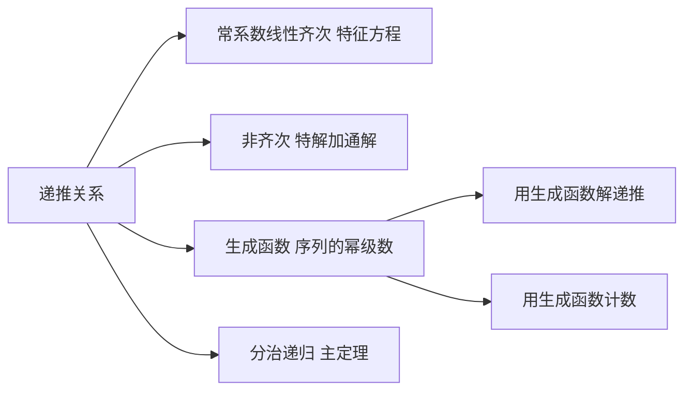

---
Title | 离散数学 递推与生成函数
-- | --
Created @ | `2026-11-24T15:23:36Z`
Updated @| `2026-11-27T02:09:35Z`
Labels | ``
Edit @| [here](https://github.com/junxnone/math/issues/97)

---
# 递推与生成函数

递推关系用前面的项定义后面的项，是描述递归过程和计数问题的自然语言；生成函数把整个序列“打包”成一个幂级数，用代数运算解决递推与计数。它们是算法复杂度分析的主要工具。

## 概念关系图

图中：递推关系可以用特征方程（线性常系数）或生成函数求解；生成函数还能直接用于计数；分治算法的复杂度递推用主定理分析。

## 递推关系

序列 $\{a_n\}$ 由初始值和递推式确定。例：

- 斐波那契：$F_n=F_{n-1}+F_{n-2}$，$F_0=0,\ F_1=1$
- 汉诺塔：$T_n=2T_{n-1}+1$，$T_1=1$（移动 $n$ 个盘子的最少步数）
- 错排数：$D_n=(n-1)(D_{n-1}+D_{n-2})$（见 [组合计数](/0094_离散数学_组合计数)）
- 卡特兰数：$C_{n+1}=\sum_{i=0}^nC_iC_{n-i}$

解递推就是求出通项公式或渐近阶。

## 常系数线性齐次递推

$$
a_n=c_1a_{n-1}+c_2a_{n-2}\quad\Longrightarrow\quad r^2-c_1r-c_2=0\ \ \text{（特征方程）}
$$

其中 $c_1,c_2$ 是常数，$r$ 是特征根。试探解 $a_n=r^n$ 代入即得特征方程。通解：

| 特征根 | 通解 |
| -- | -- |
| 两个不同根 $r_1,r_2$ | $a_n=\alpha r_1^n+\beta r_2^n$ |
| 重根 $r$ | $a_n=(\alpha+\beta n)r^n$ |
| 共轭复根 $\rho e^{\pm i\theta}$ | $a_n=\rho^n(\alpha\cos n\theta+\beta\sin n\theta)$ |

表中依次为特征根情形和通解，常数 $\alpha,\beta$ 由初值确定。这与线性常微分方程的特征方程解法完全对应（见 [常微分方程](/0057_微积分_常微分方程)）。

例：$a_n=5a_{n-1}-6a_{n-2}$，$a_0=1,\ a_1=4$。特征方程 $r^2-5r+6=0$，根 $2,3$，$a_n=\alpha2^n+\beta3^n$；由 $\alpha+\beta=1$，$2\alpha+3\beta=4$ 得 $\beta=2,\ \alpha=-1$，

$$
a_n=2\cdot3^n-2^n
$$

验证：$a_2=5\cdot4-6\cdot1=14$，公式 $2\cdot9-4=14$ ✓。

**斐波那契通项（Binet 公式）**：

$$
F_n=\frac{\varphi^n-\psi^n}{\sqrt5},\qquad \varphi=\frac{1+\sqrt5}2\approx1.618,\ \ \psi=\frac{1-\sqrt5}2\approx-0.618
$$

其中 $\varphi,\psi$ 是 $r^2=r+1$ 的两个根（$\varphi$ 即黄金比例）。因为 $|\psi|<1$，$F_n\approx\varphi^n/\sqrt5$，增长是指数的。矩阵形式：

$$
\begin{bmatrix}F_{n+1}\\F_n\end{bmatrix}=\begin{bmatrix}1&1\\1&0\end{bmatrix}^n\begin{bmatrix}1\\0\end{bmatrix}
$$

其中矩阵的特征值恰好是 $\varphi,\psi$（见 [特征值与特征向量](/0036_线性代数_特征值与特征向量)），用快速幂 $O(\log n)$ 计算 $F_n$（见 [矩阵乘积](/0027_线性代数_Matrix_矩阵乘积)）。

## 非齐次递推

解 = 齐次通解 + 一个特解。汉诺塔 $T_n=2T_{n-1}+1$：特解取常数 $T=-1$，齐次解 $\alpha2^n$，故 $T_n=\alpha2^n-1$，由 $T_1=1$ 得 $\alpha=1$，$T_n=2^n-1$。展开法验证：$T_n=2T_{n-1}+1=4T_{n-2}+2+1=\cdots=2^{n-1}T_1+(2^{n-1}-1)=2^n-1$。

## 生成函数

序列 $\{a_n\}$ 的（普通）生成函数：

$$
G(x)=\sum_{n=0}^\infty a_nx^n
$$

其中 $x$ 是形式变量（通常不关心收敛性），$a_n$ 是 $x^n$ 的系数。常用对应关系（幂级数见 [级数](/0053_微积分_级数)）：

| 序列 | 生成函数 |
| -- | -- |
| $1,1,1,\dots$ | $\dfrac1{1-x}$ |
| $\binom nk$（$k=0..n$） | $(1+x)^n$ |
| $\binom{n+k-1}{k}$（$k\ge0$） | $\dfrac1{(1-x)^n}$ |
| $c^n$ | $\dfrac1{1-cx}$ |
| $n$ | $\dfrac x{(1-x)^2}$ |

表中依次为序列和生成函数，$\binom{n+k-1}{k}$ 即可重组合数（见 [组合计数](/0094_离散数学_组合计数)）。运算规则：

- 位移：$\{a_{n-1}\}\leftrightarrow xG(x)$；求和：$\{\sum_{k\le n}a_k\}\leftrightarrow\dfrac{G(x)}{1-x}$
- **乘积对应卷积**：$G(x)H(x)$ 的系数是 $c_n=\sum_{k=0}^na_kb_{n-k}$（见 [卷积](/0100_信号与傅里叶变换_卷积)）——这使“独立选择”的计数与独立随机变量和的分布（见 [多维随机变量与协方差](/0065_概率论_多维随机变量与协方差)）都成为乘法。

## 用生成函数解递推

斐波那契：$F(x)=\sum F_nx^n$。由递推 $F_n-F_{n-1}-F_{n-2}=0$（$n\ge2$）：

$$
F(x)-xF(x)-x^2F(x)=F_0+(F_1-F_0)x=x\ \Longrightarrow\ F(x)=\frac x{1-x-x^2}
$$

其中左边每项是整体或位移后的生成函数。分母因式分解 $1-x-x^2=(1-\varphi x)(1-\psi x)$，部分分式后展开几何级数，就得到 Binet 公式。

## 用生成函数计数

每类物品的选择方式对应一个因子，总方案数是乘积的系数。例：用 $1$ 元与 $2$ 元硬币凑 $n$ 元的方法数是 $\dfrac1{(1-x)(1-x^2)}$ 中 $x^n$ 的系数，即 $\lfloor n/2\rfloor+1$（$n=5$：$5=1\cdot5=1\cdot3+2=1+2\cdot2$，共 $3$ 种）。若再加 $5$ 元硬币则乘 $\dfrac1{1-x^5}$。

**卡特兰数**：$C(x)=\sum C_nx^n$ 由递推 $C_{n+1}=\sum C_iC_{n-i}$ 得 $C(x)=1+xC(x)^2$，解得：

$$
C(x)=\frac{1-\sqrt{1-4x}}{2x}\ \Longrightarrow\ C_n=\frac1{n+1}\binom{2n}n
$$

其中根号用二项式的广义展开得到系数。

## 分治递归与主定理

分治算法的运行时间满足 $T(n)=aT(n/b)+f(n)$：把规模 $n$ 的问题分成 $a$ 个规模 $n/b$ 的子问题，合并代价 $f(n)$。当 $f(n)=\Theta(n^d)$（常数 $d\ge0$）：

$$
T(n)=\begin{cases}\Theta(n^d)&d>\log_ba\\\Theta(n^d\log n)&d=\log_ba\\\Theta\bigl(n^{\log_ba}\bigr)&d<\log_ba\end{cases}
$$

其中 $a\ge1$ 是子问题个数，$b>1$ 是规模缩小倍数。含义：比较“合并代价”与“叶子总数 $n^{\log_ba}$”谁占主导。

| 算法 | 递推 | $a,b,d$ | 结果 |
| -- | -- | -- | -- |
| 二分查找 | $T(n)=T(n/2)+1$ | $1,2,0$ | $\Theta(\log n)$ |
| 归并排序 | $T(n)=2T(n/2)+n$ | $2,2,1$ | $\Theta(n\log n)$ |
| Karatsuba 乘法 | $T(n)=3T(n/2)+n$ | $3,2,1$ | $\Theta(n^{1.585})$ |
| Strassen 矩阵乘法 | $T(n)=7T(n/2)+n^2$ | $7,2,2$ | $\Theta(n^{2.807})$ |

表中依次为算法、递推式、参数 $(a,b,d)$ 和复杂度。Strassen 算法使 $n\times n$ 矩阵乘法低于朴素的 $\Theta(n^3)$（见 [矩阵乘积](/0027_线性代数_Matrix_矩阵乘积)）。

## 应用

- 算法分析：递归程序的时间复杂度、动态规划的状态转移（见 [动态规划进阶](/0010_离散数学_递推与生成函数_动态规划进阶)）
- 组合计数：划分数、路径数、树的计数
- 概率：概率母函数 $G(s)=\mathbb{E}[s^X]$ 对应离散随机变量，卷积即独立和（见 [期望方差与矩](/0064_概率论_期望方差与矩)）
- 离散动力系统：线性差分方程的稳定性由特征根模长决定（见 [常微分方程](/0057_微积分_常微分方程)）

## 在机器学习中的作用

- 算法复杂度分析：分治类算法（归并排序、快速傅里叶变换）的 $T(n)=aT(n/b)+f(n)$ 用主定理求解，见 [离散傅里叶变换与FFT](https://github.com/junxnone/math/issues/102)
- 动态规划的转移方程本身就是递推关系，见 [动态规划进阶](https://github.com/junxnone/math/issues/10)
- 时间序列的自回归模型 AR 是线性递推；递归神经网络的隐状态更新也是递推

## 常见误区

- 特征方程有**重根**时，通解形式要乘以 $n$ 的幂（如 $(c_1+c_2n)r^n$），不能只写 $r^n$
- 非齐次递推的解 = 齐次通解 + 一个特解，初始条件要代入**完整解**后确定常数，而不是只代入齐次部分
- 主定理只适用于「子问题规模按比例缩小」的形式，不适用于所有分治递推

## Reference

- Kenneth Rosen, *Discrete Mathematics and Its Applications*, Chapters 5, 8
- Graham, Knuth & Patashnik, *Concrete Mathematics*
- [Generating function - Wikipedia](https://en.wikipedia.org/wiki/Generating_function)

