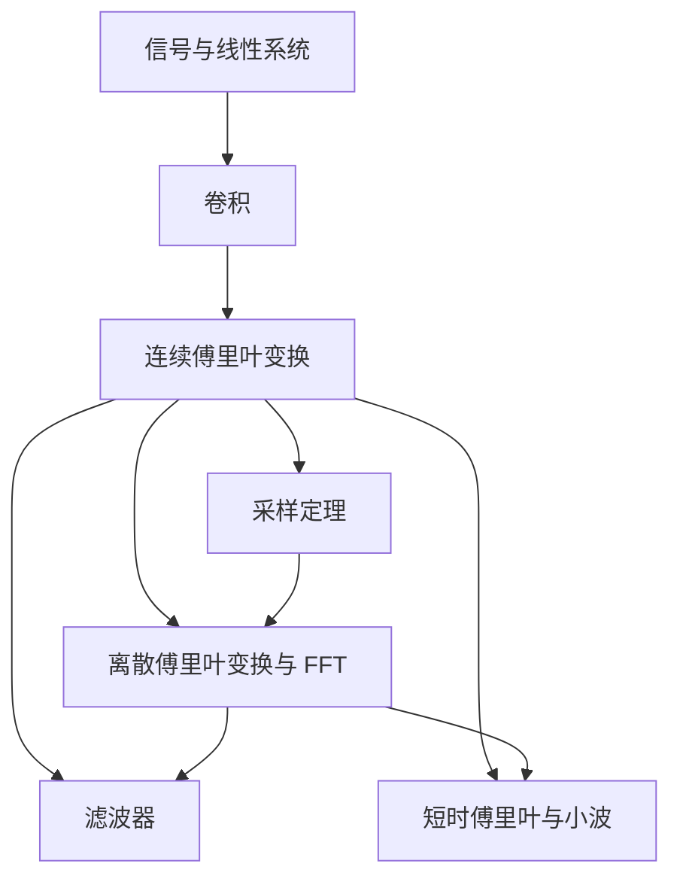

---
Title | 信号与傅里叶变换
-- | --
Created @ | `2026-11-24T15:23:39Z`
Updated @| `2026-11-24T15:23:39Z`
Labels | ``
Edit @| [here](https://github.com/junxnone/math/issues/98)

---
# 信号与傅里叶变换

信号是随时间（或空间）变化的量——声音、图像、传感器读数、股价。信号处理研究如何分析、变换和过滤信号；傅里叶变换把信号分解成不同频率的正弦成分，揭示出时域中看不到的结构，是整个领域的核心工具。

## 核心思想

- **信号与系统**：系统把输入信号变成输出信号；线性时不变（LTI）系统完全由其冲激响应刻画，输出是输入与冲激响应的卷积。
- **频域视角**：任何（合理的）信号都是不同频率正弦波的叠加；LTI 系统对每个频率分量只做幅度缩放和相位移动，卷积在频域变成乘法。
- **离散化**：采样把连续信号变成数字序列，采样定理给出不丢信息的条件；FFT 让频域计算足够快。
- **时频分析**：全局傅里叶变换丢失了“何时”的信息，短时傅里叶和小波变换同时给出时间和频率。

傅里叶变换对：

$$
X(\omega)=\int_{-\infty}^{+\infty}x(t)\,e^{-j\omega t}\,dt,\qquad x(t)=\frac1{2\pi}\int_{-\infty}^{+\infty}X(\omega)\,e^{j\omega t}\,d\omega
$$

其中：

- $x(t)$：时域信号；$X(\omega)$：频谱，$\omega$（rad/s）是角频率，$\omega=2\pi f$，$f$ 是频率（Hz）
- $j$：虚数单位（工程中用 $j$ 代替 $i$）；$e^{-j\omega t}=\cos\omega t-j\sin\omega t$（欧拉公式，见 [级数](https://github.com/junxnone/math/issues/53)）
- $|X(\omega)|$ 是各频率分量的幅度，$\arg X(\omega)$ 是相位；第二式是逆变换，把各频率分量叠加还原信号

## 知识地图

下图展示本系列各章的依赖关系，自上而下阅读。

图中：

- 节点是一章，箭头表示先修关系。
- 主线：信号与系统 → 卷积（LTI 系统的输出）→ 傅里叶变换（把卷积变乘法）。
- 之后分叉：采样定理连接连续与离散，DFT/FFT 是数字实现，滤波器是 LTI 系统在频域的设计，时频分析处理非平稳信号。

## 系列文章

| 主题 | 内容概要 | 文章 |
| -- | -- | -- |
| 信号与线性系统 | 基本信号、系统性质、LTI、冲激响应 | [信号与线性系统](https://github.com/junxnone/math/issues/99) |
| 卷积 | 定义、性质、翻转滑动、二维卷积 | [卷积](https://github.com/junxnone/math/issues/100) |
| 连续傅里叶变换 | 变换对、性质、常见变换、不确定性原理 | [连续傅里叶变换](https://github.com/junxnone/math/issues/101) |
| 离散傅里叶变换与 FFT | DFT、FFT 算法、泄漏与窗 | [离散傅里叶变换与 FFT](https://github.com/junxnone/math/issues/102) |
| 采样定理 | 奈奎斯特、混叠、重建 | [采样定理](https://github.com/junxnone/math/issues/103) |
| 滤波器 | FIR/IIR、频率响应、设计 | [滤波器](https://github.com/junxnone/math/issues/104) |
| 短时傅里叶与小波 | STFT、频谱图、小波变换 | [短时傅里叶与小波](https://github.com/junxnone/math/issues/105) |

表中三列依次为主题、内容概要和文章链接。

## 关键定理速览

卷积定理：

$$
y(t)=(x*h)(t)\ \Longleftrightarrow\ Y(\omega)=X(\omega)\,H(\omega)
$$

其中 $x$ 是输入，$h$ 是系统的冲激响应，$y$ 是输出；$X,H,Y$ 是它们的傅里叶变换。时域的卷积（复杂）变成频域的乘法（简单）。

帕塞瓦尔定理：

$$
\int|x(t)|^2dt=\frac1{2\pi}\int|X(\omega)|^2d\omega
$$

其中左边是信号总能量，右边是频谱的能量；变换保持能量（类似正交变换保持长度，见 [正交矩阵](https://github.com/junxnone/math/issues/32)）。

## 与其他主题的联系

- 线性代数：DFT 是一个酉矩阵；复指数是 LTI 系统（卷积算子）的特征函数，傅里叶变换就是对它们的对角化（见 [特征值与特征向量](https://github.com/junxnone/math/issues/36)、[向量空间](https://github.com/junxnone/math/issues/34)）。
- 微积分：傅里叶级数、积分变换、微分方程（见 [级数](https://github.com/junxnone/math/issues/53)、[常微分方程](https://github.com/junxnone/math/issues/57)）。
- 概率论：特征函数就是概率密度的傅里叶变换；独立变量和的密度是卷积（见 [多维随机变量与协方差](https://github.com/junxnone/math/issues/65)）。
- 信息论：带宽与信噪比决定信道容量（见 [信道容量](https://github.com/junxnone/math/issues/89)）。

## 应用方向

- 音频：压缩（MP3/AAC）、降噪、语音识别（梅尔频谱）
- 图像与视频：JPEG（DCT）、卷积神经网络、去模糊
- 通信：调制解调、OFDM（用 IFFT 实现）、均衡
- 雷达、医学成像（MRI 的 k 空间就是傅里叶域）、地震与振动分析

## Reference

- Oppenheim & Willsky, *Signals and Systems*
- Oppenheim & Schafer, *Discrete-Time Signal Processing*
- [Fourier transform - Wikipedia](https://en.wikipedia.org/wiki/Fourier_transform)

