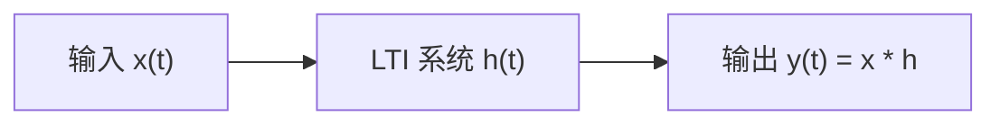

---
Title | 信号与傅里叶变换 信号与线性系统
-- | --
Created @ | `2026-11-24T15:23:42Z`
Updated @| `2026-11-25T09:50:50Z`
Labels | ``
Edit @| [here](https://github.com/junxnone/math/issues/99)

---
# 信号与线性系统

本章建立信号与系统的基本语言：信号如何分类、系统有哪些关键性质，以及为什么“线性时不变”系统最容易分析——它的全部行为由一个函数（冲激响应）决定。

## 信号的分类与基本信号

- **连续时间信号** $x(t)$（$t\in\mathbb{R}$）与**离散时间信号** $x[n]$（$n\in\mathbb{Z}$，由采样得到，见 [采样定理](/0103_信号与傅里叶变换_采样定理)）。
- **周期信号**：存在 $T>0$ 使 $x(t+T)=x(t)$。
- **能量与功率**：

$$
E=\int_{-\infty}^{+\infty}|x(t)|^2\,dt,\qquad P=\lim_{T\to\infty}\frac1{2T}\int_{-T}^{T}|x(t)|^2\,dt
$$

其中 $E$ 是总能量（有限时称能量信号），$P$ 是平均功率（周期信号、噪声通常是功率信号）。

基本信号：

| 信号 | 定义 | 作用 |
| -- | -- | -- |
| 单位阶跃 $u(t)$ | $t<0$ 为 0，$t\ge0$ 为 1 | 描述“开关” |
| 单位冲激 $\delta(t)$ | $\delta(t)=0\ (t\ne0)$，$\int\delta(t)dt=1$ | 采样与系统探测；$u'(t)=\delta(t)$ |
| 正弦 $A\cos(\omega t+\phi)$ | 幅度 $A$，角频率 $\omega$，相位 $\phi$ | 频率分析的基本元素 |
| 复指数 $e^{st}$，$s=\sigma+j\omega$ | $\sigma$ 控制衰减/增长，$\omega$ 控制振荡 | LTI 系统的特征函数 |

表中依次为信号、定义和作用。冲激不是普通函数而是**广义函数**，其核心性质是筛选：$\int x(t)\delta(t-t_0)dt=x(t_0)$。离散冲激 $\delta[n]$ 在 $n=0$ 处为 1，其余为 0，任何离散信号可以写成 $x[n]=\sum_kx[k]\delta[n-k]$（加权冲激的叠加）。

信号的基本运算：时移 $x(t-t_0)$（延迟）、反转 $x(-t)$、尺度 $x(at)$（$|a|>1$ 压缩，波形变快，频率升高）。

## 系统的性质

系统 $\mathcal{T}$ 把输入 $x$ 映射为输出 $y=\mathcal{T}\{x\}$。关键性质：

| 性质 | 定义 | 例子 |
| -- | -- | -- |
| 线性 | $\mathcal{T}\{ax_1+bx_2\}=a\mathcal{T}\{x_1\}+b\mathcal{T}\{x_2\}$ | $y=3x$ 线性，$y=x^2$ 非线性 |
| 时不变 | $x(t-t_0)\to y(t-t_0)$ | $y=x(t)$ 时不变，$y=tx(t)$ 时变 |
| 因果 | 输出只依赖当前与过去的输入 | $y(t)=x(t-1)$ 因果，$y(t)=x(t+1)$ 非因果 |
| 稳定（BIBO） | 有界输入产生有界输出 | 积分器 $y=\int x$ 不稳定 |
| 无记忆 | 输出只依赖当前输入 | $y=2x$ 无记忆 |

表中依次为性质、定义和例子。其中线性的定义与 [线性变换](/0039_线性代数_线性变换) 完全一致：线性系统就是函数空间上的线性算子。

## LTI 系统与冲激响应

**线性时不变（LTI）系统**的响应完全由它对单位冲激的响应 $h(t)=\mathcal{T}\{\delta(t)\}$（冲激响应）决定。把输入分解为加权、延迟的冲激，利用线性和时不变性：

$$
y(t)=\int_{-\infty}^{+\infty}x(\tau)\,h(t-\tau)\,d\tau=(x*h)(t),\qquad y[n]=\sum_{k=-\infty}^{\infty}x[k]\,h[n-k]
$$

其中：

- $x$：输入；$h$：冲激响应；$y$：输出；$\tau,k$：积分/求和的哑变量（输入中冲激的位置）
- 含义：每个输入样本 $x(\tau)$ 触发一个被缩放、延迟的冲激响应 $x(\tau)h(t-\tau)$，输出是它们的总和——这就是**卷积**（详见 [卷积](/0100_信号与傅里叶变换_卷积)）
- 性质与 $h$ 的关系：因果 $\iff h(t)=0\ (t<0)$；BIBO 稳定 $\iff\int|h(t)|dt<\infty$（离散：$\sum|h[n]|<\infty$）

图中：

- 从左到右是信号流向：输入通过由冲激响应 $h$ 刻画的 LTI 系统得到输出，输出等于输入与 $h$ 的卷积。
- 级联系统的总冲激响应是各 $h$ 的卷积，并联系统是各 $h$ 之和；由于卷积可交换，级联顺序不影响结果。

## 复指数是特征函数

输入 $x(t)=e^{j\omega t}$ 时：

$$
y(t)=\int h(\tau)e^{j\omega(t-\tau)}d\tau=e^{j\omega t}\int h(\tau)e^{-j\omega\tau}d\tau=H(j\omega)\,e^{j\omega t},\qquad H(j\omega)=\int h(\tau)e^{-j\omega\tau}d\tau
$$

其中 $H(j\omega)$ 是系统的**频率响应**（冲激响应的傅里叶变换）。含义：复指数经过 LTI 系统后形状不变，只是被乘以一个复数 $H(j\omega)$（改变幅度 $|H|$ 与相位 $\arg H$）。这正是线性代数中“特征向量经变换后只被缩放”的函数空间版本：$e^{j\omega t}$ 是特征函数，$H(j\omega)$ 是特征值（见 [特征值与特征向量](/0036_线性代数_特征值与特征向量)）。把任意信号分解成复指数的叠加（傅里叶分析）就把系统的作用化为对每个分量的乘法（见 [连续傅里叶变换](/0101_信号与傅里叶变换_连续傅里叶变换)）。

## 微分方程与差分方程

LTI 系统通常由常系数方程描述：

$$
\text{连续：}\ \sum_{k=0}^Na_k\frac{d^ky}{dt^k}=\sum_{k=0}^Mb_k\frac{d^kx}{dt^k},\qquad
\text{离散：}\ y[n]=\sum_{k=1}^{N}\alpha_ky[n-k]+\sum_{k=0}^{M}\beta_kx[n-k]
$$

其中 $a_k,b_k,\alpha_k,\beta_k$ 是常数系数。例：

- **RC 低通电路**：$RC\,y'+y=x$，冲激响应 $h(t)=\dfrac1{RC}e^{-t/RC}u(t)$，因果且稳定，频率响应 $H(j\omega)=\dfrac1{1+j\omega RC}$（解法见 [常微分方程](/0057_微积分_常微分方程)）。
- **一阶递归滤波器**：$y[n]=ay[n-1]+x[n]$，$h[n]=a^nu[n]$，当且仅当 $|a|<1$ 时稳定（与线性递推的特征根判据一致，见 [递推与生成函数](/0097_离散数学_递推与生成函数)）。

## 应用

- 电路与控制系统的建模与稳定性分析
- 音频效果（混响 = 与房间冲激响应卷积）、图像模糊（点扩散函数）
- 通信信道建模（多径 = 若干延迟冲激的叠加）
- 数字滤波器设计（见 [滤波器](/0104_信号与傅里叶变换_滤波器)）

## Reference

- Oppenheim & Willsky, *Signals and Systems*, Chapters 1–2
- [Linear time-invariant system - Wikipedia](https://en.wikipedia.org/wiki/Linear_time-invariant_system)

