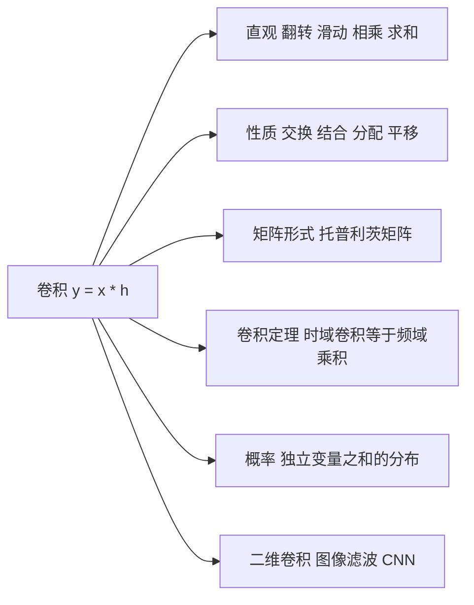

---
Title | 信号与傅里叶变换 卷积
-- | --
Created @ | `2026-11-24T15:23:45Z`
Updated @| `2026-11-27T01:59:38Z`
Labels | ``
Edit @| [here](https://github.com/junxnone/math/issues/100)

---
# 卷积

卷积是 LTI 系统输出、概率中独立变量之和、图像滤波与卷积神经网络的共同运算：把一个函数翻转后在另一个函数上滑动，逐点加权求和。

## 概念关系图

图中：卷积可以从翻转滑动的过程理解；满足交换、结合、分配律；写成矩阵是托普利茨矩阵；在频域变成乘积（卷积定理，FFT 加速的原理）；在概率中给出独立变量之和的分布，在图像与神经网络中是二维卷积。

## 定义

$$
(f*g)(t)=\int_{-\infty}^{+\infty}f(\tau)\,g(t-\tau)\,d\tau,\qquad (f*g)[n]=\sum_{k=-\infty}^{\infty}f[k]\,g[n-k]
$$

其中：

- $f,g$：两个函数（或序列）；$\tau,k$：哑变量；$t,n$：输出位置
- $g(t-\tau)$：把 $g$ 翻转（$\tau\to-\tau$）再平移 $t$
- 含义：输出在 $t$ 处的值，是 $f$ 与翻转平移后的 $g$ 的重叠乘积的积分（积分见 [积分](/0052_微积分_积分)）；$g$ 常称“核”或“滤波器”

## 翻转-滑动的直观过程

计算 $y[n]=\sum_kx[k]h[n-k]$ 的步骤：

1. 把 $h[k]$ 翻转得 $h[-k]$；
2. 平移 $n$ 得 $h[n-k]$；
3. 与 $x[k]$ 逐点相乘并求和；
4. 对每个 $n$ 重复。

例：$x=[1,2,3]$，$h=[1,1]$（均从 $n=0$ 开始）：

| $n$ | 计算 | $y[n]$ |
| -- | -- | -- |
| 0 | $x[0]h[0]$ | $1$ |
| 1 | $x[0]h[1]+x[1]h[0]$ | $1+2=3$ |
| 2 | $x[1]h[1]+x[2]h[0]$ | $2+3=5$ |
| 3 | $x[2]h[1]$ | $3$ |

表中依次为输出位置、涉及的乘积和结果，得 $y=[1,3,5,3]$。输出长度 $N_x+N_h-1=3+2-1=4$。这里 $h=[1,1]$ 是两点求和，$y$ 就是相邻两样本之和（移动平均的未归一化形式，见 [滤波器](/0104_信号与傅里叶变换_滤波器)）。

连续例：宽度为 $1$ 的矩形函数 $\Pi(t)$ 与自身卷积得到底宽 $2$、峰值 $1$ 的三角函数：积分的重叠面积随平移先线性增大到 1 再线性减小到 0。

## 性质

| 性质 | 公式 |
| -- | -- |
| 交换律 | $f*g=g*f$ |
| 结合律 | $(f*g)*h=f*(g*h)$ |
| 分配律 | $f*(g+h)=f*g+f*h$ |
| 单位元 | $f*\delta=f$ |
| 平移 | $f(t-a)*g(t)=(f*g)(t-a)$ |
| 求导 | $(f*g)'=f'*g=f*g'$ |

表中依次为性质和公式。单位元性质说明冲激是卷积的“1”（见 [信号与线性系统](/0099_信号与傅里叶变换_信号与线性系统)）。这些性质与乘法非常相似，正是因为傅里叶变换把卷积变成乘法（见下文）。

## 矩阵形式

离散卷积是线性运算，可以写成矩阵乘以向量。$y=h*x$ 对应 **Toeplitz 矩阵**（每条对角线元素相同）：

$$
\begin{bmatrix}y_0\\y_1\\y_2\\y_3\end{bmatrix}=\begin{bmatrix}h_0&0&0\\h_1&h_0&0\\h_2&h_1&h_0\\0&h_2&h_1\end{bmatrix}\begin{bmatrix}x_0\\x_1\\x_2\end{bmatrix}
$$

其中 $h_0,h_1,h_2$ 是核的三个系数，$x\in\mathbb{R}^3$，输出长度为 $3+3-1=5$ 的前几项（此处示意截取 4 行）。周期（循环）卷积对应**循环矩阵**，其特征向量就是傅里叶基，特征值是 $h$ 的 DFT——这就是卷积定理的线性代数解释（见 [离散傅里叶变换与 FFT](/0102_信号与傅里叶变换_离散傅里叶变换与FFT)、[特征值与特征向量](/0036_线性代数_特征值与特征向量)）。

## 卷积定理

$$
\mathcal{F}\{f*g\}=\mathcal{F}\{f\}\cdot\mathcal{F}\{g\},\qquad \mathcal{F}\{f\cdot g\}=\frac1{2\pi}\,\mathcal{F}\{f\}*\mathcal{F}\{g\}
$$

其中 $\mathcal{F}$ 是傅里叶变换（见 [连续傅里叶变换](/0101_信号与傅里叶变换_连续傅里叶变换)）。时域卷积等于频域乘法，反之亦然。意义：直接卷积 $N$ 点与 $M$ 点序列需要 $O(NM)$ 次乘法，而用 FFT 做“变换—相乘—逆变换”只需 $O(L\log L)$（$L\ge N+M-1$，补零避免循环混叠），长核时快得多。

## 相关与互相关

$$
(f\star g)(\tau)=\int f^*(t)\,g(t+\tau)\,dt
$$

其中 $f^*$ 是 $f$ 的复共轭，$\tau$ 是滞后量。互相关不翻转 $g$，衡量两个信号在不同延迟下的相似度，用于模板匹配、时延估计（雷达、声纳）。与卷积的关系：$f\star g=\tilde f*g$，其中 $\tilde f(t)=f^*(-t)$。自相关的傅里叶变换是功率谱（维纳-辛钦定理）。**注意**：深度学习框架里所谓的“卷积层”实际计算的是互相关（不翻转核）；因为核是学出来的，翻转与否不影响表达能力。

## 概率中的卷积

独立随机变量 $X,Y$ 之和的密度是各自密度的卷积：

$$
f_{X+Y}=f_X*f_Y
$$

其中 $f_X,f_Y$ 是概率密度（见 [多维随机变量与协方差](/0065_概率论_多维随机变量与协方差)）。例：两个均匀分布 $U(0,1)$ 之和的密度是三角形；由卷积定理，和的特征函数是各特征函数之积；中心极限定理可以理解为“反复自卷积趋于高斯”（见 [大数定律与中心极限定理](/0066_概率论_大数定律与中心极限定理)）。多项式乘法的系数也是卷积，对应生成函数的乘积（见 [递推与生成函数](/0097_离散数学_递推与生成函数)）。

## 二维卷积与图像

$$
(I*K)[i,j]=\sum_{u}\sum_{v}I[i-u,\,j-v]\,K[u,v]
$$

其中 $I$ 是图像，$K$ 是小的二维核（如 $3\times3$）。例：

- 均值模糊：$K=\tfrac19\begin{bmatrix}1&1&1\\1&1&1\\1&1&1\end{bmatrix}$；高斯模糊用高斯核（可分离：先行后列，复杂度从 $k^2$ 降到 $2k$，见 [Gaussian Filter](/0021_信号与傅里叶变换_滤波器_高斯滤波器进阶)）。
- 边缘检测：Sobel 核 $\begin{bmatrix}-1&0&1\\-2&0&2\\-1&0&1\end{bmatrix}$ 近似水平方向偏导（见 [多元函数微分](/0054_微积分_多元函数微分)）。
- 输出尺寸：边长 $n$、核 $k$、步长 $s$、填充 $p$ 时为 $\lfloor(n+2p-k)/s\rfloor+1$。

## 应用

- 信号处理：滤波、去噪、系统响应
- 深度学习：卷积神经网络（参数共享、平移等变）
- 概率统计：求和分布、核密度估计（见 [重采样与非参数方法](/0075_数理统计_重采样与非参数方法)）
- 数值计算：大整数/多项式乘法（FFT 卷积）

## 常见误区

- 卷积要先把一个函数**翻转**再滑动；不翻转的是「互相关」，在 CNN 实现中常称卷积但实际是互相关，见本文「相关与互相关」一节
- 卷积结果的长度：离散卷积 $N+M-1$；而 DFT 实现的是**循环卷积**，要补零才等于线性卷积，见 [离散傅里叶变换与FFT](https://github.com/junxnone/math/issues/102)
- 卷积的交换、结合律使得多个滤波器可以先合并，但边界处理（填充方式）会影响边缘处的结果

## Reference

- Oppenheim & Willsky, *Signals and Systems*, Chapter 2
- [Convolution - Wikipedia](https://en.wikipedia.org/wiki/Convolution)

