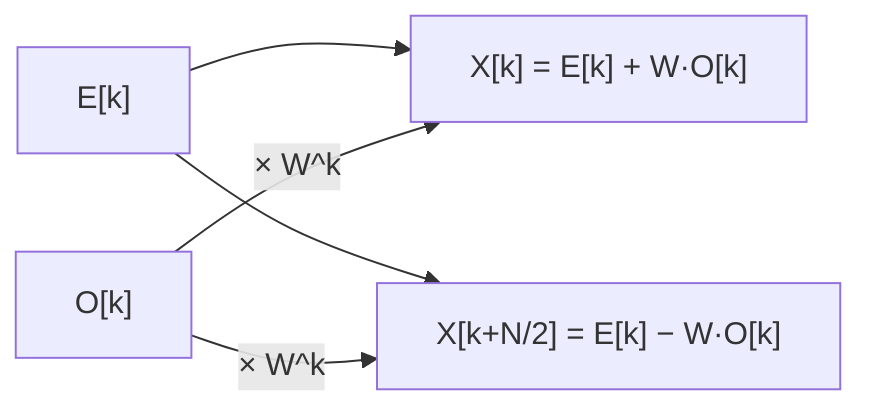

---
Title | 信号与傅里叶变换 离散傅里叶变换与FFT
-- | --
Created @ | `2026-11-24T15:23:53Z`
Updated @| `2026-11-25T09:50:56Z`
Labels | ``
Edit @| [here](https://github.com/junxnone/math/issues/102)

---
# 离散傅里叶变换与 FFT

计算机只能处理有限长的离散数据。离散傅里叶变换（DFT）是傅里叶变换在有限序列上的版本，快速傅里叶变换（FFT）把它的计算量从 $O(N^2)$ 降到 $O(N\log N)$，使频域方法在实践中成为可能。

## DFT 的定义

长度为 $N$ 的序列 $x[0],\dots,x[N-1]$：

$$
X[k]=\sum_{n=0}^{N-1}x[n]\,W_N^{kn},\qquad x[n]=\frac1N\sum_{k=0}^{N-1}X[k]\,W_N^{-kn},\qquad W_N=e^{-j2\pi/N}
$$

其中：

- $n$：时间索引；$k$：频率索引（$k=0,\dots,N-1$）
- $W_N$：$N$ 次单位根（旋转因子），满足 $W_N^N=1$、$W_N^{N/2}=-1$
- $X[k]$：第 $k$ 个频率分量（对应频率 $f_k=k f_s/N$，$f_s$ 为采样率）；$X[0]$ 是各样本之和（直流分量）
- 第二式是逆变换（IDFT），系数 $\frac1N$ 使变换可逆

例：$x=[1,2,3,4]$，$N=4$，$W_4=-j$：

$$
X[0]=10,\quad X[1]=1+2(-j)+3(-1)+4(j)=-2+2j,\quad X[2]=1-2+3-4=-2,\quad X[3]=-2-2j
$$

其中 $X[1]$ 与 $X[3]$ 互为共轭——实序列的 DFT 满足 $X[N-k]=X[k]^*$。验证帕塞瓦尔：$\sum|x|^2=30$，$\tfrac1N\sum|X|^2=\tfrac14(100+8+4+8)=30$ ✓。

## 矩阵形式与线性代数视角

$$
\mathbf{X}=F\mathbf{x},\qquad F_{kn}=W_N^{kn},\qquad F^{-1}=\frac1NF^*
$$

其中 $F$ 是 $N\times N$ 的 DFT 矩阵（范德蒙德矩阵，对称），$F^*$ 是其共轭转置。归一化后 $\frac1{\sqrt N}F$ 是**酉矩阵**（复数域上的正交矩阵，见 [正交矩阵](/0032_线性代数_Matrix_正交矩阵)）：DFT 就是把向量表示到一组标准正交的复指数基 $\{e^{j2\pi kn/N}\}$ 下（基变换，见 [向量空间](/0034_线性代数_向量空间)），保持长度（帕塞瓦尔）。直接计算 $F\mathbf{x}$ 是 $N^2$ 次复数乘法。

## 性质

- **周期性**：$X[k+N]=X[k]$，$x[n+N]=x[n]$；DFT 隐含地把序列视为周期延拓。
- **循环卷积定理**：

$$
x\circledast h\ \longleftrightarrow\ X[k]\cdot H[k],\qquad (x\circledast h)[n]=\sum_{m=0}^{N-1}x[m]\,h[(n-m)\bmod N]
$$

其中 $\circledast$ 表示 $N$ 点循环卷积，下标 $\bmod N$ 表示索引环绕。线性卷积要补零到 $L\ge N_x+N_h-1$ 才等于循环卷积（见 [卷积](/0100_信号与傅里叶变换_卷积)）。循环卷积矩阵的特征向量就是 DFT 基（见 [特征值与特征向量](/0036_线性代数_特征值与特征向量)）。

- **频率分辨率**：$\Delta f=f_s/N=1/(NT_s)$，观测时间越长分辨率越高；补零不增加真实分辨率，只是对频谱插值。

## FFT：快速算法

Cooley-Tukey 基-2 算法（$N=2^m$）：把序列按偶、奇下标分成两半：

$$
X[k]=\underbrace{\sum_{r}x[2r]\,W_{N/2}^{kr}}_{E[k]}+W_N^k\underbrace{\sum_{r}x[2r+1]\,W_{N/2}^{kr}}_{O[k]},\qquad
\begin{cases}X[k]=E[k]+W_N^kO[k]\\X[k+\tfrac N2]=E[k]-W_N^kO[k]\end{cases}
$$

其中：

- $E[k],O[k]$：偶数、奇数下标子序列的 $N/2$ 点 DFT（$k=0,\dots,N/2-1$）
- $W_N^k$：旋转因子；第二组等式用到 $W_N^{k+N/2}=-W_N^k$ 与 $E,O$ 的周期性
- 一个 $N$ 点 DFT 被分解为两个 $N/2$ 点 DFT 加 $N/2$ 次“蝶形”运算

图中：

- 这是一个“蝶形”运算单元：两个输入 $E[k]$ 与 $O[k]$（后者先乘旋转因子 $W^k$），输出和与差两个结果，每个蝶形只需 $1$ 次复数乘法、$2$ 次加法。
- 递归地继续拆分直到长度为 $1$（$1$ 点 DFT 就是自身），共 $\log_2N$ 级，每级 $N/2$ 个蝶形。

复杂度递推 $T(N)=2T(N/2)+\Theta(N)$，由主定理（见 [递推与生成函数](/0097_离散数学_递推与生成函数)）得 $\Theta(N\log N)$：

| $N$ | 直接 DFT（$N^2$） | FFT（约 $\tfrac N2\log_2N$） | 加速比 |
| -- | -- | -- | -- |
| $1024$ | $1.05\times10^6$ | $5.1\times10^3$ | 约 $200$ |
| $2^{20}$ | $1.1\times10^{12}$ | $1.0\times10^7$ | 约 $10^5$ |

表中依次为序列长度、两种方法的乘法次数和加速比；规模越大差距越悬殊，这使实时频谱分析、大数乘法成为可能。其他算法：基-4、分裂基、任意长度（Bluestein）、实数 FFT（利用共轭对称节省一半）、多维 FFT（逐维做）。

## 频谱泄漏与窗函数

DFT 隐含假设序列在 $N$ 点上是周期的。若信号频率不是 $f_s/N$ 的整数倍，截断相当于乘矩形窗，频谱出现旁瓣并向邻近频率“泄漏”。对策：

- 乘窗函数（Hann、Hamming、Blackman）使端点平滑过渡到 0，降低旁瓣，代价是主瓣变宽（分辨率下降）；
- 增加观测时间，或做周期截断。

例：$f_s=1000$ Hz，$N=1000$（$\Delta f=1$ Hz），$50$ Hz 正弦刚好落在 $k=50$ 一根谱线；$50.5$ Hz 的正弦能量散布到多根谱线。

## 应用

- 频谱分析：音频、振动、通信信号的频率成分（见 [连续傅里叶变换](/0101_信号与傅里叶变换_连续傅里叶变换)）
- 快速卷积与相关：长滤波、图像处理、大整数/多项式乘法
- 图像压缩（DCT 是 DFT 的实数变体，JPEG 使用）
- 通信：OFDM 调制（IFFT 发射、FFT 接收）
- 微分方程的谱方法、MRI 重建

## Reference

- Oppenheim & Schafer, *Discrete-Time Signal Processing*, Chapters 8–9
- [Fast Fourier transform - Wikipedia](https://en.wikipedia.org/wiki/Fast_Fourier_transform)

