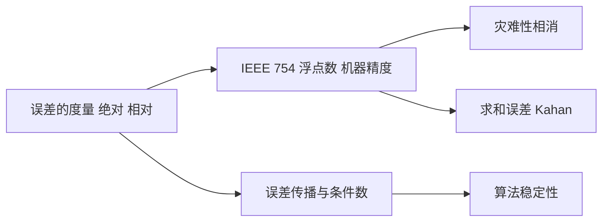

---
Title | 数值计算 误差与浮点数
-- | --
Created @ | `2026-11-24T15:24:09Z`
Updated @| `2026-11-27T01:59:52Z`
Labels | ``
Edit @| [here](https://github.com/junxnone/math/issues/107)

---
# 误差与浮点数

计算机里的“实数”其实是有限个二进制浮点数。理解它们如何表示、如何舍入、什么时候会出问题，是写出可靠数值程序的前提。

## 概念关系图

图中：先定义绝对与相对误差；浮点数有有限精度（机器精度），由此产生灾难性相消与求和误差；问题的条件数和算法的稳定性共同决定最终的数值误差。

## 误差的度量

设真值 $x$，近似值 $\tilde x$：

$$
\text{绝对误差}=|\tilde x-x|,\qquad \text{相对误差}=\frac{|\tilde x-x|}{|x|}\ (x\ne0)
$$

其中相对误差是无量纲的，更能反映精度；相对误差约 $5\times10^{-k}$ 时有约 $k$ 位有效数字。例：$\pi\approx3.1416$ 的相对误差约 $2.3\times10^{-6}$，约 $5$–$6$ 位有效数字。

## IEEE 754 浮点数

一个浮点数表示为：

$$
x=(-1)^s\times(1.f)_2\times2^{e-\text{bias}}
$$

其中 $s$ 是符号位，$f$ 是小数部分（尾数，隐含前导 1），$e$ 是指数。常用格式：

| 格式 | 总位数 | 符号 | 指数 | 尾数 | 有效十进制位 | 机器精度 $u$ |
| -- | -- | -- | -- | -- | -- | -- |
| 半精度 FP16 | 16 | 1 | 5 | 10 | 约 3 | $2^{-11}\approx4.9\times10^{-4}$ |
| bfloat16 | 16 | 1 | 8 | 7 | 约 2 | $2^{-8}\approx3.9\times10^{-3}$ |
| 单精度 FP32 | 32 | 1 | 8 | 23 | 约 7 | $2^{-24}\approx6.0\times10^{-8}$ |
| 双精度 FP64 | 64 | 1 | 11 | 52 | 约 16 | $2^{-53}\approx1.1\times10^{-16}$ |

表中依次为格式、总位数、符号/指数/尾数位数、有效十进制位数和机器精度 $u$（单位舍入误差）。bfloat16 保留与 FP32 相同的指数范围，在深度学习中用于降低内存而不易溢出。

**舍入模型**：

$$
\mathrm{fl}(x)=x(1+\delta),\ \ |\delta|\le u;\qquad \mathrm{fl}(a\circ b)=(a\circ b)(1+\delta),\ \circ\in\{+,-,\times,\div\}
$$

其中 $\mathrm{fl}(\cdot)$ 表示浮点结果，$\delta$ 是相对舍入误差，$u$ 为机器精度。**机器 epsilon** $\varepsilon_{\text{mach}}=2^{-52}\approx2.2\times10^{-16}$ 是 $1$ 与下一个可表示数之差（$u=\varepsilon/2$）。

后果：

- 大部分十进制小数无法精确表示：在双精度下 $0.1+0.2=0.30000000000000004\ne0.3$，所以判断相等要用容差 $|a-b|\le\text{tol}\cdot\max(|a|,|b|)$。
- 浮点数不均匀：数越大，相邻数间隔越大（相对间隔恒定）。大数加小数，小数会被“吞掉”：$10^{16}+1=10^{16}$（双精度）。
- 运算不满足结合律：$(a+b)+c\ne a+(b+c)$，并行求和的顺序不同结果会有微小差异。
- 范围：双精度约 $\pm1.8\times10^{308}$，超出为溢出（$\pm\infty$），小于约 $2.2\times10^{-308}$ 下溢（逐步趋于 0，次正规数）；特殊值 $\mathrm{NaN}$（如 $0/0$）。

## 灾难性相消

两个相近的数相减，高位有效数字抵消，只剩下被舍入误差污染的低位：

$$
f(x)=\frac{1-\cos x}{x^2},\qquad x=10^{-8}
$$

其中 $x=10^{-8}$ 时 $\cos x=1-5\times10^{-17}$，在双精度下舍入为 $1$，于是 $1-\cos x=0$，$f=0$，而真值 $\approx\tfrac12$（泰勒展开 $1-\cos x\approx x^2/2$，见 [中值定理与泰勒公式](/0051_微积分_中值定理与泰勒公式)）。改写为等价但稳定的形式：

$$
1-\cos x=2\sin^2\frac x2\ \Longrightarrow\ f(x)=\frac12\Bigl(\frac{\sin(x/2)}{x/2}\Bigr)^2
$$

其中 $\sin(x/2)/(x/2)\to1$（重要极限，见 [极限与连续](/0049_微积分_极限与连续)），不再有相消，得 $f\approx0.5$。

常见稳定化技巧：

| 问题式 | 稳定改写 |
| -- | -- |
| $\sqrt{x+1}-\sqrt x$（$x$ 大） | $\dfrac1{\sqrt{x+1}+\sqrt x}$ |
| $e^x-1$（$x$ 小） | 用库函数 `expm1(x)` |
| $\ln(1+x)$（$x$ 小） | 用库函数 `log1p(x)` |
| 二次方程 $ax^2+bx+c=0$ 的小根 | 先算大根 $x_1=\dfrac{-b-\mathrm{sign}(b)\sqrt{b^2-4ac}}{2a}$，再用 $x_2=c/(ax_1)$ |
| $\ln\sum e^{z_i}$ | 减去最大值：$m+\ln\sum e^{z_i-m}$（见 [交叉熵与损失函数](/0087_信息论_交叉熵与损失函数)） |

表中依次为容易出问题的式子和稳定的写法，共同原则：避免相近数相减、避免极大/极小数的混合、利用库函数。

## 求和的误差

朴素求和 $n$ 个数的误差界约 $O(nu)$，对 $n=10^8$ 的单精度累加可能严重丢失精度。改进：成对（树形）求和 $O(u\log n)$、Kahan 补偿求和（保留低位误差项）把误差降到 $O(u)$。深度学习中大批量求和、归约常用高精度累加器。

## 误差传播与条件数

由泰勒展开（见 [导数与微分](/0050_微积分_导数与微分)），输入误差 $\delta x$ 引起输出误差：

$$
f(x+\delta x)-f(x)\approx f'(x)\,\delta x\ \Longrightarrow\ \frac{|\delta y|}{|y|}\approx\kappa\frac{|\delta x|}{|x|},\quad \kappa=\Bigl|\frac{xf'(x)}{f(x)}\Bigr|
$$

其中 $\kappa$ 是 $f$ 在 $x$ 处的相对条件数。例：$f(x)=\sqrt x$，$\kappa=\tfrac12$（良条件）；$f(x)=x-1$ 在 $x\approx1$ 处 $\kappa=\bigl|\tfrac{x}{x-1}\bigr|\to\infty$（病态，这就是相消的本质）。矩阵求逆、线性方程组的条件数见 [范数与条件数](/0045_线性代数_Matrix_范数与条件数)。

## 稳定性

- **向前稳定**：算出的 $\tilde y$ 与真解 $y$ 相差小。
- **向后稳定**：算出的 $\tilde y$ 是邻近输入 $x+\delta x$ 的精确解（$\delta x$ 在舍入量级）。向后稳定算法的向前误差 $\lesssim\kappa\cdot u$，因此在良条件问题上也精确。
- 例：带部分选主元的高斯消元（LU）实践中向后稳定；不选主元时可能灾难性失败（见 [矩阵分解](/0040_线性代数_Matrix_矩阵分解)）。

## 数值验证建议

- 比较 FP32 与 FP64 结果，差异大说明问题病态或算法不稳。
- 用扰动输入（加 $10^{-8}$ 量级噪声）测试敏感度。
- 避免显式求逆和形成 $A^\top A$（会使条件数平方），优先用 QR/SVD（见 [线性方程组](/0035_线性代数_线性方程组)）。

## 应用

- 科学计算、金融计算（货币用定点/十进制类型避免二进制舍入）
- 深度学习：混合精度训练（FP16/bfloat16 前向 + FP32 主权重），损失缩放避免梯度下溢
- 图形学与游戏：大坐标下浮点精度抖动（相对原点偏移）

## 常见误区

- 浮点数不满足结合律：$(a+b)+c\ne a+(b+c)$ 在有限精度下可能不等；并行求和的顺序会改变结果
- 不要用 `==` 比较两个浮点数，应使用相对容差
- 数值问题要区分「问题的条件数」（问题本身是否敏感）与「算法的稳定性」（算法是否放大误差），后者可以改善，前者不能，见 [范数与条件数](https://github.com/junxnone/math/issues/45)
- float16 / bfloat16 的指数与尾数位数不同：前者精度高范围小，后者范围大精度低，混合精度训练要据此选用

## Reference

- Higham, *Accuracy and Stability of Numerical Algorithms*
- Goldberg, *What Every Computer Scientist Should Know About Floating-Point Arithmetic*
- [IEEE 754 - Wikipedia](https://en.wikipedia.org/wiki/IEEE_754)

