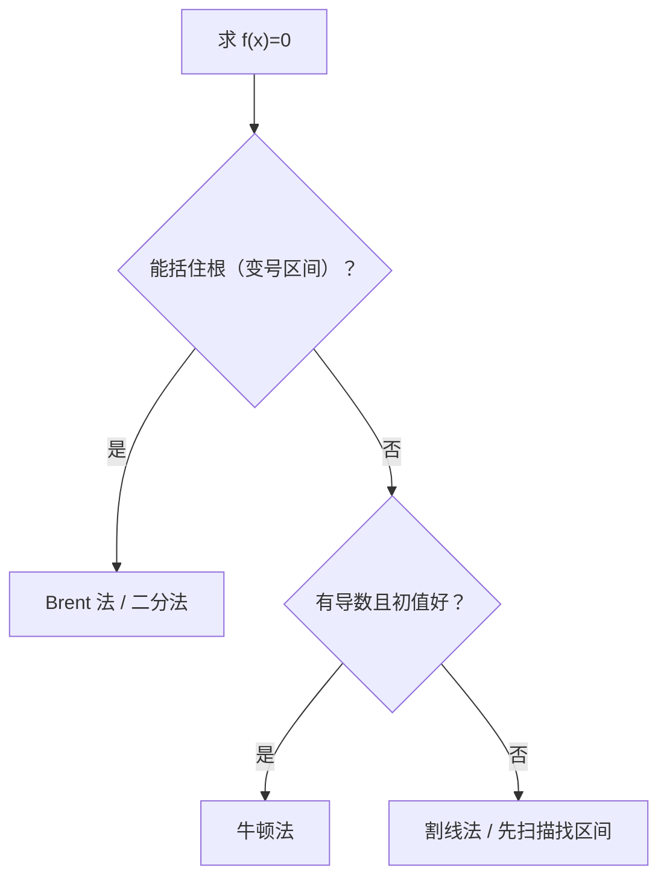

---
Title | 数值计算 非线性方程求根
-- | --
Created @ | `2026-11-24T15:24:12Z`
Updated @| `2026-11-25T09:53:56Z`
Labels | ``
Edit @| [here](https://github.com/junxnone/math/issues/108)

---
# 非线性方程求根

求解 $f(x)=0$ 是最基本的数值问题：大多数非线性方程没有解析解，只能通过迭代逼近。不同方法在可靠性、速度、所需信息（是否要导数）上各有取舍。

## 二分法

若 $f$ 在 $[a,b]$ 连续且 $f(a)f(b)<0$，则由介值定理区间内必有根（见 [极限与连续](/0049_微积分_极限与连续)）。每次取中点 $c=\frac{a+b}2$，保留符号相异的半边。误差每步减半：

$$
|x_k-x^*|\le\frac{b-a}{2^{k+1}}\ \Longrightarrow\ k\ge\log_2\frac{b-a}{\varepsilon}-1
$$

其中 $x_k$ 是第 $k$ 次中点，$x^*$ 是根，$\varepsilon$ 是目标精度。例：在 $[1,2]$ 上求 $x^2-2=0$，要精度 $10^{-6}$ 需约 $20$ 次迭代。特点：**一定收敛**、只需函数值；但只是线性收敛（$p=1$，$C=\tfrac12$），且只能找到变号根。

## 不动点迭代

把方程改写为 $x=g(x)$，迭代 $x_{k+1}=g(x_k)$。收敛条件：

$$
|g'(x^*)|<1\ \Longrightarrow\ \text{局部收敛},\qquad e_{k+1}\approx g'(x^*)\,e_k
$$

其中 $g'$ 是 $g$ 的导数，$e_k=x_k-x^*$ 是误差。由中值定理（见 [中值定理与泰勒公式](/0051_微积分_中值定理与泰勒公式)）误差按 $|g'|$ 的比例缩小，线性收敛；$|g'|>1$ 则发散。同一方程的不同改写收敛性不同：$x^2-2=0$ 写成 $x=2/x$ 时 $g'=-2/x^2=-1$ 在边界振荡，写成 $x=\tfrac12(x+2/x)$ 时 $g'(\sqrt2)=0$，收敛极快——这正是牛顿法。

## 牛顿法

$$
x_{k+1}=x_k-\frac{f(x_k)}{f'(x_k)}
$$

其中 $f'$ 是导数。几何：在 $(x_k,f(x_k))$ 作切线，取切线与 $x$ 轴的交点作为下一个近似；也可以看作对 $f$ 的一阶泰勒展开 $f(x_k)+f'(x_k)(x-x_k)=0$ 求解（见 [导数与微分](/0050_微积分_导数与微分)）。单根处 $e_{k+1}\approx\dfrac{f''(x^*)}{2f'(x^*)}e_k^2$，**二次收敛**。

例：$\sqrt2$，$f=x^2-2$，$x_{k+1}=\tfrac12\bigl(x_k+\tfrac2{x_k}\bigr)$（巴比伦法）：

| $k$ | $x_k$ | 误差 |
| -- | -- | -- |
| 0 | $1$ | $4.1\times10^{-1}$ |
| 1 | $1.5$ | $8.6\times10^{-2}$ |
| 2 | $1.416667$ | $2.5\times10^{-3}$ |
| 3 | $1.414216$ | $2.1\times10^{-6}$ |
| 4 | $1.41421356237$ | $1.6\times10^{-12}$ |

表中依次为迭代次数、近似值和与 $\sqrt2=1.41421356\ldots$ 的误差：误差每步大致平方（$10^{-1}\to10^{-3}\to10^{-6}\to10^{-12}$），有效位数翻倍。

局限：需要导数；初值离根太远可能发散或跳到别的根；$f'(x_k)\approx0$ 时数值不稳；**重根**（$f'(x^*)=0$）时退化为线性收敛（可用 $x_{k+1}=x_k-m\frac f{f'}$，$m$ 为重数）。常配合线搜索或二分法保证全局收敛。

## 割线法

用差商代替导数：

$$
x_{k+1}=x_k-f(x_k)\,\frac{x_k-x_{k-1}}{f(x_k)-f(x_{k-1})}
$$

其中 $x_{k-1},x_k$ 是最近两个近似。不需要导数，每步只算一次新的函数值，收敛阶 $p=\frac{1+\sqrt5}2\approx1.618$（黄金比例，超线性）。按“每次函数求值”的效率衡量，割线法（$1.618$）常优于需要额外计算 $f'$ 的牛顿法（$\sqrt2\approx1.414$/次求值）。多维推广是拟牛顿法（见 [二阶方法与拟牛顿](/0082_优化理论_二阶方法与拟牛顿)）。

## 方法比较与选择

| 方法 | 所需信息 | 收敛阶 | 可靠性 |
| -- | -- | -- | -- |
| 二分法 | $f$，含根区间 | $1$（线性） | 一定收敛 |
| 不动点迭代 | $g$ | $1$ | 需 $\lvert g'\rvert<1$ |
| 牛顿法 | $f,f'$ | $2$ | 依赖初值 |
| 割线法 | $f$ | $1.618$ | 依赖初值 |
| Brent 法 | $f$，含根区间 | 超线性 | 稳健（二分 + 割线 + 反二次插值） |

表中依次为方法、所需信息、收敛阶和可靠性。实际推荐：有变号区间时用 Brent（如 `scipy.optimize.brentq`）；光滑且有导数、初值好时用牛顿法。

图中：

- 菱形是判断，矩形是推荐方法，自上而下阅读。
- 括住根能保证收敛，优先使用；没有区间时再考虑利用导数加速的牛顿法，或不需导数的割线法。

## 方程组：多维牛顿法

求解 $\mathbf{F}(\mathbf{x})=\mathbf{0}$（$\mathbf{F}:\mathbb{R}^n\to\mathbb{R}^n$）：

$$
J(\mathbf{x}_k)\,\mathbf{d}_k=-\mathbf{F}(\mathbf{x}_k),\qquad \mathbf{x}_{k+1}=\mathbf{x}_k+\mathbf{d}_k
$$

其中 $J$ 是雅可比矩阵（见 [雅可比矩阵](/0044_线性代数_Matrix_雅可比矩阵)），$\mathbf{d}_k$ 是由线性方程组解出的牛顿步（见 [线性方程组的数值解法](/0109_数值计算_线性方程组的数值解法)）。同样二次收敛；$J$ 昂贵时用拟牛顿（Broyden）近似；无约束优化的牛顿法就是对 $\nabla f=\mathbf{0}$ 用此方法（见 [无约束优化](/0078_优化理论_无约束优化)）。

## 停止准则

- 函数值小：$|f(x_k)|<\text{tol}_f$（但病态时函数值小不代表接近根）
- 步长小：$|x_{k+1}-x_k|<\text{tol}_x(1+|x_k|)$
- 最大迭代次数（防止死循环）

## 应用

- 求根：方程、反函数（如已知 CDF 求分位数，见 [随机变量与分布](/0062_概率论_随机变量与分布)）、隐式方程
- 开方、除法的硬件/库实现（牛顿迭代）
- 隐式 ODE 解法每步求解非线性方程（见 [常微分方程数值解](/0112_数值计算_常微分方程数值解)）
- 机器人逆运动学、相机标定、最大似然估计（令得分为零）

## Reference

- Burden & Faires, *Numerical Analysis*, Chapter 2
- [Newton's method - Wikipedia](https://en.wikipedia.org/wiki/Newton%27s_method)

