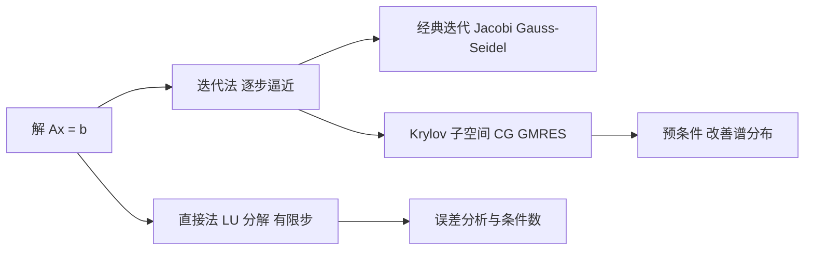

---
Title | 数值计算 线性方程组的数值解法
-- | --
Created @ | `2026-11-24T15:24:16Z`
Updated @| `2026-11-27T01:59:57Z`
Labels | ``
Edit @| [here](https://github.com/junxnone/math/issues/109)

---
# 线性方程组的数值解法

求解 $A\mathbf{x}=\mathbf{b}$ 是科学计算中最常见、最耗时的任务。方法分两类：直接法（有限步得到精确解）与迭代法（逐步逼近，适合大规模稀疏问题）。理论背景见 [线性方程组](/0035_线性代数_线性方程组)。

## 概念关系图

图中：线性方程组的解法分直接法与迭代法；直接法（LU）一步到位，误差由条件数决定；迭代法从经典方法发展到 Krylov 子空间方法，并用预条件加速。

## 直接法：高斯消元与 LU

高斯消元把 $A$ 化为上三角（见 [初等变换](/0038_线性代数_Matrix_初等变换)），回代求解；等价于 LU 分解 $PA=LU$（见 [矩阵分解](/0040_线性代数_Matrix_矩阵分解)）：

$$
PA=LU,\quad L\mathbf{y}=P\mathbf{b},\quad U\mathbf{x}=\mathbf{y}
$$

其中 $L$ 是下三角，$U$ 是上三角，$P$ 是置换矩阵（行交换）。运算量：分解约 $\tfrac23n^3$，每个右端项的前代回代 $O(n^2)$。

**选主元**：在每列消元前选取绝对值最大的元素作主元（部分选主元），避免除以很小的数引起的误差放大。例：

$$
\begin{bmatrix}10^{-20}&1\\1&1\end{bmatrix}\mathbf{x}=\begin{bmatrix}1\\2\end{bmatrix}
$$

不选主元时乘数 $10^{20}$ 使第二行中 $1-10^{20}\approx-10^{20}$，丢失了信息，解 $x_1\approx0$（真值 $\approx1$）；交换两行后乘数 $10^{-20}$，得到正确结果。

## 误差分析与条件数

$$
\frac{\lVert\delta\mathbf{x}\rVert}{\lVert\mathbf{x}\rVert}\le\kappa(A)\Bigl(\frac{\lVert\delta A\rVert}{\lVert A\rVert}+\frac{\lVert\delta\mathbf{b}\rVert}{\lVert\mathbf{b}\rVert}\Bigr),\qquad \frac{\lVert\mathbf{x}-\hat{\mathbf{x}}\rVert}{\lVert\mathbf{x}\rVert}\le\kappa(A)\frac{\lVert\mathbf{r}\rVert}{\lVert\mathbf{b}\rVert}
$$

其中：

- $\kappa(A)=\lVert A\rVert\lVert A^{-1}\rVert$：条件数（见 [范数与条件数](/0045_线性代数_Matrix_范数与条件数)）；$\delta A,\delta\mathbf{b}$：数据扰动（含舍入）
- $\hat{\mathbf{x}}$：计算解，$\mathbf{r}=\mathbf{b}-A\hat{\mathbf{x}}$：残差
- 第二式说明：**小残差不保证小误差**，当 $\kappa$ 大时即使残差很小，解仍可能很不准
- 带选主元的 LU 是向后稳定的（见 [误差与浮点数](/0107_数值计算_误差与浮点数)），因此误差主要由 $\kappa(A)u$ 决定；估计 $\kappa$ 可以判断结果可信度

**特殊结构**：对称正定用 Cholesky（一半运算量）；带状矩阵 $O(nb^2)$；三对角（追赶法）$O(n)$；稀疏矩阵用稀疏分解并重排序以减少填充。**不要显式求逆**：解 $A\mathbf{x}=\mathbf{b}$ 比计算 $A^{-1}\mathbf{b}$ 更快更准。

## 迭代法的基本思想

把 $A=M-N$（$M$ 易求逆），迭代：

$$
M\mathbf{x}_{k+1}=N\mathbf{x}_k+\mathbf{b}\ \Longleftrightarrow\ \mathbf{x}_{k+1}=G\mathbf{x}_k+\mathbf{c},\quad G=M^{-1}N
$$

其中 $G$ 是迭代矩阵，$\mathbf{c}=M^{-1}\mathbf{b}$。误差 $\mathbf{e}_{k+1}=G\mathbf{e}_k$，所以：

$$
\text{收敛}\iff\rho(G)<1,\qquad \rho(G)=\max_i|\lambda_i(G)|
$$

其中 $\rho(G)$ 是 $G$ 的谱半径（特征值模的最大值，见 [特征值与特征向量](/0036_线性代数_特征值与特征向量)）。误差每步大约缩小 $\rho(G)$ 倍。

记 $A=D+L+U$（$D$ 对角部分，$L,U$ 是严格下、上三角部分）：

| 方法 | $M$ | 迭代式（分量形式） |
| -- | -- | -- |
| Jacobi | $D$ | $x_i^{(k+1)}=\dfrac1{a_{ii}}\Bigl(b_i-\sum_{j\ne i}a_{ij}x_j^{(k)}\Bigr)$ |
| Gauss-Seidel | $D+L$ | 同上，但用已更新的 $x_j^{(k+1)}\ (j<i)$ |
| SOR | $\tfrac1\omega D+L$ | 在 G-S 基础上加松弛因子 $\omega\in(0,2)$ |

表中依次为方法、分裂中的 $M$ 和分量迭代式。充分条件：$A$ 严格对角占优（$|a_{ii}|>\sum_{j\ne i}|a_{ij}|$）时 Jacobi 与 G-S 均收敛；$A$ 对称正定时 G-S 收敛。

例：$A=\begin{bmatrix}4&1\\2&5\end{bmatrix}$，$\mathbf{b}=(1,2)^\top$，Jacobi 从 $(0,0)$ 开始：

$$
(0,0)\to(0.25,\ 0.4)\to(0.15,\ 0.3)\to(0.175,\ 0.34)\to\cdots\to\bigl(\tfrac16,\tfrac13\bigr)
$$

迭代矩阵 $G=\begin{bmatrix}0&-\tfrac14\\-\tfrac25&0\end{bmatrix}$ 的特征值 $\pm\sqrt{0.1}\approx\pm0.316$，$\rho<1$ 收敛，每两步误差缩小约 $10$ 倍。

## Krylov 子空间方法

在子空间 $\mathcal{K}_k=\mathrm{span}\{\mathbf{r}_0,A\mathbf{r}_0,\dots,A^{k-1}\mathbf{r}_0\}$ 中寻找最优近似，只需要矩阵向量乘 $A\mathbf{v}$：

- **共轭梯度（CG）**：$A$ 对称正定；等价于最小化二次函数 $\tfrac12\mathbf{x}^\top A\mathbf{x}-\mathbf{b}^\top\mathbf{x}$（见 [无约束优化](/0078_优化理论_无约束优化)）；误差界 $\lVert\mathbf{e}_k\rVert_A\le2\Bigl(\dfrac{\sqrt\kappa-1}{\sqrt\kappa+1}\Bigr)^k\lVert\mathbf{e}_0\rVert_A$，其中 $\lVert\mathbf{e}\rVert_A=\sqrt{\mathbf{e}^\top A\mathbf{e}}$。
- **GMRES**：一般非对称矩阵，最小化残差范数。
- **BiCGSTAB**：非对称矩阵，省内存。

## 预条件

收敛速度取决于 $\kappa(A)$ 或特征值分布。预条件把方程改为 $M^{-1}A\mathbf{x}=M^{-1}\mathbf{b}$，使 $M^{-1}A$ 的条件数小、特征值聚集。常用预条件子：对角（Jacobi）、不完全 LU/Cholesky、代数多重网格。好的预条件往往比选择迭代方法本身更重要。

## 方法选择

| 场景 | 推荐 |
| -- | -- |
| 稠密、中小规模（$n\lesssim10^4$） | 直接法（LU/Cholesky） |
| 稀疏、中等规模 | 稀疏直接法 |
| 极大规模稀疏、对称正定 | 预条件 CG |
| 极大规模稀疏、非对称 | 预条件 GMRES / BiCGSTAB |
| 多个右端项、同一 $A$ | LU 分解复用 |
| 超定（最小二乘） | QR / SVD，避免正规方程 |

表中依次为场景和推荐方法。

## 应用

- 有限元/有限差分离散后的偏微分方程（大型稀疏方程组）
- 最小二乘、回归（见 [回归分析](/0073_数理统计_回归分析)）
- 图像处理、PageRank（幂法 + 稀疏矩阵向量乘，见 [特征值数值算法](/0113_数值计算_特征值数值算法)）
- 隐式时间积分、牛顿法的每步线性化问题

## 在机器学习中的作用

- 线性回归的正规方程、高斯过程中的 $(K+\sigma^2I)^{-1}\mathbf{y}$ 用 Cholesky 或共轭梯度求解，见 [高斯过程进阶](https://github.com/junxnone/math/issues/20)
- 牛顿法 / 自然梯度每步求解线性系统，Hessian-向量乘积配合共轭梯度（无 Hessian 优化）
- 稀疏线性系统（图拉普拉斯、有限元）的迭代求解，见 [谱图论](https://github.com/junxnone/math/issues/124)

## 常见误区

- 求解线性方程组**不要显式求逆**，应使用分解或迭代法，见 [矩阵的逆](https://github.com/junxnone/math/issues/31)
- 迭代法的收敛性取决于迭代矩阵的谱半径（要小于 1）；对称正定矩阵可用共轭梯度，非对称则用 GMRES 等
- 预条件是为了让 $M^{-1}A$ 的特征值更集中，不是单纯「让矩阵变小」；好的预条件比换算法更有效

## Reference

- Trefethen & Bau, *Numerical Linear Algebra*
- Saad, *Iterative Methods for Sparse Linear Systems*
- [Numerical linear algebra - Wikipedia](https://en.wikipedia.org/wiki/Numerical_linear_algebra)

