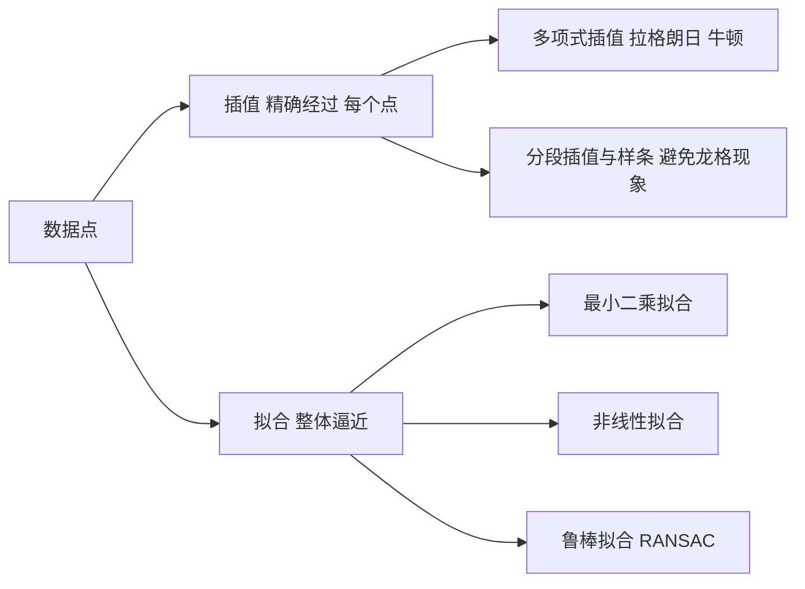

---
Title | 数值计算 插值与拟合
-- | --
Created @ | `2026-11-24T15:24:19Z`
Updated @| `2026-11-27T02:01:40Z`
Labels | ``
Edit @| [here](https://github.com/junxnone/math/issues/110)

---
# 插值与拟合

插值要求函数**恰好经过**给定的数据点，拟合只要求**整体逼近**。前者用于数据精确可靠的情形（查表、重采样），后者用于带噪声的数据（统计建模）。

## 概念关系图

图中：数据点可以用插值（精确通过）或拟合（整体逼近）处理；插值又分多项式插值与分段样条；拟合包括线性与非线性最小二乘，数据含大量离群点时用鲁棒拟合（RANSAC）。

## 多项式插值

给定 $n+1$ 个互异节点 $(x_0,y_0),\dots,(x_n,y_n)$，存在**唯一**一个次数不超过 $n$ 的多项式 $p$ 使 $p(x_i)=y_i$。唯一性：系数满足以范德蒙德矩阵为系数的线性方程组，该矩阵行列式 $\prod_{i<j}(x_j-x_i)\ne0$，所以可逆（见 [线性方程组](/0035_线性代数_线性方程组)、[逆](/0031_线性代数_Matrix_逆)）。

例：点 $(0,1),(1,3),(2,2)$。设 $p(x)=a+bx+cx^2$：

$$
a=1,\quad a+b+c=3,\quad a+2b+4c=2\ \Longrightarrow\ b=\tfrac72,\ c=-\tfrac32,\qquad p(x)=1+\tfrac72x-\tfrac32x^2
$$

其中 $a,b,c$ 是待定系数。验证：$p(1)=1+3.5-1.5=3$，$p(2)=1+7-6=2$ ✓。直接解范德蒙德系统数值上病态（条件数随 $n$ 指数增长，见 [范数与条件数](/0045_线性代数_Matrix_范数与条件数)），实践中用下面两种等价形式。

## 拉格朗日形式

$$
p(x)=\sum_{i=0}^ny_i\,\ell_i(x),\qquad \ell_i(x)=\prod_{j\ne i}\frac{x-x_j}{x_i-x_j}
$$

其中 $\ell_i(x)$ 是拉格朗日基函数：$\ell_i(x_i)=1$，$\ell_i(x_j)=0\ (j\ne i)$，所以 $p(x_i)=y_i$。优点是形式清晰、无需解方程，缺点是增加节点要全部重算。

## 牛顿形式与差商

$$
p(x)=f[x_0]+f[x_0,x_1](x-x_0)+f[x_0,x_1,x_2](x-x_0)(x-x_1)+\cdots,\qquad f[x_i,\dots,x_{i+k}]=\frac{f[x_{i+1},\dots,x_{i+k}]-f[x_i,\dots,x_{i+k-1}]}{x_{i+k}-x_i}
$$

其中 $f[x_i]=y_i$，$f[\cdot]$ 是差商（一阶差商是割线斜率，推广了导数，见 [导数与微分](/0050_微积分_导数与微分)）。增加一个节点只需添加一项，计算与存储效率更好；与泰勒多项式相似，系数是“高阶导数的离散版本”。

## 插值误差与龙格现象

$$
f(x)-p(x)=\frac{f^{(n+1)}(\xi)}{(n+1)!}\prod_{i=0}^n(x-x_i),\qquad \xi\in(\min x_i,\max x_i)
$$

其中 $f^{(n+1)}$ 是 $f$ 的 $n+1$ 阶导数（由中值定理，见 [中值定理与泰勒公式](/0051_微积分_中值定理与泰勒公式)），$\prod(x-x_i)$ 是节点多项式。注意：

- **龙格现象**：对 $f(x)=\dfrac1{1+25x^2}$ 在 $[-1,1]$ 做等距节点高次插值，节点越多边缘振荡越大，误差反而增大。原因是节点多项式在边缘很大。
- **切比雪夫节点** $x_i=\cos\bigl(\tfrac{(2i+1)\pi}{2(n+1)}\bigr)$：靠近端点更密，使 $\max|\prod(x-x_i)|$ 最小，高次插值稳定收敛。
- 结论：**不要用等距节点做高次多项式插值**，改用分段低次插值（样条）。

## 分段插值与样条

| 类型 | 构造 | 光滑度 |
| -- | -- | -- |
| 分段线性 | 相邻点连直线 | $C^0$ |
| 分段三次 Hermite | 用节点处的值与导数 | $C^1$ |
| 三次样条 | 每段三次，$s,s',s''$ 在节点处连续 | $C^2$ |

表中依次为类型、构造和光滑度。$n+1$ 个节点的三次样条有 $4n$ 个系数，内部连续条件给出 $4n-2$ 个方程，还需 2 个边界条件（自然样条 $s''=0$ 或固定斜率），最后归结为**三对角线性方程组**（$O(n)$ 求解，见 [线性方程组的数值解法](/0109_数值计算_线性方程组的数值解法)）。三次样条最小化总弯曲能量 $\int(s'')^2dx$，视觉上最光滑，是 CAD 与动画曲线的基础。

## 最小二乘拟合

数据带噪声时，拟合 $m$ 个点（$m\gg$ 参数个数）的模型 $y\approx\sum_{j=1}^p c_j\phi_j(x)$（$\phi_j$ 是基函数，如 $1,x,x^2$）：

$$
\min_{\mathbf{c}}\ \lVert A\mathbf{c}-\mathbf{y}\rVert_2^2,\qquad A_{ij}=\phi_j(x_i)\ \Longrightarrow\ A^\top A\,\mathbf{c}=A^\top\mathbf{y}
$$

其中 $\mathbf{c}\in\mathbb{R}^p$ 是系数，$A\in\mathbb{R}^{m\times p}$ 是设计矩阵，$\mathbf{y}$ 是观测值。右端是正规方程，几何上是向列空间的正交投影（见 [投影](/0042_线性代数_投影)、[最小二乘](/0006_数理统计_回归分析_最小二乘进阶)）。数值上用 QR 或 SVD 代替正规方程，避免条件数平方（见 [矩阵分解](/0040_线性代数_Matrix_矩阵分解)）。统计性质见 [回归分析](/0073_数理统计_回归分析)。

**插值 vs 拟合**：用 $m$ 个点的 $m-1$ 次多项式插值会精确穿过含噪声的点，造成过拟合；拟合用低次模型平均掉噪声。选择模型复杂度需要权衡偏差与方差（交叉验证，见 [重采样与非参数方法](/0075_数理统计_重采样与非参数方法)）。

**正交多项式基**（勒让德、切比雪夫）使 $A^\top A$ 近似对角，条件数好得多；傅里叶基用于周期数据（见 [级数](/0053_微积分_级数)）。

## 非线性拟合

模型对参数非线性（如 $y=ae^{bx}$）时无法用正规方程，可以：

- 变换线性化：$\ln y=\ln a+bx$（注意噪声分布也被变换）；
- 非线性最小二乘：Gauss-Newton / Levenberg-Marquardt（见 [二阶方法与拟牛顿](/0082_优化理论_二阶方法与拟牛顿)）；
- 稳健拟合：含离群点时用 RANSAC（见 [RANSAC](/0015_数值计算_插值与拟合_RANSAC进阶)）或 Huber 损失。

## 二维插值

- 双线性插值：先对 $x$ 再对 $y$ 做线性插值，图像缩放的默认方法；双三次插值更平滑。
- 散乱数据：径向基函数（RBF）、克里金（高斯过程，见 [Gaussian Process](/0020_概率论_随机过程初步_高斯过程进阶)）。

## 应用

- 数据重采样、查找表（LUT）、图像缩放与旋转
- 曲线曲面造型（样条、贝塞尔曲线）、动画关键帧
- 趋势拟合、校准曲线、传感器标定
- 数值公式的推导：对插值多项式求导/积分得到差分与求积公式（见 [数值微分与积分](/0111_数值计算_数值微分与积分)）

## 插值与拟合对比

| 对比项 | 插值 | 拟合 |
| --- | --- | --- |
| 是否经过数据点 | 必须经过 | 不要求，只要整体误差小 |
| 适用数据 | 精确、无噪声 | 带噪声 |
| 过拟合风险 | 高阶多项式易龙格振荡 | 模型复杂度过高时过拟合 |
| 代表方法 | 拉格朗日、牛顿、样条 | 最小二乘，见 [最小二乘进阶](https://github.com/junxnone/math/issues/6) |

表中：对比结论：数据可靠用插值，有噪声用拟合；数据含离群点时用 [RANSAC进阶](https://github.com/junxnone/math/issues/15)。

## 在机器学习中的作用

- 样条与分段插值：特征分箱后平滑、激活函数的分段线性近似（ReLU 网络本身是分段线性插值）
- 学习率调度、位置编码等曲线的构造
- 高斯过程可以看作带不确定性的插值（克里金），见 [高斯过程进阶](https://github.com/junxnone/math/issues/20)

## 常见误区

- 高阶多项式插值在等距节点上会出现**龙格现象**（边缘剧烈振荡），点多不等于好；应使用分段样条或切比雪夫节点
- 拟合模型阶数越高训练误差越小，但泛化越差，要用验证集选择复杂度
- 插值不应用于外推：在数据范围之外误差急剧增大

## Reference

- Burden & Faires, *Numerical Analysis*, Chapter 3
- [Polynomial interpolation - Wikipedia](https://en.wikipedia.org/wiki/Polynomial_interpolation)
- [Spline interpolation - Wikipedia](https://en.wikipedia.org/wiki/Spline_interpolation)

