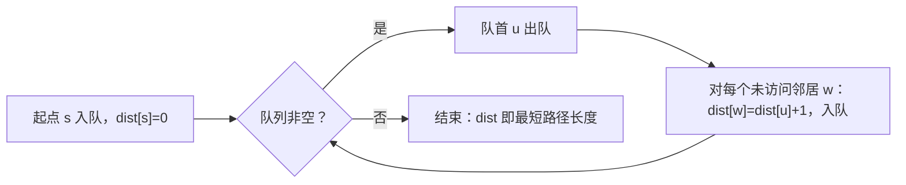

---
Title | 图论 图的表示与遍历
-- | --
Created @ | `2026-11-25T01:17:39Z`
Updated @| `2026-11-27T02:10:10Z`
Labels | ``
Edit @| [here](https://github.com/junxnone/math/issues/114)

---
# 图的表示与遍历

算法处理图之前，先要决定如何在内存中表示它；遍历则是访问图中所有顶点的系统方法，是几乎所有图算法的基本骨架。

## 图的存储

| 表示 | 空间 | 判断边 $(u,v)$ 是否存在 | 枚举 $u$ 的邻居 | 适合 |
| -- | -- | -- | -- | -- |
| 邻接矩阵 | $O(n^2)$ | $O(1)$ | $O(n)$ | 稠密图、需要矩阵运算 |
| 邻接表 | $O(n+m)$ | $O(\deg u)$ | $O(\deg u)$ | 稀疏图（绝大多数实际图） |
| 边列表 | $O(m)$ | $O(m)$ | $O(m)$ | 按边处理（Kruskal、Bellman-Ford） |
| 关联矩阵 | $O(nm)$ | — | — | 理论分析、网络流 |

表中依次为表示方法、空间、查询边、枚举邻居的复杂度和适用场景，其中 $n=|V|$ 是顶点数，$m=|E|$ 是边数，$\deg u$ 是顶点 $u$ 的度。稀疏图（$m\ll n^2$，如道路网络 $m\approx3n$）应使用邻接表。

**邻接矩阵与途径计数**：

$$
(A^k)_{ij}=\#\{\text{从 }v_i\text{ 到 }v_j\text{ 长度为 }k\text{ 的途径}\}
$$

其中 $A$ 是邻接矩阵（$A_{ij}=1$ 表示有边）。证明靠矩阵乘法的定义：$(A^2)_{ij}=\sum_kA_{ik}A_{kj}$ 恰好统计经过中间点 $v_k$ 的途径（见 [矩阵乘积](/0027_线性代数_Matrix_矩阵乘积)）。例：可达矩阵（传递闭包）可由 $\sum_{k=0}^{n-1}A^k$ 的非零位置得到；无向图的 $\operatorname{tr}(A^3)=6\times$ 三角形个数。

## 广度优先搜索 (BFS)

从起点 $s$ 出发，先访问所有距离 $1$ 的顶点，再访问距离 $2$ 的……用**队列**实现：

图中：

- 自左向右是 BFS 的循环：每次取出队首顶点，把它尚未访问的邻居标记距离并入队。
- 队列保证“先进先出”，所以顶点按距离 $s$ 由近到远的层次被访问。
- 结束时 `dist[v]` 就是无权图中 $s$ 到 $v$ 的最短路径长度（边数）。

复杂度 $O(n+m)$（邻接表）。应用：无权最短路径、连通分量、判定二分图（见 [图论 二分图](/0023_图论_二分图)）、层次遍历、网络中 $k$ 度好友。

## 深度优先搜索 (DFS)

沿一条路一直走到尽头再回溯，用**栈**（或递归）实现：

$$
\text{DFS}(u):\ \text{标记 }u;\ \text{pre}[u]\leftarrow t_{\text{in}};\ \text{对每个未访问邻居 }w:\ \text{DFS}(w);\ \text{post}[u]\leftarrow t_{\text{out}}
$$

其中 $\text{pre}[u]$、$\text{post}[u]$ 是进入和离开 $u$ 的时间戳（计数器 $t$ 依次递增）。复杂度 $O(n+m)$。DFS 把边分成四类：**树边**（发现新顶点）、**回边**（指向祖先，意味着有环）、**前向边**、**横叉边**；无向图只有树边和回边。时间戳给出重要结论：

- 有向图含环 $\iff$ DFS 中出现回边；
- 顶点按 $\text{post}$ 递减排列即为**拓扑序**（见下）；
- 割点、桥、强连通分量都由 DFS 的 $\text{low}$ 值计算（见 [图论 连通性](/0118_图论_连通性)）。

## 连通分量

对无向图，每次从未访问顶点出发做一次 BFS/DFS，访问到的顶点构成一个连通分量；总共做 $c$ 次，$c$ 即连通分量个数，总时间 $O(n+m)$。若用**并查集 (Union-Find)** 则可以边读入边合并，几乎 $O(\alpha(n))$ 每次操作（$\alpha$ 是增长极慢的反阿克曼函数），适合动态连通性（见 [图论 最小生成树](/0116_图论_最小生成树)）。

## 拓扑排序

对**有向无环图 (DAG)**，拓扑排序是顶点的线性排列，使每条边 $(u,v)$ 中 $u$ 排在 $v$ 之前。表示“任务依赖”：先修课、构建系统、数据流图。

**Kahn 算法**：反复取出入度为 $0$ 的顶点输出，并删去它的出边，更新邻居入度：

$$
\text{入度为 }0\text{ 的顶点入队}\to\text{出队输出}\to\text{邻居入度}-1\to\text{变为 }0\text{ 则入队}
$$

其中入度 $\deg^-(v)$ 是指向 $v$ 的边数。若输出顶点数少于 $n$，说明图中有环（剩下的顶点互相依赖，无法排序）。另一种做法是对 DFS 的离开时间 $\text{post}$ 倒序。拓扑序一般不唯一；偏序的线性扩展即拓扑序（见 [集合与关系](/0092_离散数学_集合与关系) 的偏序）。例：课程 $A\to B$，$A\to C$，$B\to D$，$C\to D$，则 $A,B,C,D$ 与 $A,C,B,D$ 都是合法拓扑序。

DAG 上可以用动态规划按拓扑序求最长路径、计数路径（见 [动态规划进阶](/0010_离散数学_递推与生成函数_动态规划进阶)）；神经网络的前向与反向传播就是沿计算图的拓扑序正向、逆向处理。

## BFS 与 DFS 比较

| 比较项 | BFS | DFS |
| -- | -- | -- |
| 数据结构 | 队列 | 栈 / 递归 |
| 访问顺序 | 按距离分层 | 沿路径深入再回溯 |
| 最短路径（无权） | 能求 | 不能保证 |
| 空间 | 最宽层的大小 | 最长路径的深度 |
| 典型用途 | 最短路径、层次、二分图判定 | 环检测、拓扑排序、割点、强连通分量、回溯搜索 |

表中依次为比较项、BFS 与 DFS 的情况。二者时间复杂度同为 $O(n+m)$，选择取决于所需的信息：要“最近”用 BFS，要“结构（环、连通性）”用 DFS。

## 例

邻接表 $1:[2,3]$，$2:[4]$，$3:[4]$，$4:[\,]$（有向）。从 $1$ 出发 BFS 顺序 $1,2,3,4$（距离 $0,1,1,2$）；DFS 顺序 $1,2,4,3$（先深入到 $4$ 再回溯访问 $3$）；离开时间 $4<2<3<1$，倒序得拓扑序 $1,3,2,4$。

## 应用

- 网络爬虫（BFS）、社交网络好友推荐（$k$ 跳邻居）
- 迷宫与最短步数（BFS 在网格图上）、连通区域标记（图像处理里的 flood fill）
- 编译器与构建系统的依赖排序、死锁检测（找环）
- 回溯法（八皇后、数独）本质是在状态空间图上做 DFS

## 在机器学习中的作用

- 计算图的拓扑排序决定反向传播的执行顺序（自动微分）
- 邻接表 / 稀疏矩阵是图神经网络的输入表示，见 [图神经网络基础](https://github.com/junxnone/math/issues/127)
- BFS / DFS 用于搜索与规划、连通分量计算，见 [连通性](https://github.com/junxnone/math/issues/118)

## 常见误区

- 邻接矩阵占 $O(V^2)$ 空间，稀疏图应使用邻接表（$O(V+E)$）
- DFS 递归深度可能很大，图很深时会栈溢出，需要改用显式栈
- 拓扑排序只对**有向无环图**（DAG）有定义；存在环时无法排序，并可用来检测环

## Reference

- Cormen et al., *Introduction to Algorithms*, Chapter 22
- [OI wiki - 图的存储与遍历](https://oi-wiki.org/graph/save/)

