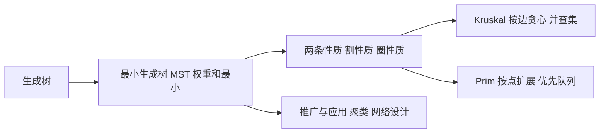

---
Title | 图论 最小生成树
-- | --
Created @ | `2026-11-25T01:19:46Z`
Updated @| `2026-11-27T02:01:52Z`
Labels | ``
Edit @| [here](https://github.com/junxnone/math/issues/116)

---
# 最小生成树

生成树是用最少的边把所有顶点连通起来的子图。在带权图中，权重和最小的生成树称为最小生成树（MST），用于以最低成本铺设网络。

## 概念关系图

图中：最小生成树的正确性由「割性质」和「圈性质」保证；Kruskal 与 Prim 是这两个性质的两种贪心实现；应用包括网络设计和单链接聚类。

## 定义

连通无向带权图 $G=(V,E,w)$ 的**生成树** $T$ 是包含所有顶点的树（连通、无环，边数 $n-1$，见 [图论 树](/0117_图论_树)）。

$$
T^*=\arg\min_{T\ \text{为生成树}}\ w(T),\qquad w(T)=\sum_{e\in T}w(e)
$$

其中 $w(e)$ 是边 $e$ 的权重，$w(T)$ 是树的总权重。若所有边权互不相同，MST 唯一；否则可能有多棵。例：4 个城市铺光纤，边权为造价，最小生成树就是总造价最低且保证所有城市互通的方案。

## 两条基本性质

- **割性质 (Cut property)**：把顶点分成两个非空集合 $(S,V\setminus S)$，跨越这个割的所有边中权重最小的边，一定属于某棵 MST。
- **环性质 (Cycle property)**：任何环上权重最大的边（唯一时），一定不属于 MST。

Kruskal 与 Prim 算法的正确性都由割性质推出：它们每一步选的边都是某个割上的最小边，所以“贪心”不会出错。

## Kruskal 算法

把所有边按权重升序排序，依次考虑每条边：若加入后不形成环就选取，否则跳过，直到选满 $n-1$ 条边。

$$
\text{排序 }E\ \to\ \text{对每条边 }(u,v):\ \text{若 find}(u)\ne\text{find}(v)\ \text{则选取并 union}(u,v)
$$

其中 find/union 是**并查集 (Union-Find)** 的操作：find 返回顶点所在连通块的代表元，union 合并两个块。两端点已在同一块里就意味着加边会成环。并查集加路径压缩与按秩合并后每次操作接近 $O(1)$（均摊 $\alpha(n)$，$\alpha$ 为反阿克曼函数）。复杂度 $O(m\log m)$，主要来自排序。适合稀疏图和边列表输入。

例：顶点 $A,B,C,D$，边 $AB:1$，$BC:2$，$AC:3$，$CD:4$，$BD:5$。升序：$AB(1)$ 选；$BC(2)$ 选；$AC(3)$ 与 $A,B,C$ 已连通，成环，跳过；$CD(4)$ 选；已选 $3=n-1$ 条边，停止。总权重 $1+2+4=7$。

## Prim 算法

从任一顶点出发，维护已在树中的顶点集合 $S$，每次选择连接 $S$ 与 $V\setminus S$ 的最小权边，把新顶点并入。用最小堆维护“每个未入树顶点到 $S$ 的最小边权”：

$$
v=\arg\min_{x\notin S}\ \text{key}[x],\qquad \text{key}[x]=\min_{u\in S}w(u,x)
$$

其中 $\text{key}[x]$ 是顶点 $x$ 与当前树之间的最小边权。堆实现 $O(m\log n)$；稠密图用数组实现 $O(n^2)$ 更好。它与 Dijkstra 结构几乎相同，区别在于 Prim 比较的是“到树的单条边权”，Dijkstra 比较的是“到源点的路径总长”。

## 比较

| 算法 | 思想 | 复杂度 | 适合 |
| -- | -- | -- | -- |
| Kruskal | 全局按边权排序，不成环就加 | $O(m\log m)$ | 稀疏图 |
| Prim | 从一个点向外生长 | $O(m\log n)$ 或 $O(n^2)$ | 稠密图 |
| Borůvka | 每个连通块同时选最小出边 | $O(m\log n)$ | 并行计算 |

表中依次为算法、思想、复杂度和适用场景。三者结果的权重和相同。

## 相关结论与推广

- **瓶颈性质**：MST 同时也是“最小化最大边权”的生成树，且任意两点在 MST 上的路径最小化了路径上的最大边权（极小化瓶颈路径）。
- **生成树计数**：$K_n$ 有 $n^{n-2}$ 棵生成树（Cayley 公式）；一般图的生成树个数由拉普拉斯矩阵的任一代数余子式给出（见 [图论 谱图论](/0124_图论_谱图论)）。
- **次小生成树**、**最小斯坦纳树**（可添加额外顶点，NP 难）、**度约束 MST**。
- **旅行商问题的 2-近似**：MST 的权重 $\le$ 最优 TSP 回路权重，先序遍历 MST 并走捷径得到不超过最优两倍的回路（见 [图论 NP难问题](/0125_图论_NP难问题)）。

## 应用

- 网络设计：通信线路、管道、电力网的最低成本铺设
- 聚类：单链接层次聚类等价于 Kruskal，砍去 MST 中最长的 $k-1$ 条边得到 $k$ 个簇
- 图像分割（Felzenszwalb 算法）、近似算法
- 电路设计中的布线、地图简化

## 在机器学习中的作用

- 单链接层次聚类等价于最小生成树后删去最长的若干条边
- 流形学习（Isomap 的邻接图）、近似算法（TSP 的 2 倍近似基于 MST）
- 图结构学习中保持连通性的稀疏化

## 常见误区

- 最小生成树**不一定唯一**（存在权重相同的边），但最小权重和是唯一的；若所有边权互不相同则 MST 唯一
- MST 不等于最短路径树：MST 最小化边权**总和**，最短路径树最小化从源点出发的路径长度，两者一般不同，见 [最短路径](https://github.com/junxnone/math/issues/115)
- Kruskal 需要并查集判断是否成环；漏掉环检测会得到含环的子图

## Reference

- Cormen et al., *Introduction to Algorithms*, Chapter 23
- [OI wiki - 最小生成树](https://oi-wiki.org/graph/mst/)

