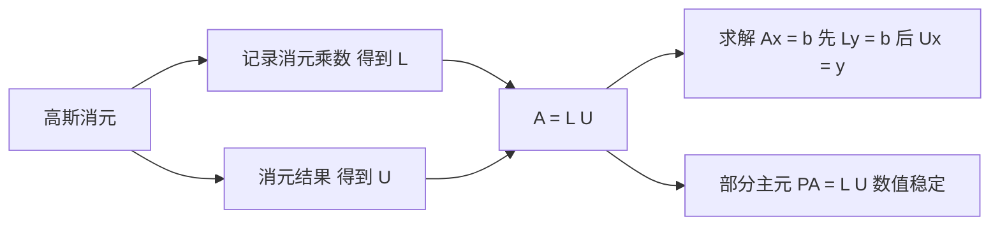

---
Title | 线性代数 Matrix 矩阵分解 LU分解
-- | --
Created @ | `2026-11-27T02:42:56Z`
Updated @| `2026-11-27T02:47:38Z`
Labels | ``
Edit @| [here](https://github.com/junxnone/math/issues/129)

---
# LU分解

LU 分解把方阵写成**下三角矩阵 × 上三角矩阵**，把一次高斯消元「记录」下来，之后求解线性方程组、求逆、算行列式都只需代入。总览见 [矩阵分解](https://github.com/junxnone/math/issues/40)，消元见 [初等变换](https://github.com/junxnone/math/issues/38)。

## 概念关系图

图中：高斯消元的结果是上三角矩阵 $U$，消元时用到的乘数构成下三角矩阵 $L$；有了 $A=LU$，解方程只需两次三角回代；实际计算要加行交换（主元）保证稳定。

## 定义

$$
A=LU,\qquad L=\begin{bmatrix}1&&\\ \ell_{21}&1&\\ \ell_{31}&\ell_{32}&1\end{bmatrix},\quad U=\begin{bmatrix}u_{11}&u_{12}&u_{13}\\&u_{22}&u_{23}\\&&u_{33}\end{bmatrix}
$$

其中：

- $L$：单位下三角矩阵（对角线为 1），$\ell_{ij}$ 是消元时第 $i$ 行减去第 $j$ 行的倍数（乘数）
- $U$：上三角矩阵，是消元之后的行阶梯形
- 存在条件：$A$ 的所有顺序主子式非零（消元过程中不遇到 0 主元），否则需要行交换

## 求解线性方程组

$$
A\mathbf{x}=\mathbf{b}\ \Longleftrightarrow\ L\mathbf{y}=\mathbf{b}\ (\text{前代}),\quad U\mathbf{x}=\mathbf{y}\ (\text{回代})
$$

其中：先解下三角方程得中间量 $\mathbf{y}$，再解上三角方程得 $\mathbf{x}$；每次三角求解只需 $O(n^2)$ 次运算，而分解本身是 $O(n^3)$（约 $\tfrac23n^3$ 次乘加），因此**分解一次、对多个右端项复用**非常划算。

## 部分主元（行交换）

$$
PA=LU
$$

其中：$P$ 是置换矩阵，记录行交换；每一步选取该列绝对值最大的元素作为主元，避免除以很小的数而放大误差。没有主元选取的 LU 在数值上可能严重不稳定（即使矩阵本身很好）。

## 相关量的计算

| 量 | 利用 LU 的做法 | 复杂度 |
| --- | --- | --- |
| 行列式 | $\det A=\pm\prod_i u_{ii}$（符号由行交换次数决定） | 分解后 $O(n)$ |
| 逆矩阵 | 对 $I$ 的每一列分别解 $A\mathbf{x}_j=\mathbf{e}_j$ | 约 $2n^3$ |
| 多个右端项 | 复用同一对 $L,U$ | 每个 $O(n^2)$ |

表中：对比结论：LU 是通用的方阵求解器；对称正定矩阵可用更快的 Cholesky 分解，见 [Cholesky分解](https://github.com/junxnone/math/issues/131)；一般矩阵的最小二乘用 [QR分解](https://github.com/junxnone/math/issues/130)。

## 在机器学习中的作用

- 线性回归的正规方程、高斯过程中的线性系统求解，见 [线性方程组](https://github.com/junxnone/math/issues/35)
- 牛顿法每一步求解 $H\Delta=-g$
- 数值软件（NumPy / LAPACK）中 `solve`、`det`、`inv` 的底层实现

## 常见误区

- 不要为了解方程先求 $A^{-1}$ 再乘 $\mathbf{b}$；用 LU 直接求解更快、更准，见 [矩阵的逆](https://github.com/junxnone/math/issues/31)
- LU 分解不总是存在（不加主元时），**带部分主元的 LU 对任意可逆矩阵都存在**
- 分解形式不唯一：约定 $L$ 的对角线为 1（Doolittle）或 $U$ 的对角线为 1（Crout）会得到不同但等价的分解

