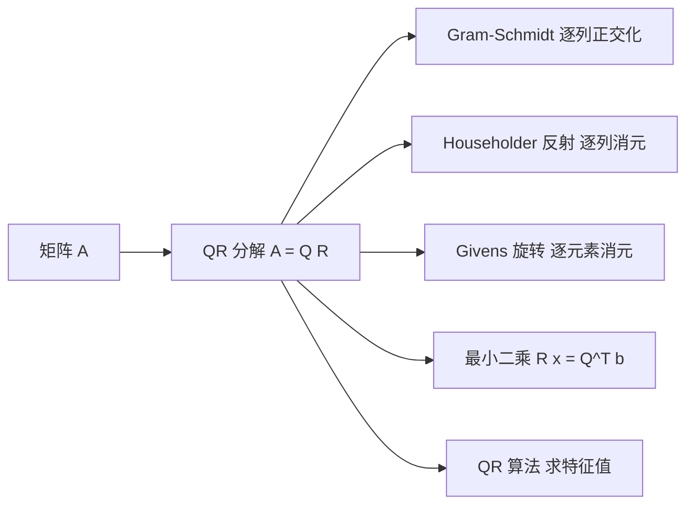

---
Title | 线性代数 Matrix 矩阵分解 QR分解
-- | --
Created @ | `2026-11-27T02:42:59Z`
Updated @| `2026-11-27T02:47:41Z`
Labels | ``
Edit @| [here](https://github.com/junxnone/math/issues/130)

---
# QR分解

QR 分解把矩阵写成**正交矩阵 × 上三角矩阵**。正交变换不放大误差，所以 QR 是最小二乘、特征值计算等问题中数值最稳定的工具之一。总览见 [矩阵分解](https://github.com/junxnone/math/issues/40)，正交矩阵见 [正交矩阵](https://github.com/junxnone/math/issues/32)。

## 概念关系图

图中：QR 分解有三种构造方式——Gram–Schmidt 正交化、Householder 反射、Givens 旋转；得到后用于稳定地求最小二乘解，并构成求特征值的 QR 算法。

## 定义

对列满秩的 $A\in\mathbb{R}^{m\times n}$（$m\ge n$）：

$$
A=QR,\qquad Q^{\top}Q=I,\quad R\ \text{上三角}
$$

其中：

- 简化（thin）QR：$Q\in\mathbb{R}^{m\times n}$，列是 $A$ 的列空间的一组**标准正交基**；$R\in\mathbb{R}^{n\times n}$ 上三角
- 完全（full）QR：$Q$ 为 $m\times m$ 的正交矩阵，$R$ 为 $m\times n$（下方补零行）
- 含义：$R$ 的各列给出 $A$ 的每一列在正交基 $Q$ 下的坐标

## 三种构造方法

| 方法 | 做法 | 稳定性 | 特点 |
| --- | --- | --- | --- |
| Gram–Schmidt | 逐列减去在已有正交基上的投影，再单位化 | 经典版易失去正交性，改进版（MGS）较好 | 直观，对应 [投影](https://github.com/junxnone/math/issues/42) |
| Householder | 用反射 $H=I-2vv^{\top}/v^{\top}v$ 把每一列的下方元素消为 0 | 非常稳定 | 稠密矩阵的标准做法，见 [正交矩阵](https://github.com/junxnone/math/issues/32) |
| Givens | 用平面旋转逐个消元 | 稳定 | 适合稀疏矩阵、只需消去少数元素 |

表中：对比结论：软件实现通常用 Householder；需要利用稀疏结构时用 Givens；理解原理用 Gram–Schmidt。

Gram–Schmidt 的核心公式：

$$
\mathbf{u}_k=\mathbf{a}_k-\sum_{j<k}\frac{\mathbf{q}_j^{\top}\mathbf{a}_k}{\mathbf{q}_j^{\top}\mathbf{q}_j}\,\mathbf{q}_j,\qquad \mathbf{q}_k=\frac{\mathbf{u}_k}{\lVert\mathbf{u}_k\rVert}
$$

其中：$\mathbf{a}_k$ 为 $A$ 的第 $k$ 列；减去的是 $\mathbf{a}_k$ 在前 $k-1$ 个已正交基上的投影，剩下的分量与它们垂直；$R$ 的元素 $r_{jk}=\mathbf{q}_j^\top\mathbf{a}_k$。

## 解最小二乘

$$
\min_{\mathbf{x}}\lVert A\mathbf{x}-\mathbf{b}\rVert_2\ \Longrightarrow\ R\mathbf{x}=Q^{\top}\mathbf{b}
$$

其中：用 $A=QR$ 代入后，正交矩阵不改变范数，问题变为解上三角方程 $R\mathbf{x}=Q^\top\mathbf{b}$（简化 QR）。相比解正规方程 $A^\top A\mathbf{x}=A^\top\mathbf{b}$，**避免了条件数平方**（$\kappa(A^\top A)=\kappa(A)^2$），数值上稳定得多，见 [最小二乘进阶](https://github.com/junxnone/math/issues/6)、[范数与条件数](https://github.com/junxnone/math/issues/45)。

## QR 算法（求特征值）

反复做 $A_k=Q_kR_k$、$A_{k+1}=R_kQ_k$，$A_k$ 收敛到上三角（对角线为特征值），是计算稠密矩阵全部特征值的标准方法，见 [特征值数值算法](https://github.com/junxnone/math/issues/113)。

## 在机器学习中的作用

- 线性回归的稳定求解；正交化（正交初始化权重、正交约束）
- 随机化 SVD 中对随机投影后的矩阵做 QR 以获得正交基
- 数值线性代数库中最小二乘 `lstsq` 的常用后端

## 常见误区

- QR 中的 $R$ 对角线符号不唯一（可以整列 / 整行取反）；约定对角线为正时分解唯一
- 经典 Gram–Schmidt 在列近似线性相关时会丢失正交性，实际用改进版或 Householder
- QR 只对列满秩矩阵给出唯一的简化分解；秩亏时要用带列主元的 QR 或 SVD，见 [伪逆](https://github.com/junxnone/math/issues/43)

