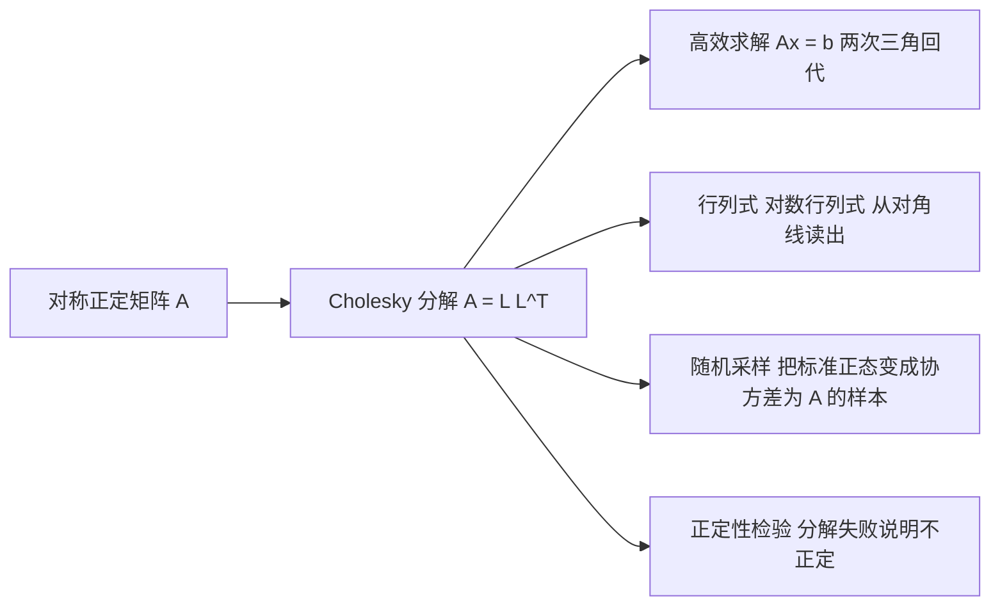

---
Title | 线性代数 Matrix 矩阵分解 Cholesky分解
-- | --
Created @ | `2026-11-27T02:43:03Z`
Updated @| `2026-11-27T02:47:44Z`
Labels | ``
Edit @| [here](https://github.com/junxnone/math/issues/131)

---
# Cholesky分解

Cholesky 分解把**对称正定矩阵**写成「下三角矩阵 × 它的转置」，是 LU 分解在对称正定情形下的特化：计算量约少一半、不需要主元选取、数值上很稳定。总览见 [矩阵分解](https://github.com/junxnone/math/issues/40)，对称正定见 [对称正定与二次型](https://github.com/junxnone/math/issues/41)。

## 概念关系图

图中：分解成功本身就证明矩阵正定；利用 $L$ 可以高效解方程、算行列式，并生成指定协方差的高斯样本。

## 定义

$$
A=LL^{\top},\qquad L=\begin{bmatrix}\ell_{11}&&\\\ell_{21}&\ell_{22}&\\\vdots&&\ddots\end{bmatrix},\ \ \ell_{ii}>0
$$

其中：$A$ 是对称正定矩阵；$L$ 是对角线为正的下三角矩阵（唯一）。逐元素公式为：

$$
\ell_{jj}=\sqrt{a_{jj}-\sum_{k<j}\ell_{jk}^{2}},\qquad \ell_{ij}=\frac{1}{\ell_{jj}}\Bigl(a_{ij}-\sum_{k<j}\ell_{ik}\ell_{jk}\Bigr)\ \ (i>j)
$$

其中：按列依次计算；根号下的量恰好是 Schur 补，$A$ 正定保证它恒为正，若遇到非正数说明 $A$ 不是正定矩阵。

## 与其他分解对比

| 对比项 | LU | Cholesky |
| --- | --- | --- |
| 适用矩阵 | 一般方阵 | 对称正定矩阵 |
| 形式 | $PA=LU$ | $A=LL^{\top}$ |
| 计算量 | 约 $\tfrac23n^3$ | 约 $\tfrac13n^3$ |
| 是否需要主元 | 需要（稳定性） | 不需要 |
| 存储 | $L$ 与 $U$ | 只需 $L$ |

表中：对比结论：只要矩阵对称正定（如协方差矩阵、核矩阵、$A^\top A$），优先用 Cholesky，见 [LU分解](https://github.com/junxnone/math/issues/129)。

## 主要用途

**1. 解方程**：$A\mathbf{x}=\mathbf{b}$ 化为 $L\mathbf{y}=\mathbf{b}$、$L^\top\mathbf{x}=\mathbf{y}$ 两次三角回代。

**2. 行列式**：

$$
\ln\det A=2\sum_{i}\ln\ell_{ii}
$$

其中：$\det A=(\prod_i\ell_{ii})^2$；用对数避免数值溢出，高斯分布对数似然中的 $\ln\lvert\Sigma\rvert$ 就这样计算，见 [高斯分布进阶](https://github.com/junxnone/math/issues/5)。

**3. 高斯采样**：

$$
\mathbf{z}\sim\mathcal{N}(0,I)\ \Longrightarrow\ \mathbf{x}=\boldsymbol\mu+L\mathbf{z}\sim\mathcal{N}(\boldsymbol\mu,\ LL^{\top})
$$

其中：$\Sigma=LL^\top$ 是目标协方差；独立标准正态向量左乘 $L$ 就得到协方差为 $\Sigma$ 的样本（仿射变换性质）。

## 在机器学习中的作用

- 高斯过程：对核矩阵 $K+\sigma^2I$ 做 Cholesky 求预测与对数边缘似然，见 [高斯过程进阶](https://github.com/junxnone/math/issues/20)
- 多元高斯采样、变分推断中的重参数化；卡尔曼滤波中协方差的平方根形式
- 判断矩阵是否正定（Hessian、协方差估计）

## 常见误区

- Cholesky 只适用于**对称正定**；仅半正定的矩阵可能分解失败，常给对角线加一个小量 $\epsilon I$（抖动）使其正定
- 不是对称矩阵时调用会得到错误结果（多数库只读取一个三角部分，不会报错），使用前要确认对称性
- $L$ 与 $L^\top$ 的约定不同（有的库返回上三角 $R$，$A=R^\top R$），注意转置

