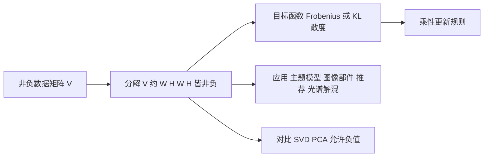

---
Title | 线性代数 Matrix 矩阵分解 非负矩阵分解
-- | --
Created @ | `2026-11-27T02:43:07Z`
Updated @| `2026-11-27T02:47:47Z`
Labels | ``
Edit @| [here](https://github.com/junxnone/math/issues/132)

---
# 非负矩阵分解

非负矩阵分解（NMF）把一个**非负矩阵**分解为两个非负矩阵的乘积 $V\approx WH$。「非负」约束使得结果只能做**加法组合**，因此得到的因子往往可解释为「部分」（主题、笔画、基因模块）。总览见 [矩阵分解](https://github.com/junxnone/math/issues/40)，与 SVD 的对比见 [SVD](https://github.com/junxnone/math/issues/12)。

## 概念关系图

图中：把非负数据分解成两个非负因子；通过最小化重构误差（Frobenius 或 KL）得到，常用乘性更新求解；与 SVD / PCA 的区别在于非负约束带来的「部分」解释。

## 定义

$$
V\approx WH,\qquad V\in\mathbb{R}_{\ge0}^{m\times n},\ W\in\mathbb{R}_{\ge0}^{m\times r},\ H\in\mathbb{R}_{\ge0}^{r\times n},\ r\ll\min(m,n)
$$

其中：

- $V$：数据矩阵（如 $m$ 个词 × $n$ 篇文档的词频）；$r$：潜在因子个数（秩）
- $W$：基（每列是一个「部件」，如一个主题的词分布）；$H$：系数（每列给出该样本由各部件组合的权重）
- 非负约束使得每个样本是各部件的**非负线性组合**，没有抵消，所以部件是「加性」的

## 目标函数

$$
\min_{W,H\ge0}\ \lVert V-WH\rVert_F^{2}\qquad\text{或}\qquad \min_{W,H\ge0}\ D_{KL}(V\,\Vert\,WH)=\sum_{ij}\Bigl(V_{ij}\ln\frac{V_{ij}}{(WH)_{ij}}-V_{ij}+(WH)_{ij}\Bigr)
$$

其中：第一种是 Frobenius 范数的平方误差（高斯噪声假设），第二种是广义 KL 散度（泊松噪声假设，适合计数数据），见 [范数](https://github.com/junxnone/math/issues/11)、[互信息与KL散度](https://github.com/junxnone/math/issues/86)。该问题关于 $(W,H)$ 联合**非凸**，但固定一个因子时关于另一个是凸的，因此可交替优化。

## 乘性更新规则（Lee & Seung）

针对 Frobenius 目标：

$$
H\leftarrow H\circ\frac{W^{\top}V}{W^{\top}WH},\qquad W\leftarrow W\circ\frac{VH^{\top}}{WHH^{\top}}
$$

其中：$\circ$ 与除法都是逐元素运算（哈达玛积，见 [哈达玛乘积](https://github.com/junxnone/math/issues/28)）；从非负初值出发，乘以非负比值可保持非负；更新使目标函数单调不增，收敛到局部极小。

## 与 SVD / PCA 对比

| 对比项 | SVD / PCA | NMF |
| --- | --- | --- |
| 因子符号 | 可正可负 | 全部非负 |
| 解释 | 正交方向，系数有正有负，难以解释为「部分」 | 加性的部件，稀疏、可解释 |
| 唯一性 | 全局最优，解唯一（除符号） | 非凸，依赖初值，一般不唯一 |
| 因子正交 | 正交 | 不要求正交 |

表中：对比结论：需要可解释的「基于部分的表示」用 NMF，需要最优低秩近似用 SVD。

## 在机器学习中的作用

- 主题模型：词-文档矩阵分解得到主题与文档的主题权重
- 图像分析：人脸分解成眼、鼻、嘴等部件；音频源分离（频谱分解）
- 推荐系统：用户-物品评分的非负分解；光谱解混、基因表达模块识别

## 常见误区

- NMF 不能处理含负值的数据；若数据有负值需先平移或使用其他分解
- 因子个数 $r$ 的选择没有闭式规则，要用重构误差、稳定性或下游任务确定
- 结果依赖初值与局部极小，应多次随机初始化或用 SVD 初始化（如 NNDSVD），并检查稳定性

