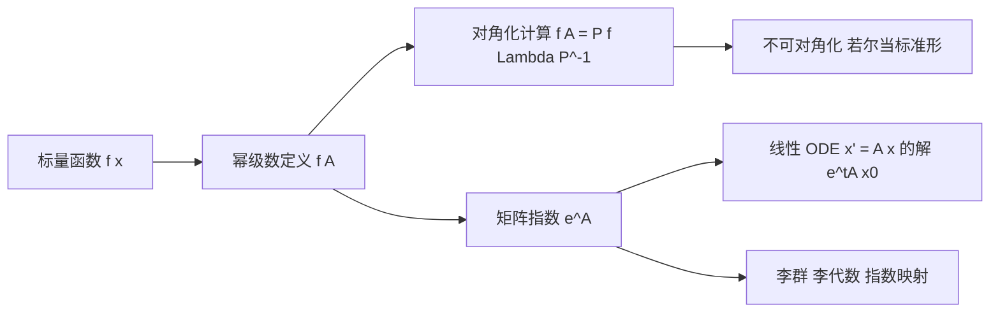

---
Title | 线性代数 Matrix 矩阵函数与矩阵指数
-- | --
Created @ | `2026-11-27T02:43:11Z`
Updated @| `2026-11-27T02:47:59Z`
Labels | ``
Edit @| [here](https://github.com/junxnone/math/issues/133)

---
# 矩阵函数与矩阵指数

把标量函数 $f(x)$（如 $e^{x}$、$\sqrt{x}$、$\ln x$）推广到**方阵**自变量，得到矩阵函数 $f(A)$。其中最重要的是**矩阵指数** $e^{A}$：它给出线性常微分方程组的解，也是李群与李代数之间的桥梁。矩阵运算基础见 [矩阵](https://github.com/junxnone/math/issues/4)，对角化见 [特征值与特征向量](https://github.com/junxnone/math/issues/36)。

## 概念关系图

图中：用幂级数把标量函数推广到矩阵；可对角化时转化为对特征值作用函数；矩阵指数给出线性微分方程的解，并连接李代数与李群。

## 定义

若 $f(x)=\sum_{k\ge0}c_kx^k$，则

$$
f(A)=\sum_{k=0}^{\infty}c_kA^{k},\qquad e^{A}=\sum_{k=0}^{\infty}\frac{A^{k}}{k!}=I+A+\frac{A^{2}}{2!}+\cdots
$$

其中：$A$ 是方阵；级数对任何方阵都收敛（指数函数的收敛半径是无穷）；$e^A$ 总是可逆，逆为 $e^{-A}$。

## 用特征分解计算

若 $A=P\Lambda P^{-1}$（$\Lambda=\operatorname{diag}(\lambda_1,\dots,\lambda_n)$），则

$$
f(A)=P\,f(\Lambda)\,P^{-1}=P\operatorname{diag}\bigl(f(\lambda_1),\dots,f(\lambda_n)\bigr)P^{-1}
$$

其中：函数只需要作用在特征值上；因此 $e^{A}$ 的特征值是 $e^{\lambda_i}$，$\det e^{A}=e^{\operatorname{tr}A}$，见 [矩阵的迹](https://github.com/junxnone/math/issues/37)。矩阵不可对角化时需要若尔当标准形或其他数值方法（如缩放-平方法、Padé 近似）。

## 线性微分方程组

$$
\dot{\mathbf{x}}(t)=A\mathbf{x}(t),\ \ \mathbf{x}(0)=\mathbf{x}_0\ \Longrightarrow\ \mathbf{x}(t)=e^{tA}\mathbf{x}_0
$$

其中：解的行为由 $A$ 的特征值决定：所有特征值实部为负时 $\mathbf{x}(t)\to0$（稳定），见 [常微分方程](https://github.com/junxnone/math/issues/57)。对应的离散系统 $\mathbf{x}_{k+1}=A\mathbf{x}_k$ 的解为 $A^k\mathbf{x}_0$，稳定条件是谱半径小于 1。

## 性质与陷阱

| 性质 | 表达式 | 条件 |
| --- | --- | --- |
| 可交换时的加法定理 | $e^{A+B}=e^{A}e^{B}$ | **仅当** $AB=BA$ |
| 逆 | $(e^{A})^{-1}=e^{-A}$ | 总成立 |
| 转置 | $(e^{A})^{\top}=e^{A^{\top}}$ | 总成立 |
| 反对称矩阵 | $A^{\top}=-A\Rightarrow e^{A}$ 是正交矩阵，行列式为 1 | 对应旋转，见 [李群与李代数](https://github.com/junxnone/math/issues/135) |

表中：对比结论：一般情形 $e^{A+B}\ne e^{A}e^{B}$，需要用 Baker–Campbell–Hausdorff 公式修正；反对称矩阵的指数给出旋转。

## 其他常见矩阵函数

- 矩阵平方根：对称正定矩阵 $A^{1/2}$，用于白化 $\Sigma^{-1/2}$，见 [对称正定与二次型](https://github.com/junxnone/math/issues/41)
- 矩阵对数：李群到李代数的逆映射
- 矩阵符号函数、矩阵幂：用于迭代算法和网络分析（图的可达性）

## 在机器学习中的作用

- 神经常微分方程（Neural ODE）与状态空间模型（S4、Mamba）：离散化 $e^{\Delta A}$ 得到循环更新
- 图上的扩散核 $e^{-tL}$（$L$ 为图拉普拉斯），见 [谱图论](https://github.com/junxnone/math/issues/124)
- 流形上的优化：用指数映射沿旋转群更新参数

## 常见误区

- $e^{A}$ 不是对每个元素取指数；逐元素指数与矩阵指数完全不同
- $e^{A+B}=e^{A}e^{B}$ 需要 $A,B$ 可交换，否则不成立
- 数值上不要直接用定义式截断级数（范数大时误差大），应使用缩放-平方法等稳定算法

