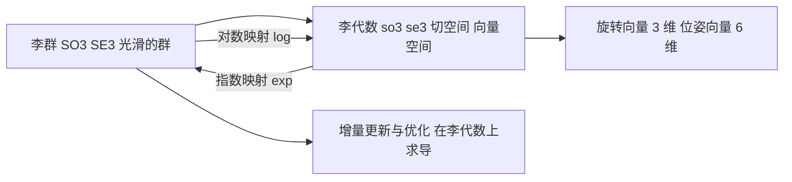

---
Title | 线性代数 线性变换 李群与李代数
-- | --
Created @ | `2026-11-27T02:43:18Z`
Updated @| `2026-11-27T02:48:06Z`
Labels | ``
Edit @| [here](https://github.com/junxnone/math/issues/135)

---
# 李群与李代数

**李群**是同时又是光滑流形的群，描述连续的对称变换；**李代数**是李群在单位元处的切空间，是一个向量空间，可以做加法、求导。机器人与三维视觉中的旋转 $SO(3)$ 与刚体位姿 $SE(3)$ 都是李群。它们的「线性化」让我们能对旋转做**微小增量更新与优化**。基础见 [正交矩阵](https://github.com/junxnone/math/issues/32)、[矩阵函数与矩阵指数](https://github.com/junxnone/math/issues/133)，工程应用见 aiwiki 的 [RL Robot Transform](https://github.com/junxnone/aiwiki/issues/766)。

## 概念关系图

图中：李群与李代数通过指数映射和对数映射相互转换；李代数用最小的向量（旋转向量、位姿向量）参数化，使得可以在向量空间中做求导与优化，再映射回群。

## 群与李群

群是带运算的集合，满足封闭、结合、单位元、逆元，见 [代数结构](https://github.com/junxnone/math/issues/95)。旋转群：

$$
SO(3)=\{R\in\mathbb{R}^{3\times3}\mid R^{\top}R=I,\ \det R=1\}
$$

其中：$R$ 为旋转矩阵（见 [正交矩阵](https://github.com/junxnone/math/issues/32)）；乘法对应旋转的复合；该集合是三维光滑流形（自由度为 3），因此是李群。刚体位姿群：

$$
SE(3)=\Bigl\{T=\begin{bmatrix}R&\mathbf{t}\\0&1\end{bmatrix}\ \Big|\ R\in SO(3),\ \mathbf{t}\in\mathbb{R}^{3}\Bigr\}
$$

其中：$\mathbf{t}$ 为平移，$T$ 是 $4\times4$ 齐次变换矩阵（见 [刚体变换与齐次坐标](https://github.com/junxnone/math/issues/136)），自由度为 6。

## 李代数 so(3)

对 $R(t)\in SO(3)$，由 $R^\top R=I$ 求导可知 $R^\top\dot R$ 是反对称矩阵。因此 $SO(3)$ 在单位元处的切空间是**三维反对称矩阵**的集合：

$$
\mathfrak{so}(3)=\{\,\boldsymbol\phi^{\wedge}\mid\boldsymbol\phi\in\mathbb{R}^{3}\},\qquad \boldsymbol\phi^{\wedge}=\begin{bmatrix}0&-\phi_3&\phi_2\\\phi_3&0&-\phi_1\\-\phi_2&\phi_1&0\end{bmatrix}
$$

其中：$\boldsymbol\phi=\theta\mathbf{u}$ 是**旋转向量**（$\mathbf{u}$ 为单位转轴，$\theta$ 为转角）；$\wedge$ 把向量变成反对称矩阵，满足 $\boldsymbol\phi^{\wedge}\mathbf{v}=\boldsymbol\phi\times\mathbf{v}$（叉乘，见 [向量](https://github.com/junxnone/math/issues/2)）。

## 指数映射与对数映射

$$
R=\exp(\boldsymbol\phi^{\wedge})=I+\frac{\sin\theta}{\theta}\boldsymbol\phi^{\wedge}+\frac{1-\cos\theta}{\theta^{2}}(\boldsymbol\phi^{\wedge})^{2},\qquad \theta=\lVert\boldsymbol\phi\rVert
$$

其中：这是罗德里格斯公式（见 aiwiki 的 [RL Robot Rotation](https://github.com/junxnone/aiwiki/issues/777)）；它就是反对称矩阵的矩阵指数。反方向用对数映射 $\boldsymbol\phi=\log(R)^{\vee}$，转角 $\theta=\arccos\frac{\operatorname{tr}R-1}{2}$。

## 左扰动与增量更新

在优化位姿（如 SLAM、手眼标定）时，不直接对 $R$ 求导，而是用小扰动：

$$
R\leftarrow\exp(\delta\boldsymbol\phi^{\wedge})\,R,\qquad \delta\boldsymbol\phi\in\mathbb{R}^{3}
$$

其中：$\delta\boldsymbol\phi$ 是三维小量，可以像普通向量一样求导、做高斯-牛顿 / LM 迭代，更新后仍然保证 $R\in SO(3)$（不需要重新正交化）。这是李群优化相比直接优化 9 个矩阵元素的核心优势，见 [二阶方法与拟牛顿](https://github.com/junxnone/math/issues/82)。

## 对比

| 对象 | 维数 | 运算 | 性质 |
| --- | --- | --- | --- |
| $SO(3)$ | 3 | 矩阵乘法 | 非线性流形，不能直接加减 |
| $\mathfrak{so}(3)$ | 3 | 向量加法与李括号 | 向量空间，可做微积分 |
| $SE(3)$ | 6 | 矩阵乘法 | 刚体位姿 |
| $\mathfrak{se}(3)$ | 6 | 向量加法 | 位姿向量（旋转加平移） |

表中：对比结论：群上不能加法，只能乘法；李代数上可以加法和求导，两者通过指数映射互转。

## 在机器学习中的作用

- SLAM、视觉里程计、手眼标定中的位姿优化（流形上的高斯-牛顿）
- 几何深度学习与等变网络：用群的表示设计对旋转 / 平移等变的网络
- 机器人学：位姿的插值、速度（旋量）与雅可比

## 常见误区

- 旋转向量的加法**不等于**旋转的复合：$\exp(\boldsymbol\phi_1^\wedge)\exp(\boldsymbol\phi_2^\wedge)\ne\exp((\boldsymbol\phi_1+\boldsymbol\phi_2)^\wedge)$（除非可交换），需要 BCH 公式修正
- $SE(3)$ 的李代数 $\mathfrak{se}(3)$ 的指数映射不是「分别对旋转和平移取指数」，平移部分还要乘上雅可比矩阵
- 旋转角接近 0 或 $\pi$ 时，对数映射与罗德里格斯公式需要特殊处理，避免数值问题

