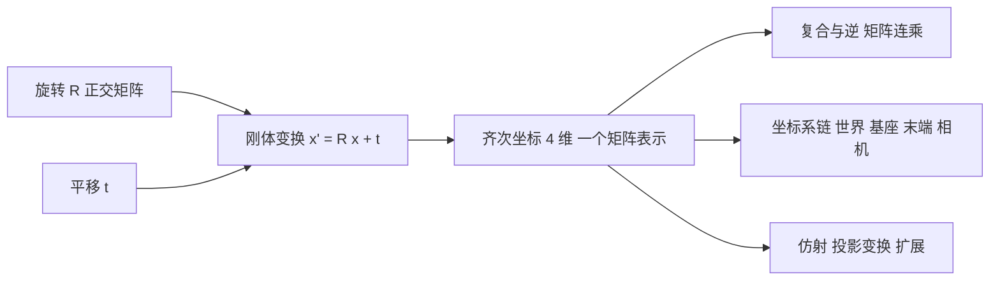

---
Title | 线性代数 线性变换 刚体变换与齐次坐标
-- | --
Created @ | `2026-11-27T02:43:22Z`
Updated @| `2026-11-27T02:48:09Z`
Labels | ``
Edit @| [here](https://github.com/junxnone/math/issues/136)

---
# 刚体变换与齐次坐标

刚体变换由**旋转 + 平移**组成，保持点之间的距离不变。引入**齐次坐标**后，平移也能写成矩阵乘法，于是一连串的坐标变换可以用矩阵连乘表示。它是计算机图形学、机器人学和三维视觉的基本语言。旋转见 [正交矩阵](https://github.com/junxnone/math/issues/32)，四元数见 [四元数与三维旋转进阶](https://github.com/junxnone/math/issues/16)，李群视角见 [李群与李代数](https://github.com/junxnone/math/issues/135)。

## 概念关系图

图中：旋转与平移合成刚体变换；齐次坐标把它统一为一个 $4\times4$ 矩阵，因此复合是矩阵乘法、求逆有闭式；同样的框架可以扩展到仿射与透视投影。

## 刚体变换

$$
\mathbf{x}'=R\,\mathbf{x}+\mathbf{t},\qquad R^{\top}R=I,\ \det R=1
$$

其中：$\mathbf{x},\mathbf{x}'\in\mathbb{R}^{3}$ 为变换前后的点；$R$ 为旋转矩阵（见 [正交矩阵](https://github.com/junxnone/math/issues/32)）；$\mathbf{t}$ 为平移向量。它保持任意两点间的距离与向量的夹角，只改变位置与朝向。

## 齐次坐标

在点的坐标末尾补一个 1：

$$
\tilde{\mathbf{x}}=\begin{bmatrix}\mathbf{x}\\1\end{bmatrix},\qquad \tilde{\mathbf{x}}'=T\tilde{\mathbf{x}},\quad T=\begin{bmatrix}R&\mathbf{t}\\\mathbf{0}^{\top}&1\end{bmatrix}
$$

其中：$T$ 是 $4\times4$ 齐次变换矩阵；展开得到 $\mathbf{x}'=R\mathbf{x}+\mathbf{t}$，平移被吸收进矩阵乘法。对**方向向量**（不受平移影响）则补 0：$\tilde{\mathbf{v}}=[\mathbf{v};0]$。

## 复合与逆

$$
T_{AC}=T_{AB}\,T_{BC},\qquad T^{-1}=\begin{bmatrix}R^{\top}&-R^{\top}\mathbf{t}\\\mathbf{0}^{\top}&1\end{bmatrix}
$$

其中：$T_{AB}$ 表示坐标系 $B$ 相对于 $A$ 的位姿；下标相邻相消，便于检查连乘顺序；刚体变换的逆不需要通用求逆，只需转置旋转部分。见 [矩阵乘积](https://github.com/junxnone/math/issues/27)。

## 坐标系链

机器人的正运动学就是对各连杆变换连乘：

$$
T_{0n}=T_{01}T_{12}\cdots T_{n-1,n}
$$

其中：$T_{i-1,i}$ 为相邻连杆间的变换；相机、基座、末端执行器之间的关系同理（如手眼标定求 $AX=XB$）。矩阵乘法不可交换，所以**顺序**至关重要。

## 变换层次

| 变换 | 保持的性质 | 自由度（3D） | 矩阵形式 |
| --- | --- | --- | --- |
| 刚体（欧氏） | 距离、角度 | 6 | $\begin{bmatrix}R&\mathbf{t}\\0&1\end{bmatrix}$ |
| 相似 | 角度、形状 | 7 | $\begin{bmatrix}sR&\mathbf{t}\\0&1\end{bmatrix}$ |
| 仿射 | 平行性 | 12 | $\begin{bmatrix}A&\mathbf{t}\\0&1\end{bmatrix}$ |
| 射影（透视） | 共线性 | 15 | 一般 $4\times4$ 矩阵（定义到相差一个尺度） |

表中：$s$ 为缩放因子，$A$ 为任意可逆 $3\times3$ 矩阵；对比结论：从刚体到射影，约束越来越少，保持的几何性质也越来越少。

## 在机器学习中的作用

- 三维视觉：相机外参（世界到相机的刚体变换）与内参，投影成像
- SLAM 与位姿估计网络的输出；点云配准（ICP）求刚体变换，见 [SVD](https://github.com/junxnone/math/issues/12) 中的 Kabsch 解法
- 数据增强：对三维点云做随机旋转与平移

## 常见误区

- 变换的复合顺序：$T_{AB}T_{BC}$ 表示先 $C\to B$ 再 $B\to A$；写反会得到完全不同的结果
- 齐次坐标是**尺度等价**的（$[x,y,z,w]$ 与 $[kx,ky,kz,kw]$ 表示同一点），还原时要除以最后一维 $w$
- 刚体变换矩阵的旋转部分必须保持正交；连乘多次后要定期重新正交化，或使用四元数 / 李代数表示

