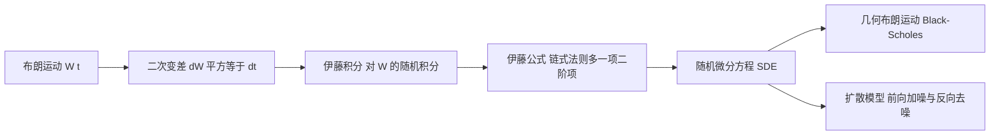

---
Title | 概率论 随机过程初步 布朗运动与伊藤积分
-- | --
Created @ | `2026-11-27T02:43:42Z`
Updated @| `2026-11-27T02:50:58Z`
Labels | ``
Edit @| [here](https://github.com/junxnone/math/issues/141)

---
# 布朗运动与伊藤积分

布朗运动（维纳过程）是连续时间随机过程的基石：路径连续但处处不可微，增量服从高斯分布。以它为噪声驱动的**随机微分方程（SDE）**与伊藤积分，构成了金融数学（Black–Scholes）和扩散生成模型的数学基础。过程基础见 [随机过程初步](https://github.com/junxnone/math/issues/67)、[随机过程进阶](https://github.com/junxnone/math/issues/13)，高斯分布见 [高斯分布进阶](https://github.com/junxnone/math/issues/5)。

## 概念关系图

图中：布朗运动的关键是二次变差不为零（$dW^2=dt$）；据此定义伊藤积分与伊藤公式，进而写出并求解随机微分方程，应用于金融定价与扩散生成模型。

## 定义

标准布朗运动 $\{W_t,t\ge0\}$ 满足：

$$
W_0=0,\quad W_t-W_s\sim\mathcal{N}(0,\,t-s),\quad \text{不相交区间增量独立},\quad \text{路径连续}
$$

其中：增量的方差等于时间间隔，所以 $W_t\sim\mathcal{N}(0,t)$，位移的尺度随 $\sqrt t$ 增长；协方差 $\operatorname{Cov}(W_s,W_t)=\min(s,t)$。它是鞅，也是马尔可夫过程，见 [随机过程进阶](https://github.com/junxnone/math/issues/13)。

## 路径性质

- **连续但处处不可微**：增量 $\lvert W_{t+h}-W_t\rvert\sim\sqrt h\gg h$，所以 $dW_t/dt$ 不存在
- **二次变差**：$\sum(\Delta W)^2\to t$，即 $dW_t^{2}=dt$（普通光滑函数的二次变差为 0）
- **无限变差**：路径总长度无限，不能用黎曼 – 斯蒂尔杰斯积分定义 $\int f\,dW$

## 伊藤积分

对适应过程 $f_t$，定义

$$
\int_0^{T}f_t\,dW_t=\lim_{n\to\infty}\sum_{i}f_{t_i}\bigl(W_{t_{i+1}}-W_{t_i}\bigr)
$$

其中：被积函数在每个小区间的**左端点**取值（伊藤约定）；结果是鞅，且满足**伊藤等距**：

$$
\mathbb{E}\Bigl[\Bigl(\int_0^{T}f_t\,dW_t\Bigr)^{2}\Bigr]=\mathbb{E}\Bigl[\int_0^{T}f_t^{2}\,dt\Bigr]
$$

其中：右侧是普通积分，使方差可以计算。

## 伊藤公式

对 $dX_t=\mu\,dt+\sigma\,dW_t$ 与光滑函数 $f(t,x)$：

$$
df(t,X_t)=\Bigl(\frac{\partial f}{\partial t}+\mu\frac{\partial f}{\partial x}+\frac{\sigma^{2}}{2}\frac{\partial^{2}f}{\partial x^{2}}\Bigr)dt+\sigma\frac{\partial f}{\partial x}\,dW_t
$$

其中：与普通链式法则相比**多了二阶项** $\tfrac{\sigma^2}{2}f_{xx}\,dt$，源于 $dW^2=dt$；这一项会改变漂移，影响期望，见 [多元函数微分](https://github.com/junxnone/math/issues/54)。

## 随机微分方程

$$
dX_t=\mu(X_t,t)\,dt+\sigma(X_t,t)\,dW_t
$$

其中：$\mu$ 为漂移（确定性趋势），$\sigma$ 为扩散系数（噪声强度）。典型例子：

| 模型 | 方程 | 特点 |
| --- | --- | --- |
| 布朗运动（带漂移） | $dX=\mu\,dt+\sigma\,dW$ | 高斯，线性增长的均值 |
| 几何布朗运动 | $dS=\mu S\,dt+\sigma S\,dW$ | 恒为正，解 $S_t=S_0\exp\bigl((\mu-\sigma^{2}/2)t+\sigma W_t\bigr)$，Black–Scholes 的股价模型 |
| OU 过程 | $dX=-\theta X\,dt+\sigma\,dW$ | 均值回复，平稳分布为高斯 |

表中：对比结论：几何布朗运动的指数里有 $-\sigma^2/2$ 修正项，来自伊藤公式；OU 过程是扩散模型的核心过程。

## 在机器学习中的作用

- 扩散模型：前向加噪是 SDE，反向去噪对应逆向 SDE，学习的是得分函数 $\nabla\ln p_t$
- 随机梯度下降的连续极限（带噪声的梯度流）；Langevin 动力学用于采样，见 [蒙特卡洛与MCMC](https://github.com/junxnone/math/issues/145)
- 金融时间序列建模、不确定性传播

## 常见误区

- 对布朗运动**不能**用普通微积分的链式法则，必须用伊藤公式（二阶项不能丢）
- 伊藤积分与斯特拉托诺维奇积分取值点不同（左端点 vs 中点），结果不同，使用前要确认约定
- $W_t$ 的方差随 $t$ 线性增长而不是二次增长；位移尺度是 $\sqrt t$

