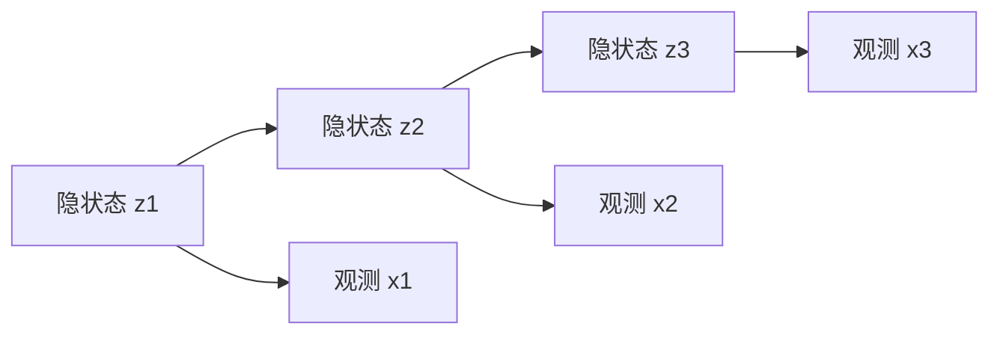

---
Title | 概率论 随机过程初步 隐马尔可夫模型
-- | --
Created @ | `2026-11-27T02:43:45Z`
Updated @| `2026-11-27T02:51:01Z`
Labels | ``
Edit @| [here](https://github.com/junxnone/math/issues/142)

---
# 隐马尔可夫模型

隐马尔可夫模型（HMM）假设：系统有一个**不可观测的隐状态序列**，它是马尔可夫链；我们只能看到由隐状态「发射」出的观测序列。它是语音识别、词性标注、基因序列分析的经典模型。马尔可夫链基础见 [马尔可夫过程进阶](https://github.com/junxnone/math/issues/18)，动态规划见 [动态规划进阶](https://github.com/junxnone/math/issues/10)。

## 概念关系图

图中：上排是隐状态链（马尔可夫性：下一状态只依赖当前状态），下排是观测（每个观测只依赖当前隐状态）；我们能看到下排，要推断上排。

## 模型参数

HMM 由三组参数 $\lambda=(\pi,A,B)$ 定义（设隐状态 $N$ 个）：

$$
\pi_i=P(z_1=i),\qquad A_{ij}=P(z_{t+1}=j\mid z_t=i),\qquad B_j(x)=P(x_t=x\mid z_t=j)
$$

其中：$\pi$ 为初始状态分布；$A$ 为转移矩阵（每行和为 1，见 [矩阵](https://github.com/junxnone/math/issues/4)）；$B$ 为发射概率（离散观测时是矩阵，连续观测时常用高斯或混合高斯）。联合分布：

$$
p(x_{1:T},z_{1:T})=\pi_{z_1}B_{z_1}(x_1)\prod_{t=2}^{T}A_{z_{t-1}z_t}\,B_{z_t}(x_t)
$$

## 三个基本问题

| 问题 | 目标 | 算法 | 复杂度 |
| --- | --- | --- | --- |
| 评估 | 观测序列的概率 $p(x_{1:T}\mid\lambda)$ | 前向算法 | $O(TN^2)$ |
| 解码 | 最可能的隐状态序列 $\arg\max_z p(z\mid x)$ | Viterbi 算法 | $O(TN^2)$ |
| 学习 | 估计参数 $\lambda$ | Baum–Welch（EM） | 每轮 $O(TN^2)$ |

表中：$T$ 为序列长度；对比结论：三个问题都靠**动态规划**避免枚举 $N^T$ 条状态路径。

## 前向算法

定义前向变量 $\alpha_t(j)=p(x_{1:t},z_t=j)$，递推：

$$
\alpha_1(j)=\pi_jB_j(x_1),\qquad \alpha_{t+1}(j)=\Bigl[\sum_{i=1}^{N}\alpha_t(i)A_{ij}\Bigr]B_j(x_{t+1}),\qquad p(x_{1:T})=\sum_j\alpha_T(j)
$$

其中：每一步把「到达状态 $i$ 的概率」按转移概率汇总到状态 $j$，再乘以发射概率；序列很长时要在对数域或做归一化，防止数值下溢。

## Viterbi 解码

用最大值代替求和：

$$
\delta_{t+1}(j)=\max_i\bigl[\delta_t(i)A_{ij}\bigr]B_j(x_{t+1})
$$

其中：$\delta_t(j)$ 是到时刻 $t$、以状态 $j$ 结尾的最优路径概率；同时记录每步的最优前驱，最后回溯得到最优状态序列。它等价于在状态网格图上求最大概率路径（最短路径），见 [最短路径](https://github.com/junxnone/math/issues/115)。

## Baum–Welch（EM 学习）

用 EM 算法（见 [EM算法](https://github.com/junxnone/math/issues/144)）：

- **E 步**：用前向 – 后向算法计算 $\gamma_t(i)=P(z_t=i\mid x)$ 与 $\xi_t(i,j)=P(z_t=i,z_{t+1}=j\mid x)$
- **M 步**：重新估计 $A_{ij}=\dfrac{\sum_t\xi_t(i,j)}{\sum_t\gamma_t(i)}$，$B_j(x)=\dfrac{\sum_{t:x_t=x}\gamma_t(j)}{\sum_t\gamma_t(j)}$，$\pi_i=\gamma_1(i)$

其中：分子是期望的转移（或发射）次数，分母是状态的期望出现次数；每轮迭代似然不下降，收敛到局部最优。

## 在机器学习中的作用

- 语音识别（声学模型）、词性标注、命名实体识别的经典方法
- 生物序列分析（基因预测、蛋白质家族）；金融状态（牛熊市）识别
- 与卡尔曼滤波的联系：连续隐状态的线性高斯版本，见 [卡尔曼滤波](https://github.com/junxnone/math/issues/147)；神经序列模型取代了很多 HMM 应用，但思想仍在

## 常见误区

- 隐状态的**个数**需要事先指定，且隐状态未必有明确语义；用 BIC 等准则选择
- HMM 假设观测只依赖当前隐状态、状态转移只依赖前一状态，对长程依赖建模能力有限
- 概率连乘会下溢，一定要用对数概率或缩放；Baum–Welch 只保证局部最优，需要多次随机初始化

