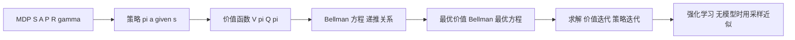

---
Title | 概率论 随机过程初步 马尔可夫决策过程
-- | --
Created @ | `2026-11-27T02:43:49Z`
Updated @| `2026-11-27T02:51:04Z`
Labels | ``
Edit @| [here](https://github.com/junxnone/math/issues/143)

---
# 马尔可夫决策过程

马尔可夫决策过程（MDP）在马尔可夫链上加入**动作**与**奖励**：智能体在每个状态选择动作，环境按概率转移并给出奖励，目标是找到使长期累计奖励最大的策略。它是强化学习的数学框架。马尔可夫链基础见 [马尔可夫过程进阶](https://github.com/junxnone/math/issues/18)，动态规划见 [动态规划进阶](https://github.com/junxnone/math/issues/10)。

## 概念关系图

图中：MDP 由状态、动作、转移、奖励和折扣因子定义；策略决定行动，价值函数评估策略；Bellman 方程给出价值的递推关系；用动态规划（价值迭代、策略迭代）求最优策略，模型未知时用强化学习近似。

## 定义

MDP 是五元组 $(\mathcal{S},\mathcal{A},P,R,\gamma)$：

$$
P(s'\mid s,a)=\Pr(S_{t+1}=s'\mid S_t=s,A_t=a),\qquad R(s,a),\qquad \gamma\in[0,1)
$$

其中：

- $\mathcal{S}$：状态集合；$\mathcal{A}$：动作集合
- $P(s'\mid s,a)$：转移概率（马尔可夫性：只依赖当前状态与动作）；$R(s,a)$：奖励
- $\gamma$：折扣因子，权衡即时奖励与未来奖励
- 策略 $\pi(a\mid s)$：在状态 $s$ 选择动作 $a$ 的概率

## 回报与价值函数

$$
G_t=\sum_{k=0}^{\infty}\gamma^{k}R_{t+k+1},\qquad V^{\pi}(s)=\mathbb{E}_{\pi}[G_t\mid S_t=s],\qquad Q^{\pi}(s,a)=\mathbb{E}_{\pi}[G_t\mid S_t=s,A_t=a]
$$

其中：$G_t$ 为折扣回报；$V^\pi(s)$ 为状态价值（从 $s$ 出发按策略 $\pi$ 的期望回报）；$Q^\pi(s,a)$ 为动作价值。折扣使无穷级数收敛（几何级数，见 [级数](https://github.com/junxnone/math/issues/53)）。

## Bellman 方程

$$
V^{\pi}(s)=\sum_{a}\pi(a\mid s)\Bigl[R(s,a)+\gamma\sum_{s'}P(s'\mid s,a)\,V^{\pi}(s')\Bigr]
$$

其中：价值等于「即时奖励 + 折扣后的下一状态价值」的期望；这是关于 $V^\pi$ 的**线性方程组**：$V^\pi=R^\pi+\gamma P^\pi V^\pi$，解为 $V^\pi=(I-\gamma P^\pi)^{-1}R^\pi$，见 [线性方程组](https://github.com/junxnone/math/issues/35)。最优价值满足 Bellman 最优方程：

$$
V^{*}(s)=\max_{a}\Bigl[R(s,a)+\gamma\sum_{s'}P(s'\mid s,a)\,V^{*}(s')\Bigr]
$$

其中：$\max$ 使方程变为非线性；最优策略 $\pi^*(s)=\arg\max_a Q^*(s,a)$。

## 求解方法

| 方法 | 做法 | 收敛性 | 需要模型 |
| --- | --- | --- | --- |
| 价值迭代 | 反复应用 Bellman 最优算子 $V\leftarrow\max_a[R+\gamma PV]$ | 压缩映射，几何收敛到 $V^*$ | 是 |
| 策略迭代 | 交替：策略评估（解 $V^\pi$）与策略改进（贪心） | 有限步收敛 | 是 |
| Q-learning | 用采样 $Q\leftarrow Q+\alpha[r+\gamma\max_{a'}Q(s',a')-Q]$ | 条件下收敛 | 否 |
| 策略梯度 | 对 $J(\theta)=\mathbb{E}[G]$ 求梯度上升 | 局部最优 | 否 |

表中：$\alpha$ 为学习率；对比结论：模型已知用动态规划；模型未知用基于采样的强化学习。

价值迭代收敛的原因是 Bellman 最优算子是 $\gamma$-压缩映射：$\lVert TV-TV'\rVert_\infty\le\gamma\lVert V-V'\rVert_\infty$。

## 在机器学习中的作用

- 强化学习的理论基础：DQN、策略梯度、Actor–Critic 都建立在 MDP 与 Bellman 方程上
- 序列决策问题：机器人控制（见 aiwiki 的 [RL Robot Control](https://github.com/junxnone/aiwiki/issues/796)）、对话系统、推荐
- 部分可观测情形推广为 POMDP；与 [隐马尔可夫模型](https://github.com/junxnone/math/issues/142) 相比，MDP 多了「动作」

## 常见误区

- 马尔可夫性要求状态包含**足够的信息**（不记历史）；信息不足时要扩充状态或使用 POMDP
- $\gamma$ 接近 1 时更关注长期，但收敛更慢、方差更大；$\gamma=1$ 时仅对有终止的任务定义
- 最优价值函数唯一，但**最优策略不一定唯一**（可能有并列的动作）

