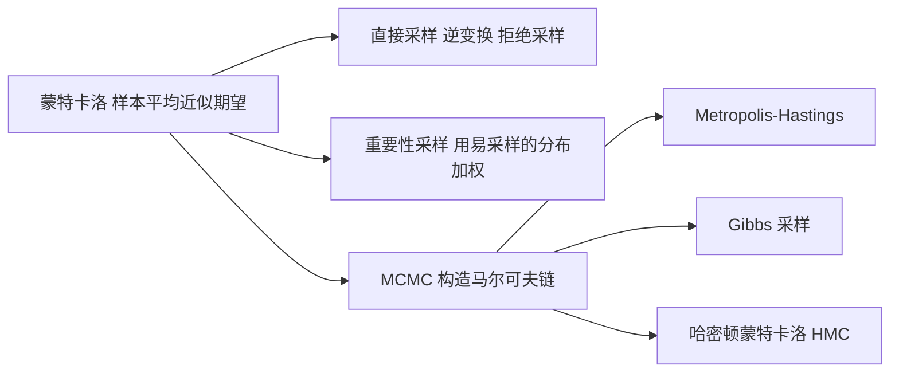

---
Title | 数理统计 贝叶斯统计 MCMC采样
-- | --
Created @ | `2026-11-27T02:43:57Z`
Updated @| `2026-11-27T02:51:10Z`
Labels | ``
Edit @| [here](https://github.com/junxnone/math/issues/145)

---
# 蒙特卡洛与MCMC

蒙特卡洛方法用**随机采样**近似期望与积分；当目标分布难以直接采样（如贝叶斯后验）时，用**马尔可夫链蒙特卡洛（MCMC）**构造一条平稳分布恰为目标分布的马尔可夫链，用链上的样本近似。蒙特卡洛积分见 [数值微分与积分](https://github.com/junxnone/math/issues/111)，马尔可夫链见 [马尔可夫过程进阶](https://github.com/junxnone/math/issues/18)，后验见 [贝叶斯推断进阶](https://github.com/junxnone/math/issues/8)。

## 概念关系图

图中：蒙特卡洛用样本平均近似期望；能直接采样时用逆变换或拒绝采样，否则用重要性采样或 MCMC；MCMC 的三种主要算法是 Metropolis–Hastings、Gibbs 采样与哈密顿蒙特卡洛。

## 蒙特卡洛估计

$$
\mathbb{E}_{p}[f(X)]=\int f(x)p(x)\,dx\approx\frac{1}{N}\sum_{i=1}^{N}f(x_i),\quad x_i\sim p
$$

其中：由大数定律估计值收敛于期望；误差按 $O(1/\sqrt N)$ 下降，**与维数无关**，这是它在高维积分中的优势，见 [大数定律与中心极限定理](https://github.com/junxnone/math/issues/66)。

## 重要性采样

不能从 $p$ 采样时，改从易采样的提议分布 $q$ 采样并加权：

$$
\mathbb{E}_{p}[f(X)]=\mathbb{E}_{q}\Bigl[f(X)\,\frac{p(X)}{q(X)}\Bigr]\approx\frac1N\sum_{i}w_if(x_i),\quad w_i=\frac{p(x_i)}{q(x_i)}
$$

其中：$w_i$ 为重要性权重；$q$ 要覆盖 $p$ 的支撑；若 $q$ 与 $p$ 相差大，权重方差很大，估计不稳定。

## MCMC 与 Metropolis–Hastings

构造转移核使目标分布 $\pi$ 满足**细致平衡**（见 [马尔可夫过程进阶](https://github.com/junxnone/math/issues/18)）：$\pi(x)T(x\to x')=\pi(x')T(x'\to x)$。MH 算法：

1. 从提议分布 $q(x'\mid x)$ 采样候选 $x'$
2. 以概率 $\alpha=\min\Bigl(1,\ \dfrac{\pi(x')\,q(x\mid x')}{\pi(x)\,q(x'\mid x)}\Bigr)$ 接受，否则保持原位置

其中：$\pi$ 只需要知道**相差一个常数**（如未归一化的后验 $p(x\mid\theta)p(\theta)$），因为比值中归一化常数抵消；提议对称时 $\alpha=\min(1,\pi(x')/\pi(x))$，即 [模拟退火进阶](https://github.com/junxnone/math/issues/14) 中的 Metropolis 准则（温度为 1）。

## Gibbs 采样与 HMC

| 方法 | 做法 | 特点 |
| --- | --- | --- |
| Gibbs 采样 | 依次从每个变量的**全条件分布** $p(x_j\mid x_{-j})$ 采样 | 接受率恒为 1；要求全条件分布可采样，变量强相关时混合慢 |
| 哈密顿蒙特卡洛（HMC） | 引入动量变量，沿哈密顿动力学（用梯度）移动再做 MH 修正 | 利用梯度，在高维连续空间中探索效率高 |
| Langevin 采样 | 沿 $\nabla\ln\pi$ 加噪声，对应 SDE，见 [布朗运动与伊藤积分](https://github.com/junxnone/math/issues/141) | 与扩散模型的采样相关 |

表中：对比结论：低维简单用 MH；条件分布易采样用 Gibbs；连续高维用 HMC（如 Stan 的 NUTS）。

## 诊断

- **预烧期（burn-in）**：丢弃链开始阶段（未收敛）的样本
- **自相关与有效样本数**：相邻样本相关，有效样本数 $N_{\text{eff}}=N/(1+2\sum_k\rho_k)$ 小于样本数
- **多链收敛诊断**：用不同初值运行多条链，检查 $\hat R$ 统计量是否接近 1

## 在机器学习中的作用

- 贝叶斯推断：从后验采样得到参数不确定性，见 [贝叶斯统计](https://github.com/junxnone/math/issues/74)
- 生成模型与能量模型的采样、受限玻尔兹曼机的训练（对比散度）
- 与变分推断互补：MCMC 渐近精确但慢，变分快但有偏，见 [变分推断](https://github.com/junxnone/math/issues/146)

## 常见误区

- 链的样本**不是独立的**，直接当作独立样本计算标准误会低估不确定性
- 没有收敛就使用样本（未做预烧、诊断）是最常见的错误；多峰分布可能陷在单个模式
- 提议分布的步长要调节：太小则探索慢，太大则几乎总被拒绝；MH 的理想接受率约 0.2 ~ 0.4（高维）

