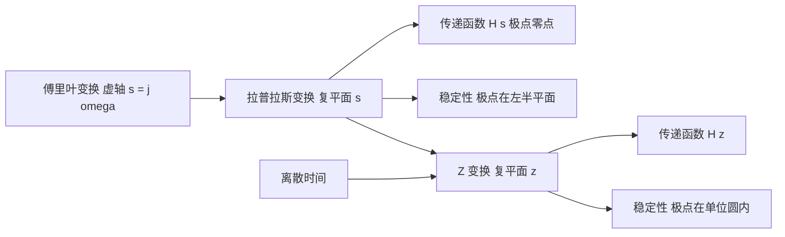

---
Title | 信号与傅里叶变换 拉普拉斯变换与Z变换
-- | --
Created @ | `2026-11-27T02:44:08Z`
Updated @| `2026-11-27T02:54:09Z`
Labels | ``
Edit @| [here](https://github.com/junxnone/math/issues/148)

---
# 拉普拉斯变换与Z变换

傅里叶变换要求信号绝对可积，对不稳定系统或带初值的问题不够用。**拉普拉斯变换**（连续时间）与 **Z 变换**（离散时间）把信号映射到**复频域**，把微分 / 差分方程变成代数方程，并给出系统的**传递函数**与稳定性判据。傅里叶变换见 [连续傅里叶变换](https://github.com/junxnone/math/issues/101)，LTI 系统见 [信号与线性系统](https://github.com/junxnone/math/issues/99)，滤波器见 [滤波器](https://github.com/junxnone/math/issues/104)。

## 概念关系图

图中：傅里叶变换是拉普拉斯变换在虚轴上的特例；两者都得到传递函数，由极点位置判断稳定性；Z 变换是离散时间的对应，稳定区域从左半平面变成单位圆内部。

## 拉普拉斯变换

$$
X(s)=\int_{0}^{\infty}x(t)\,e^{-st}\,dt,\qquad s=\sigma+j\omega
$$

其中：$s$ 是复变量，$\sigma$ 为衰减因子；当 $\sigma=0$（$s=j\omega$）时就是傅里叶变换；积分收敛的 $s$ 区域称为收敛域（ROC）。常用变换对：

| 时域 $x(t)$ | 复频域 $X(s)$ |
| --- | --- |
| $\delta(t)$ | $1$ |
| $u(t)$（阶跃） | $1/s$ |
| $e^{-at}u(t)$ | $1/(s+a)$ |
| $\sin\omega_0t\,u(t)$ | $\omega_0/(s^{2}+\omega_0^{2})$ |

表中：对比结论：$X(s)$ 的分母零点（极点）决定时域响应的形态——衰减、增长或振荡。

## 主要性质

- **线性**；**时域微分**：$\mathcal{L}\{x'(t)\}=sX(s)-x(0^-)$，把微分变成乘以 $s$（并含初值）
- **卷积定理**：$\mathcal{L}\{x*h\}=X(s)H(s)$，见 [卷积](https://github.com/junxnone/math/issues/100)
- **终值定理**：若极限存在，$\lim_{t\to\infty}x(t)=\lim_{s\to0}sX(s)$

用它解常微分方程：对两边做变换，得到关于 $X(s)$ 的代数方程，解出后做反变换，见 [常微分方程](https://github.com/junxnone/math/issues/57)。

## 传递函数与稳定性

LTI 系统的输入输出之比 $H(s)=Y(s)/X(s)$ 就是冲激响应的拉普拉斯变换：

$$
H(s)=\frac{b_ms^{m}+\cdots+b_0}{a_ns^{n}+\cdots+a_0}=K\frac{\prod(s-z_i)}{\prod(s-p_i)}
$$

其中：$z_i$ 是零点，$p_i$ 是极点。**因果系统 BIBO 稳定当且仅当所有极点位于左半平面**（$\operatorname{Re}p_i<0$）；极点的虚部决定振荡频率，实部决定衰减速度。这与线性微分方程组的稳定性由特征值实部决定一致，见 [特征值与特征向量](https://github.com/junxnone/math/issues/36)。

## Z 变换

$$
X(z)=\sum_{n=-\infty}^{\infty}x[n]\,z^{-n},\qquad z=re^{j\omega}
$$

其中：$z$ 为复变量；$z=e^{j\omega}$（单位圆）时是离散时间傅里叶变换。关键性质：时移 $x[n-k]\leftrightarrow z^{-k}X(z)$；卷积定理 $x*h\leftrightarrow X(z)H(z)$。离散系统 BIBO 稳定当且仅当所有极点在**单位圆内**。

| 对比项 | 拉普拉斯变换 | Z 变换 |
| --- | --- | --- |
| 信号类型 | 连续时间 | 离散时间 |
| 复变量与平面 | $s$，左 / 右半平面 | $z$，单位圆内 / 外 |
| 稳定区域 | 极点实部 $<0$ | 极点模 $<1$ |
| 与傅里叶的关系 | 虚轴 $s=j\omega$ | 单位圆 $z=e^{j\omega}$ |
| 微分 / 差分方程 | 微分变乘 $s$ | 延迟变乘 $z^{-1}$ |

表中：对比结论：二者思想完全平行；双线性变换 $s=\frac{2}{T}\frac{z-1}{z+1}$ 可把模拟滤波器转化为数字滤波器。

## 在机器学习中的作用

- 控制与系统辨识：传递函数、稳定性分析；状态空间模型（S4 等）用连续系统离散化，与 [矩阵函数与矩阵指数](https://github.com/junxnone/math/issues/133) 相关
- 数字滤波器设计（IIR 滤波器）与信号处理管线，见 [滤波器](https://github.com/junxnone/math/issues/104)
- 时间序列的自回归（AR）模型对应 Z 域的全极点系统，见 [随机过程进阶](https://github.com/junxnone/math/issues/13)

## 常见误区

- 不同信号可能有**相同的表达式** $X(s)$ 而收敛域不同（因果 vs 非因果）；必须同时给出收敛域
- 拉普拉斯变换常用单边形式（$t\ge0$），初值要显式带入；双边形式用于非因果信号
- 极点在右半平面（或单位圆外）表示系统不稳定，但不稳定系统的反馈闭环可能变稳定，要分清开环与闭环

