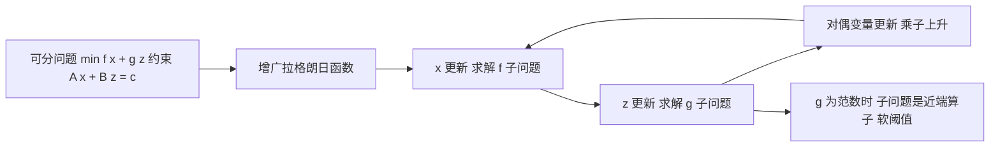

---
Title | 优化理论 约束优化与对偶 ADMM
-- | --
Created @ | `2026-11-27T02:44:12Z`
Updated @| `2026-11-27T02:54:13Z`
Labels | ``
Edit @| [here](https://github.com/junxnone/math/issues/149)

---
# ADMM

ADMM（交替方向乘子法）把一个难以直接求解的约束优化问题**分解**成若干个容易的子问题交替求解，并用拉格朗日乘子（对偶变量）协调它们。它适合大规模、可分布式、带非光滑正则（如 $L_1$）的问题。基础见 [约束优化与对偶](https://github.com/junxnone/math/issues/79)、[拉格朗日乘数法进阶](https://github.com/junxnone/math/issues/19)，近端算子见 [一阶方法与随机梯度](https://github.com/junxnone/math/issues/81)。

## 概念关系图

图中：把目标拆成两块 $f$ 与 $g$，用约束耦合；增广拉格朗日函数的 $x$、$z$ 子问题交替求解，再更新乘子；当 $g$ 是 $L_1$ 范数等时，$z$ 更新就是软阈值。

## 问题与增广拉格朗日

$$
\min_{x,z}\ f(x)+g(z)\quad\text{s.t.}\quad Ax+Bz=c
$$

其中：$f,g$ 为凸函数（可以非光滑）；约束把两组变量耦合在一起。增广拉格朗日函数：

$$
L_\rho(x,z,y)=f(x)+g(z)+y^{\top}(Ax+Bz-c)+\frac{\rho}{2}\lVert Ax+Bz-c\rVert_2^{2}
$$

其中：$y$ 为对偶变量（乘子）；$\rho>0$ 为惩罚参数；最后的二次项（增广项）使方法对条件更宽松、收敛更稳健，是对 [约束优化与对偶](https://github.com/junxnone/math/issues/79) 中经典拉格朗日方法的改进。

## 迭代

$$
\begin{aligned}
x^{k+1}&=\arg\min_{x}L_\rho(x,z^{k},y^{k})\\
z^{k+1}&=\arg\min_{z}L_\rho(x^{k+1},z,y^{k})\\
y^{k+1}&=y^{k}+\rho\,\bigl(Ax^{k+1}+Bz^{k+1}-c\bigr)
\end{aligned}
$$

其中：先对 $x$ 最小化、再对 $z$ 最小化（**交替**而非联合），最后对偶变量沿约束残差上升；每个子问题只涉及 $f$ 或 $g$，往往有闭式解或可并行计算。收敛判据：原残差 $\lVert Ax+Bz-c\rVert$ 与对偶残差都足够小。

## 例：Lasso

$$
\min_{\beta}\ \tfrac12\lVert X\beta-\mathbf{y}\rVert_2^{2}+\lambda\lVert\beta\rVert_1\ \ \Longrightarrow\ \ \min_{\beta,z}\ \tfrac12\lVert X\beta-\mathbf{y}\rVert_2^{2}+\lambda\lVert z\rVert_1\ \ \text{s.t.}\ \beta=z
$$

其中：引入 $z$ 把光滑项与非光滑项分开。迭代为：

- $\beta$ 更新：解线性系统 $(X^\top X+\rho I)\beta=X^\top\mathbf{y}+\rho(z-u)$，其中 $u=y/\rho$（可预先做 Cholesky 分解，见 [Cholesky分解](https://github.com/junxnone/math/issues/131)）
- $z$ 更新：**软阈值** $z=\mathcal{S}_{\lambda/\rho}(\beta+u)$，$\mathcal{S}_\kappa(a)=\operatorname{sign}(a)\max(\lvert a\rvert-\kappa,0)$
- $u\leftarrow u+\beta-z$

其中：软阈值是 $L_1$ 范数的近端算子，把小于阈值的分量压成 0，从而得到稀疏解，见 [范数](https://github.com/junxnone/math/issues/11)、[回归分析](https://github.com/junxnone/math/issues/73)。

## 与相关方法对比

| 方法 | 处理对象 | 特点 |
| --- | --- | --- |
| 梯度下降 | 光滑目标 | 简单，不能直接处理非光滑项 |
| 近端梯度 | 光滑加简单非光滑 | 一阶，收敛 $O(1/k)$ 或加速 $O(1/k^2)$ |
| 对偶上升 | 可分约束问题 | 需要强凸性，易发散 |
| ADMM | 可分问题加线性约束 | 无需强凸，子问题可并行，精度中等、实用 |

表中：对比结论：ADMM 的优势是「分解 + 协调」，易于分布式实现；达到高精度较慢，通常用于得到中等精度的解。

## 在机器学习中的作用

- 稀疏学习：Lasso、群稀疏、低秩矩阵恢复（核范数）、图模型选择
- 分布式优化与联邦学习：各节点解局部子问题，用一致性约束协调（共识 ADMM）
- 神经网络压缩（剪枝）与带约束的训练，见 aiwiki 的 [MO Pruning](https://github.com/junxnone/aiwiki/issues/808)

## 常见误区

- 惩罚参数 $\rho$ 影响收敛速度，过大过小都慢；常用自适应调整（让原残差与对偶残差平衡）
- ADMM 对**凸**问题有收敛保证；用于非凸问题时只能作为启发式，可能收敛到局部点
- 交替更新的顺序与变量划分会影响效率，同一个问题可以有多种 ADMM 分解方式

